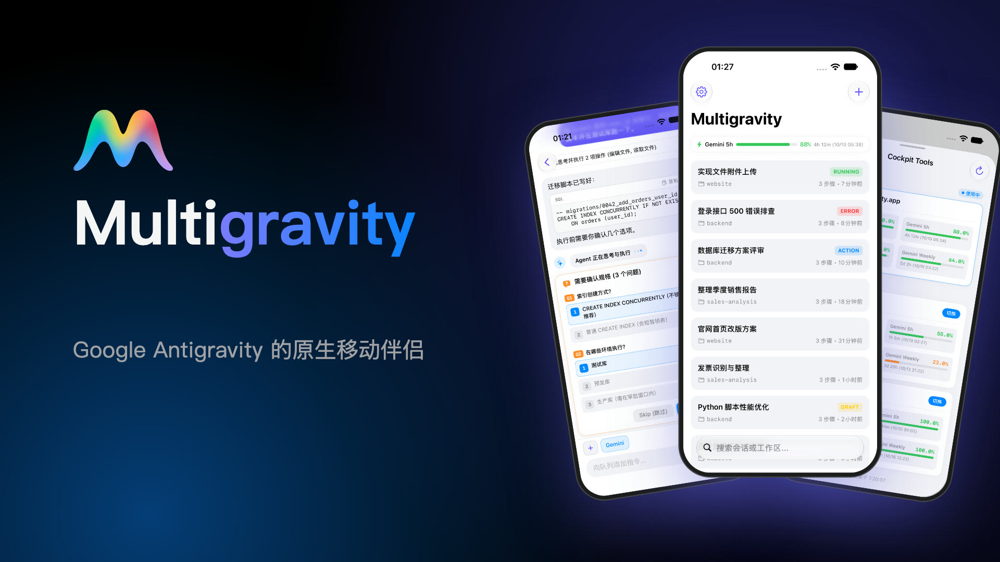
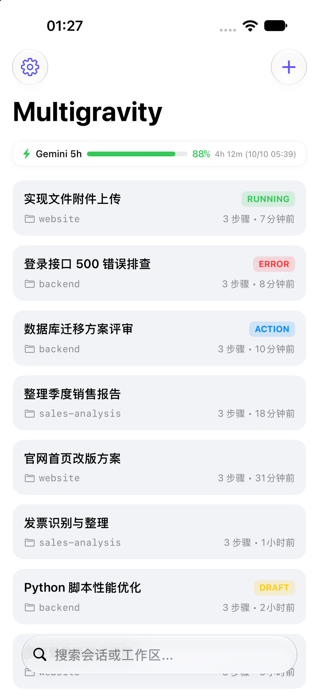
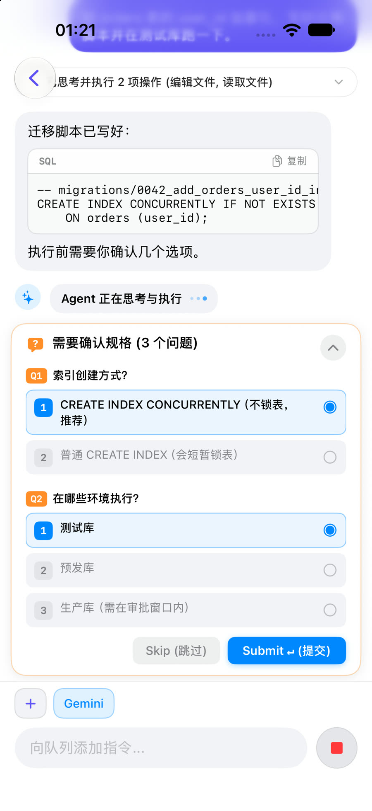
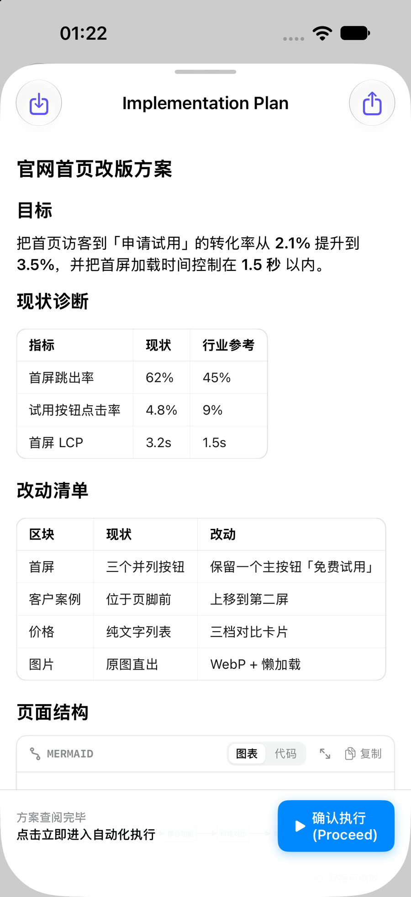
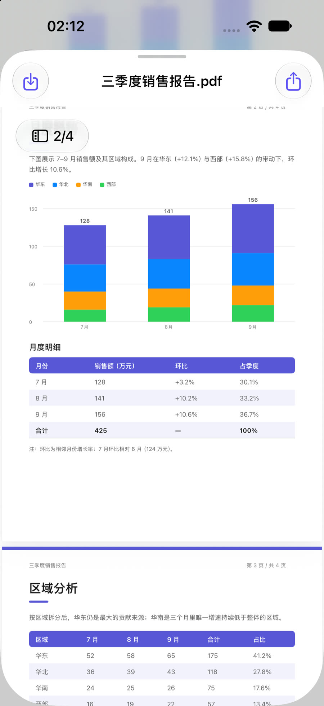

# Multigravity 📱✨

> **The Full-Stack Mobile & Remote Companion for Google Antigravity AI Agent.**  
> 随时随地，在 Android、iPhone、iPad 或任意移动设备上自如操控、实时对话、监控配额并指挥运行在电脑上的 Antigravity 智能体。  
> 
> *代码仓库保持为 `antigravity-mobile`，产品对外正式品牌命名为 **Multigravity**，全局命令行工具为 **`mgy`**。*

[](https://github.com/GHSaiMo/antigravity-mobile/releases/latest)
[](https://github.com/GHSaiMo/antigravity-mobile/releases/latest)
[](https://github.com/GHSaiMo/antigravity-mobile/releases/latest)
[](https://github.com/GHSaiMo/antigravity-mobile/releases/latest)
[](https://github.com/GHSaiMo/antigravity-mobile/releases/latest)
[](https://kotlinlang.org)
[](https://swift.org)
[](https://go.dev)
[](LICENSE)

<p align="center">
  
</p>

<p align="center">
  🌐 <b>官网</b>：<a href="https://mgy.jiuge.space">mgy.jiuge.space</a> &nbsp;·&nbsp; 📦 <a href="https://github.com/GHSaiMo/antigravity-mobile/releases/latest">最新版 v1.1.6</a>
</p>

https://github.com/user-attachments/assets/37360cde-3875-45bf-947e-7774e800094c

---

## ⚡ 极速开始 (v1.1.6 正式版)

### 1. 🍎 macOS / 🐧 Linux / 🪟 Windows 服务端一键安装 (推荐)

一键安装指令**支持全自动根据操作系统与架构自适应下载匹配的二进制包**（**免翻墙免代理，秒级全自动完成部署**）：

#### 🍎 macOS / 🐧 Linux (x86_64 / NAS) / 🪟 Windows (Git Bash / MSYS) 用户：
国内网络加速一键安装（默认推荐）：
```bash
curl -fsSL https://ghfast.top/https://raw.githubusercontent.com/GHSaiMo/antigravity-mobile/main/scripts/install.sh | bash
```

<details>
<summary><b>🌐 海外或已配置终端代理用户（GitHub 官方源）</b></summary>

```bash
curl -fsSL https://raw.githubusercontent.com/GHSaiMo/antigravity-mobile/main/scripts/install.sh | bash
```
</details>

#### 🪟 Windows (PowerShell / Windows Terminal) 用户：
国内网络加速一键安装（默认推荐）：
```powershell
irm https://ghfast.top/https://raw.githubusercontent.com/GHSaiMo/antigravity-mobile/main/scripts/install.ps1 | iex
```

<details>
<summary><b>🌐 海外或已配置终端代理用户（GitHub 官方源）</b></summary>

```powershell
irm https://raw.githubusercontent.com/GHSaiMo/antigravity-mobile/main/scripts/install.ps1 | iex
```
</details>

> **智能安装特性**：
> - 🖥️ **跨平台自适应**：自动识别 **macOS**（Apple Silicon M系列 / Intel）、**Linux**（x86_64 / NAS / 无头服务器）与 **Windows**（x86_64），精准下载对应系统的单架构极简包；
> - 🐧 **Linux & NAS 首发支持 (v1.0.5)**：完美适配 Linux x86_64（如群晖/极空间/自建 NAS/Debian/Ubuntu/Arch 等），原生支持 Antigravity Daemon Discovery 协议 (`~/.gemini/antigravity/daemon/ls_*.json`)，支持无 CSRF Token 的 Headless / Standalone 实例自动秒级发现与反代，提供 `ss` 与 `lsof` 双模端口探测，并支持配置为 systemd 用户守护进程开机常驻！
> - ⚡ **自适应本地代理**：自动探测本机活跃代理（Clash: 7890、V2Ray: 10808、Surge: 6152 等），无需手动 export；
> - 🚀 **镜像双保险**：无代理或直连受阻时，秒级无缝降级至国内加速节点；
> - 🔒 **平滑部署**：macOS / Linux 免 sudo 部署至 `~/.local/bin/mgy` 并自动配置全局快捷方式；Windows 自动注册至用户 PATH 及 WindowsApps 目录，开箱即用免重启终端。

### 2. 📱 Android 手机客户端安装
前往 [GitHub Releases v1.1.6](https://github.com/GHSaiMo/antigravity-mobile/releases/latest)，下载：
- **`Multigravity-v1.1.6.apk`**
- *安装包已配置标准签名，任何安卓手机下载后均可直接点击安装，零编译门槛。*
- *安全提示：为保证覆盖安装，Release 签名密钥库 `android/app/release.jks` 与默认口令随仓库公开。因此 APK 签名只代表「同一发布线」，不能证明来源可信，请仅从本仓库 Releases 页面下载。如需自行分发，请用 `MGY_KEYSTORE_PASSWORD` 等环境变量与自己的密钥库重新签名。*

### 3. 🔑 启动服务与扫码配对
在终端（macOS / Linux / Windows PowerShell / CMD）中直接运行：
```bash
mgy
```
网关前台启动后会**在终端直接打印一次 ASCII 配对二维码**。打开手机上的 Multigravity App，扫描终端二维码，即可瞬间连通！

---

## 🛠️ 常用 CLI 指令 (`mgy`)

网关已收敛为纯 Go 单一二进制工具，内置毫秒级响应的原生管理子命令（彻底摆脱外部脚本与 Python 依赖）：

```bash
mgy                # 前台启动网关主服务，双栈监听并打印一次配对二维码
mgy run            # 等同于直接运行 mgy，支持传入自定义参数 (如 -port 58900)
mgy pair           # 向正在运行的网关申请并打印 5 分钟有效的新配对二维码与链接
mgy cockpit        # 交互式配置 Cockpit 报表服务与安全 Token (支持 status/token/restart)
mgy bark           # 交互式配置 Bark 实时推送与提示音 (iOS 专用，支持 status/test/set)
mgy cloudflare     # 交互式配置 Cloudflare 专属穿透隧道与域名 (快捷别名: mgy cf)
mgy list           # 查看所有已配对授权的移动设备 (支持在线与离线查看)
mgy clear all      # 一键清除所有已配对设备授权
mgy clear <dev_id> # 清除指定设备授权
mgy version        # 查看当前网关版本信息
mgy help           # 查看完整命令与启动参数帮助
```

> 📖 **进阶维护指南**：
> 完整安装机制、多场景本地自测（架构匹配 / 纯净首次安装 / 远程穿透排错）与一键卸载方案，详见 ➔ [**安装、本地自测与卸载运维指南 (docs/installation_and_testing_guide.md)**](docs/installation_and_testing_guide.md)。

<details>
<summary><b>🗑️ 服务端彻底卸载与清理 (包含 Cloudflare 与全部配置)</b></summary>

- **🍎 macOS / 🐧 Linux / 🪟 Git Bash**：
  ```bash
  curl -fsSL https://ghfast.top/https://raw.githubusercontent.com/GHSaiMo/antigravity-mobile/main/scripts/uninstall.sh | bash
  ```
- **🪟 Windows (PowerShell)**：
  ```powershell
  irm https://ghfast.top/https://raw.githubusercontent.com/GHSaiMo/antigravity-mobile/main/scripts/uninstall.ps1 | iex
  ```
*(本地执行可直接运行 `./scripts/uninstall.sh`，支持 `--keep-config` 仅保留配置或 `--keep-cf` 保留 Cloudflare 引擎)*
</details>

---

## 🖼️ 界面一览

<table>
  <tr>
    <td align="center" valign="top" width="25%"><br/><b>全局视野</b><br/><sub>状态色一目了然，额度常驻顶部</sub></td>
    <td align="center" valign="top" width="25%"><br/><b>一触即决</b><br/><sub>多题点选一次提交，高危命令一键审批</sub></td>
    <td align="center" valign="top" width="25%"><br/><b>方案放行</b><br/><sub>方案原生预览，一键 Proceed 开工</sub></td>
    <td align="center" valign="top" width="25%"><br/><b>交付物直接看</b><br/><sub>PDF 文档图片原生预览，翻页缩放</sub></td>
  </tr>
</table>

> 以上截图均来自 iOS 客户端内置的**演示模式**（数据为虚构），可在未配对时直接体验。

---

## 💡 为什么需要 Multigravity？

**Google Antigravity** 是新一代高自主性 AI 编码与工程智能体。但在日常工程实践中：
- 复杂任务（如跨仓库大规模重构、端到端自动化测试、深度架构推导）往往需要 Agent 自主运行数十分钟甚至数小时；
- 离开电脑桌（通勤途中、用餐或会议中）无法随时跟进 Agent 思考进度与工具执行结果；
- 当 Agent 需要用户确认（Prompt Feedback / 方案决策 / 命令审批）时，桌面端若无人值守，整个流水线便会陷入停滞。

**Multigravity** 为解决这一痛点而生：它不仅是一个透明代理网关，更是一套**完整的全栈端到端移动与外设协同系统**——涵盖原生 Android App（Jetpack Compose）、原生 iOS App（SwiftUI 5 / Swift 6）、极简自嵌入 PWA Web 客户端、随身外设硬件联动网桥，以及具备进程自愈、端到端 TLS 域名中继和跨端活跃游标感知的 Go 本地服务。

---

## 🏛️ 全栈架构设计

| 层级 | 核心组件 | 关键职责与技术特性 |
| :--- | :--- | :--- |
| **📱 移动访问层** | **Android 原生客户端** (Compose) | **全功能旗舰体验**：Kotlin 1.9+、Jetpack Compose Material 3 纯黑美学、Edge-to-Edge 全面屏沉浸显示、IME 软键盘自适应防遮挡与聚焦触底平滑滚动；OkHttp + WebSocket 实时打字机流分发、多步工具折叠胶囊；**Antigravity 2.32+ 动态多智能体工作流全生命周期落地（Workflow 发起 / 预设模板抽屉 / 专用安全审批卡 / 阶段流水线轴 / 并发智能体网格 / 实时日志流 / 子代理原位详情穿透 / 双层中断控制 / 分级通知）(`v1.1.6`)**；**实时上下文水位圆环与生成速率 (TTFT / TPS) 审计面板、Token 历史 52 周热力图与费用估算、上下文溢出智能救援卡片 (`v1.1.6`)**；**定时任务（Automations）全链路打通、离线双保险、立即运行 (Run Now) 与执行时间推算 (v1.1.5)**；**原生 `/swarm` 蜂群多智能体协同看板桌面级复刻（Pixel Bee 头像 / Roster 成员 / 拓扑图）(v1.1.5)**；**Antigravity 2.30/2.31 全局后台任务中心 (`ListBackgroundTasks`)、长对话原生章节目录 TOC (`GetChapterTitles`)、后台任务防抢跑与排队安全出列、全双工 CJK 空格清洗与实时连接状态、Git 面板联动 GitHub PR 状态与 Mermaid 语法容错自愈 (v1.1.4)**；**Antigravity 2.29+ 全双工实时语音通话 (jetski-voice-proto) 与沉浸式 VoiceCallCard (v1.1.3)**；**折叠态「语音交互」胶囊气泡与纯净多轮对话过滤**；**失败自查气泡 15sp 对齐与 Markdown 视觉强化**；**额度匀速指标（均速刻度针 & 节奏健康分析 & Argon 独立周期判定）(v1.1.3)**；**对话步骤导轨与章节大纲导航 (Conversation Navigator) (v1.1.0)**；**应用内沉浸式安全浏览器 (CustomTabs) (v1.1.0)**；**WebM 录屏视频硬件加速播放 (ExoPlayer) (v1.1.0)**；**已连接 MCP 工具集与技能健康看板 (MCP & Skills Inspector) (v1.1.0)**；**对话列表右滑置顶（Pin）与二次弹窗确认**；**代码 Diff 词级与字符级高亮**；**后台命令（Running Tasks）卡片重构（前3行折叠/长命令展开/一键复制/终端高亮）**；**细分状态徽标（Working/Running command/Action required/Error/Unread）**；**任意格式文件附件选择与上传**；**精细化 Git/GitHub 沙箱权限审批卡片 (PERMISSION_GRANTS_V2)**；**父子会话家族树层级标记**；**原生选择题交互卡片与多题决策** (自适应高度无留白 / 全屏半屏平滑切换 / 选项与问题多行完整呈现 / 活力橙视觉统一 / 软键盘智能避让)；**多模态生图直出渲染**与 `ImageViewerSheet` 全手势大图缩放；**网络设置一键并发探活测速与智能路由选路**；**Cockpit Tools 四象限配额看板与多账号池无感热切**；方案产物原生浮窗 (Markdown / PPTX 幻灯片渲染 / Brain 元数据逆向解析 / 本地一键下载导出) 与 Proceed 推进闭环；**消息撤回与代码修改方案回滚**；**会话全文搜索、导出 Markdown、斜杠命令与技能、本会话改动累计 Diff、原生 Git 提交/推送、精美长图分享（深浅主题 / 一键定向微信）、默认模型配置**；排队追问面板、后台任务感知与终止、工程快捷动作胶囊、ZXing 离线二维码秒级配对、`EncryptedSharedPreferences` 硬件密钥持久化、全态分类信号 |
| | **iOS 原生客户端** (SwiftUI 5) | **Swift 6 严格并发**：零数据竞态、丝滑流畅；**Antigravity 2.32+ 动态多智能体工作流全生命周期落地（Workflow 发起 / 预设模板抽屉 / 专用安全审批卡 / 阶段流水线轴 / 并发智能体网格 / 实时日志流 / 子代理原位详情穿透 / 双层中断控制 / 分级通知）(`v1.1.6`)**；**实时上下文水位圆环与生成速率 (TTFT / TPS) 审计面板、Token 历史 52 周热力图与费用估算、上下文溢出智能救援卡片 (`v1.1.6`)**；**定时任务（Automations）全链路打通、离线双保险、立即运行 (Run Now) 与执行时间推算 (v1.1.5)**；**原生 `/swarm` 蜂群多智能体协同看板桌面级复刻（Pixel Bee 头像 / Roster 成员 / 拓扑图）(v1.1.5)**；**Antigravity 2.30/2.31 全局后台任务中心 (`ListBackgroundTasks`)、长对话原生章节目录 TOC (`GetChapterTitles`)、后台任务防抢跑与排队安全出列、全双工 CJK 空格清洗与实时连接状态、Git 面板联动 GitHub PR 状态与 Mermaid 语法容错自愈 (v1.1.4)**；**Antigravity 2.29+ 全双工实时语音通话 (jetski-voice-proto) 与沉浸式 VoiceCallCard (v1.1.3)**；**硬件级 AEC 回声消除与环境降噪**；**折叠态「语音交互」胶囊气泡与纯净多轮对话过滤**；**失败自查气泡 15sp 对齐与 Markdown 视觉强化**；**额度匀速指标（均速刻度针 & 节奏健康分析 & Argon 独立周期判定）(v1.1.3)**；**对话步骤导轨与章节大纲导航 (Conversation Navigator) (v1.1.0)**；**应用内沉浸式安全浏览器 (SFSafariViewController) (v1.1.0)**；**WebM 录屏视频硬件加速与双轨容错播放 (WebKit + AVPlayer) (v1.1.0)**；**VisionKit 智能文稿扫描相机 (Document Scanner) (v1.1.0)**；**已连接 MCP 工具集与技能健康看板 (MCP & Skills Inspector) (v1.1.0)**；**对话列表右滑置顶（Pin）与二次弹窗确认**；**代码 Diff 词级与字符级高亮**；**后台命令（Running Tasks）卡片重构（前3行折叠/长命令展开/一键复制/终端高亮）**；**细分状态徽标（Working/Running command/Action required/Error/Unread）**；**CommonMark 0.30 CJK 标点容错修复**；**全格式文件与相册视频选择**；**精细化 Git/GitHub 沙箱权限审批卡片 (PERMISSION_GRANTS_V2)**；**父子会话家族树层级缩进与徽标**；**原生选择题交互卡片深度优化** (自适应高度 / 选项与问题多行完整呈现 / 全屏半屏平滑伸缩 / 活力橙视觉统一 / 动态绑定 MARKETING_VERSION)；单趟 O(N) LaTeX 渲染、Markdown 富媒体与多模态生图直出、`ImageViewerSheet` 双指捏合无级缩放与系统分享保存；方案产物浮窗与 Proceed 闭环；统一文件预览工具栏与 PPTX 幻灯片渲染；**Cockpit Tools 四象限额度看板与多账号热切**；**网络设置一键并发探活与智能选路**；**消息撤回与代码修改回滚**（毛玻璃材质浮窗）；**会话全文搜索、导出 Markdown、斜杠命令与技能、本会话改动累计 Diff、原生 Git 提交/推送、精美长图分享、默认模型配置、iPad 现代列表与大标题折叠**；排队追问队列与自适应输入；交互式命令审批卡片；交互式侧滑返回（Swipe-Back）原生手势体验；全态分类信号 (`RUNNING` / `ERROR` / `ACTION` / 未读呼吸小蓝点)；0ms 会话焦点上报、灵动岛 (Live Activity) |
| | **移动端 PWA / Web** (Vanilla JS) | 零构建打包、嵌入 Go 二进制 (`embed.FS`)、全面对齐 iOS 原生设计系统与 NavigationStack 导航、列表滚动/侧滑手势消抖（防误触进入）、居中对称标题与 38px 悬浮垃圾桶删除、自适应安全区与键盘防遮挡、**Antigravity 2.32+ 动态工作流看板/阶段轴/实时日志/专用审批卡 (`v1.1.6`)**、**实时上下文水位环/审计弹窗/52 周 Token 热力图与溢出救援 (`v1.1.6`)**、**定时任务全链路与立即运行 (v1.1.5)**、**原生 `/swarm` 蜂群看板 (v1.1.5)**、**Antigravity 2.30/2.31 全局后台任务胶囊条、Git 面板联动 GitHub PR 与 Mermaid 容错自愈 (v1.1.4)**、**Antigravity 2.29+ 全双工实时语音通话 (v1.1.3)**、**额度匀速指标（刻度针 & 气泡分析）**、**失败自查气泡 15px 对齐与 Markdown 格式强化**、**同步支持多题交互确认与选项多行自适应排版**、**Token-level 词级代码 Diff 高亮 (v1.0.9)**、Markdown 浮窗与方案 Proceed 推进、排队消息与后台任务同步、添加到主屏幕 |
| **🎯 跨端游标与焦点层** | **随人而动游标引擎 (Follow-Me Cursor Engine)** | 毫秒级多端焦点仲裁：活跃长连接流 (Active Stream) > 移动端黏性焦点 (Mobile Sticky 30m) > 桌面端 IDE 活跃焦点 (Desktop Focus) > 磁盘最后活跃会话兜底；提供 0ms 会话焦点上报与预热；防自反保护机制 (Anti-Reflection 1.5s 抑制期) 彻底消除已读回环误判；幽灵会话三重防御过滤 |
| **🦞 物理外设网桥层** | **YoooClaw 物理硬件网桥 (`integrations/yoooclaw/`)** | 随身外设按键录音 ➔ ASR ➔ Gateway-First 代理直连注入活跃 Cascade 会话；双层协同分流（第一层 Hermes 业务守卫放行，第二层统一游标精准定位目标会话）；四色交织 RGB 流光动效与 OLED 屏幕状态回显 |
| **⚡ 远程连接与鉴权层** | **智能路由与一键并发测速 (Smart Multi-Channel Routing)** | 移动端动态管理 Wi-Fi 局域网 (LAN IPv4) 与 Cloudflare 专属 HTTPS 隧道；提供一键并发探活，秒级测速回显并自动优选延迟最低链路，支持客户端手动动态切换端点 |
| | **Cloudflare Tunnel 专属公网穿透 (零配置 HTTPS)** | 内置全自动 Cloudflare 穿透，启动即自动获取专属 HTTPS 域名，公网端到端 TLS 加密；配对二维码默认携带安全 HTTPS 链接 (`ssl=1`)，手机端无缝通过 iOS ATS 拦截 |
| | **局域网 Wi-Fi 直连 (LAN Direct)** | 同一 Wi-Fi 下直连本地内网 IP，极低延迟，外出或异网自动走 Cloudflare 隧道 |
| | **二维码扫码配对 (QR Pairing)** | 终端或 `mgy pair` 自动生成一次性 `agy://pair` 配对二维码，扫码秒级签发独占 Device Token，存入系统安全存储 (Keychain / EncryptedSharedPreferences)，与 IP 完全解耦；支持高级手动大小写不敏感配对 |
| | **Tailscale / 私有 Mesh VPN (备选)** | 点对点加密 WireGuard 网络，无公网 IP 时安全组网互联 |
| **🖥️ 本地网关层** | **自愈实例探测器 (Inspector)** | **原生支持 macOS、Linux 与 Windows**：深度逆向自动嗅探各平台 `language_server` 进程、实时捕获动态端口与鉴权令牌、原生支持 Linux Headless/Daemon Discovery 协议即时发现与免 CSRF 令牌连通、具备 `lsof` 与 `ss` 双模端口探测、进程重启零感知毫秒级自愈；离线状态具备指数退避 (5s→10s→20s→40s) 防 CPU 空转 |
| | **ConnectRPC & WebSocket 代理** | 双向流式转发与长连接保活、**原生解析 `askQuestion` 多题交互列表与 `questionResponses` 聚合提交**、自动注入 `x-codeium-csrf-token`、免二次编码大图透传优化 (`needsModification`)、单 IP 60次/分 WS Ticket 限流加固、安全沙箱文件代理 (`/api/v1/files/content`) 与 Brain 伴生元数据解析、内置提供 Web 静态资产与排队追问代理；**Proto + SQLite FTS5 轨迹存储双引擎与毫秒级本地全文搜索 (v1.0.9)** |
| | **Cockpit 配额引擎 (Cockpit Engine)** | 实时提取多账号配额数据、支持双模型 5h/Weekly 四象限监控与精准重置时间倒计时、多账号池一键无感热切与邮箱脱敏遮罩、**自动校准应用配置并自愈补全缺失的 state.vscdb / IDE 软链接，切号失败自动回滚保障** |
| | **Bark 实时推送守护 (Notification Watcher)** | 后台持续监听 Agent 状态，任务完成/失败/审批拦截/提问/Proceed 自动触发 Bark 实时推送与 DeepLink 唤醒；**配额阶梯预警展示完整账号邮箱 (v1.0.9)** |
| **⚙️ 核心引擎层** | **Antigravity Core** | `language_server` 核心智能体进程，运行于 macOS、Linux (NAS/无头服务) 或 Windows 本地回环 |

---

## ✨ 核心能力与功能特性

### 1. 🧭 开箱即用与跨平台秒级配对 (Onboarding Guide & QR Pairing)
- **单页紧凑型引导设计**：对齐 iOS / Android 双端视觉，首次启动或重新配对呈现极简两步式操作；
- **跨平台一键安装指令**：macOS (Apple Silicon & Intel)、Linux (x86_64 / NAS) 与 Windows (PowerShell) 一键部署命令直接一键复制，支持横向防折叠滚动展示；若已安装网关，直接提示终端执行 `mgy`；
- **扫码一键自动配对**：电脑或服务器终端前台运行网关后自动生成复合 ASCII 二维码，手机端打开扫码器秒级捕获并完成凭据交换与设备绑定，零手动配置；
- **高级手动配对选项**：支持手动输入网关 URL 或 6 位配对码，支持大小写不敏感容错校验，全展开抽屉自适应软键盘防遮挡。

---

### 2. ⚡ 多通道网络管理、一键并发探活与智能选路 (Smart Routing & Probing)
- **多通道端点统一管理**：移动端「网络设置」面板直观管理局域网 Wi-Fi (LAN IPv4) 与云端域名/FRP 穿透中继；
- **一键并发探活与测速**：点击「开始测速」，毫秒级并发探测所有已配置通道的连通性与往返延迟（如 `17ms · Wi-Fi 局域网` / `27ms · 外网直连`）；
- **智能自动选路机制**：并发探测后自动优选并平滑切换至延迟最低的通道，确保通勤移动与跨网场景下长连接不中断；
- **手动路由控制**：支持在路由端点列表中点击「设为生效」手动指定目标链路，实时呈现连接状态指示灯与当前生效延迟。

---

### 3. 📊 Cockpit Tools 配额罗盘与多账号池无感热切 (Account Pool & Quota Engine)
- **动态 Quota 状态条 (`QuotaStatusBar`)**：首页顶部常驻实时额度状态条，一眼掌握核心配额健康度；
- **全方位四象限配额看板**：全景监控当前使用账号的 **Claude 5h、Gemini 5h、Claude Weekly、Gemini Weekly** 四象限配额百分比，精确显示额度恢复与重置倒计时（精确到分/秒，如 `4h 55m (09/20 00:49)`、`3d 20h 34m`）；**Free 账号自适应纯净单排双列**：自动剥离 5h 维度，精准对齐真实的 7 天 `Claude Weekly` 与 `Gemini Weekly` 重置倒计时；
- **备用账号池管理**：支持展示与维护多个备用账号，一键点击「切换」按钮即可在移动端完成热切换（Hot-switching），无需重新登录与退出；
- **隐私保护与实时刷新**：支持邮箱脱敏遮罩展示（支持一键眼睛图标切换隐藏明文），支持手动添加新账号与一键实时刷新配额；
- **配置自愈与切号全流程自动化 (v1.0.4)**：网关自动校准 Cockpit 启动配置并补齐缺失的应用路径，自动修复并补全 `state.vscdb` 存储、Antigravity IDE 软链接与数据库表，热重载配置并自动完成平滑热重启与账号注入，彻底根治移动端切号 `APP_PATH_NOT_FOUND` 报错，并内置切号失败自动回滚机制。

---

### 4. 🎨 实时流式会话、多模态绘图与富媒体产物闭环 (Multimodal & Artifacts)
- **实时打字机流式长连接**：基于 **OkHttp 4.12 + WebSocket**（Android）与 **URLSession WebSocket**（iOS）驱动流式响应，支持断网重连与状态同步；
- **多步工具折叠胶囊 (`ToolStepCollapseCard`)**：自动聚合长串工具调用与思考流为轻量胶囊条（如 `⚡ 已思考并执行 23 项操作 (run_command, view_file, g...)`），杜绝刷屏卡顿，点击即可展开查看详情；
- **多模态绘图直出原生渲染**：深度支持图像生成工具直出（如赛博朋克霓虹猫咪等高质量大图），直接在会话流中高质量渲染；
- **全屏手势级大图查看器 (`ImageViewerSheet`)**：点击会话内任意图片即可进入沉浸式查看器，支持双击缩放、双指捏合无级缩放、自由平移拖拽、保存至相册与系统分享；
- **图片长按操作菜单 (v1.0.7)**：聊天流中的图片长按即可呼出菜单——查看大图 / 保存到相册 / 分享 / 拷贝，全屏预览器同步补齐快捷保存与分享；
- **音频附件支持 (v1.0.7)**：附件扩展支持 MP3 / M4A / WAV / AAC / FLAC 等常见音频格式的上传与跨端流转；
- **方案产物浮窗与 Proceed 推进闭环**：会话内 Markdown 链接即刻展开原生浮窗，逆向解析 Brain 伴生元数据摘要，底部常驻 Proceed 一键推进闭环；
- **PPTX 幻灯片原生渲染与下载**：原生支持幻灯片文档预览，提供统一文件预览工具栏并支持本地一键下载导出。
- **传输与缓存性能优化 (v1.0.8)**：WebSocket 增量帧（`delta=1`）+ 内容哈希校验，大步骤 / 长代码块只推变化部分；图片在轨迹中改为缩略图 + 原图按需加载，不再每帧下发整张 base64；Cloudflare 隧道与明文中继支持 gzip 与长连接复用；会话缓存写盘合并为每 1.5 秒一次，退到后台时即时落盘；Markdown 表格按内容自适应紧凑列宽。

---

### 5. 🧩 多题交互决策与智能选择题卡片 (Multi-Question Interaction & Smart Cards)
- **原生多题交互确认 (`askQuestion`) 完整支持 (v1.0.4)**：网关深度解析原生智能体提出的多题列表（如方案选型、设计偏好、多步决策等），支持分题徽标（Q1 / Q2 / ...）、单选切换与自由补充输入；全端自动聚合打包全部题目选择与补充说明（`questionResponses`）一次性提交；
- **高度自适应无多余留白**：根据题目数量与选项内容动态自适应卡片高度，绝不多占屏幕多余空间；超出半屏（50% 视口 / 480pt）自动限高并支持内平滑滚动；
- **全屏 / 半屏一键平滑切换**：右上角提供一键切换按钮（支持手势拖拽），长篇方案轻松全屏阅读，轻量问题半屏对照上下文；
- **问题与选项全内容多行呈现**：告别文字省略截断或繁琐横向滚动，问题文本与长选项文字均支持完整多行换行排版，阅读清晰、操作精准防误触；
- **活力橙视觉主题统一**：边框、问号图标与题号角标统一采用活力橙主题色（#FF9800），与锁屏和灵动岛待办通知风格完美对齐；
- **输入法智能避让**：交互卡片弹出时自动收起软键盘，彻底避免键盘遮挡选项与提交按钮；
- **高危终端命令审批**：终端敏感操作在移动端呈现原生审批卡片，一键批准（Approve）或拒绝（Reject）。

---

### 6. ⏪ 消息撤回与代码修改方案回滚 (Message Undo & Revert)
- **用户指令一键撤回**：会话中支持对最近发送的指令一键撤回（Undo），并自动还原至输入框草稿置顶排序，方便快速编辑与重新提问；
- **代码修改方案回滚**：关联代码修改时提供方案回滚预览，搭配毛玻璃磨砂质感浮窗与原生材质胶囊按钮，保障操作安全。

---

### 7. 📱 双旗舰原生移动端深度体验打磨 (Android & iOS)
- **Android 原生客户端 (`android/`)**：
  - 基于 **Kotlin 1.9+** 与 **Jetpack Compose Material 3** 暗黑美学；
  - **Edge-to-Edge 全面屏沉浸显示**：完美消除多任务切换与底部手势条黑边；
  - **输入体验优化**：软键盘 IME Insets 防遮挡，输入框聚焦时自动平滑滚动至会话最底，交互卡片弹出时自动收起软键盘；
  - **健壮性与架构加固 (v1.0.4)**：修复 `PendingInteraction` 反序列化异常、解决图片重复渲染、优化通知生命周期管理；
  - **新建会话抽屉 (`NewConversationSheet`)**：支持工作区选择与纯对话模式（Pure Chat）。
- **iOS 原生客户端 (`ios/`)**：
  - 📖 **真机调试与打包构建指南**：详见 ➔ [**iOS 原生应用本地构建与真机调试指南 (docs/ios_build_guide.md)**](docs/ios_build_guide.md)；
  - 基于 **SwiftUI 5** 与 **Swift 6 严格并发模式**（Strict Concurrency Checking），零数据竞态；
  - **交互卡片深度优化 (v1.0.4)**：`InteractionCardView` 高度自适应、全屏/半屏平滑伸缩、选项多行完整排版与活力橙视觉系统；
  - **原生手势修复**：全面恢复交互式侧滑返回（Swipe-Back）手势，消除进出会话时的抖动与高度跳跃；
  - **动态版本号绑定 (v1.0.4)**：设置与关于面板版本信息动态绑定 `MARKETING_VERSION`；
  - **单趟 O(N) LaTeX 渲染** 与 VS Code 原生文件图标支持。
- **共有交互能力**：
  - **工程快捷动作胶囊 (`QuickActionChips`)**：Gemini / Claude 模型一键切换（对应「设置 › 默认模型」所选的具体模型，列表由网关动态读取）、**Workflow 动态工作流快捷发起（固定于模型按钮右侧）**、图片选择、Changes 改动面板与 Git 提交快捷入口；
  - **交互式命令审批与多题决策卡片**：终端高危命令一键审批与智能体提问决策；
  - **排队追问面板 (`QueuedMessagesCard`)**：Agent 忙碌时自适应排队输入，支持单条移除、插队立即发送与文本修改；
  - **后台任务感知与终止 (`RunningTasksCard`)**：实时感知后台长耗时命令并支持一键 Kill；
  - **全态分类信号**：`RUNNING`（绿）、`ERROR`（红）、`ACTION`（蓝）与呼吸未读小蓝点。

---

### 8. 🌐 嵌入式 Mobile Web & PWA (`web/`)
- **零构建（Zero-Build）**：极简现代原生 JavaScript + CSS，利用 Go `embed.FS` 编译进单个二进制；
- **手势消抖机制（防滚动误触）**：精确区分手指纵向滚动与横向侧滑，消除列表滑动误触进入会话的痛点；
- **完全对齐 iOS 原生设计系统**：NavigationStack 导航、居中对称标题、浮窗操作与侧滑删除圆形垃圾桶图标；
- **多题交互决策同步支持 (v1.0.4)**：全面支持多题列表与长选项自适应多行排版换行，提交全量问答；
- **PWA 沉浸体验**：支持 iOS Safari 与 Chrome「添加到主屏幕」，全屏独立 App 模式运行。

---

### 9. 🎯 跨端活跃会话游标与“随人而动”焦点引擎
- **Follow-Me 动态多端焦点仲裁**：
  $$\text{Active Stream (活跃长连接)} > \text{Mobile Sticky (移动端聚焦 30m)} > \text{Desktop Focus (桌面 IDE 切换)} > \text{Disk Fallback (磁盘最后活动)}$$
- **0ms 会话焦点上报 (`POST /gateway/cascade/focus`)**：移动端进入会话卡片瞬刻无感知上报焦点，提前预热缓存；
- **防自反保护机制 (Anti-Reflection Protection, 1.5s 抑制期)**：彻底杜绝多端状态同步过程中的死循环误判；
- **幽灵会话三重防御过滤**：自动过滤子代理内部杂音，杜绝空白卡片。

---

### 10. 🦞 YoooClaw 物理外设随身网桥 (`integrations/yoooclaw/`)
- **硬件直连 Cascade**：随身外设按键录音 ➔ ASR ➔ Gateway-First 代理直连注入活跃 Cascade 会话；
- **双层协同分流**：第一层 Hermes 业务守卫放行，第二层统一游标精准定位目标会话；
- **状态物理回显**：四色交织 RGB 流光动效与 OLED 屏幕状态实时反馈。

---

### 11. 🔔 实时全自动通知推送与 DeepLink (Bark 集成)
- **全自动化智能推送**：任务完成、异常报错、交互审批（命令/修改）、方案就绪（Proceed 提醒）自动触发 Bark 推送；
- **DeepLink 毫秒直达**：点击手机横幅通知直接唤醒打开对应会话；
- **开箱即用**：在配置中填入 `BARK_URL` 即可立即激活。
- **低额度预警**：当前账号的 Gemini 5h 额度 ≤20% 推送提醒、≤5% 推送紧急通知（每个重置周期每档只推一次，重启不重复），正文附重置倒计时与「按近 60 分钟速度预计几点用完」；阈值可用 `QUOTA_ALERT_WARN_PERCENT` / `QUOTA_ALERT_CRITICAL_PERCENT` 覆盖，`QUOTA_ALERT_ENABLED=0` 关闭。
- **升级自检**：网关每连上一个新的 Antigravity 实例就读取其接口清单，Antigravity 升级后若某个接口消失，手机端自动隐藏对应入口（搜索 / 导出 / Changes / 撤回 / 斜杠命令）；基础能力缺失时首页顶部提示升级网关。读不到时按"未知"处理，不会误隐藏。
- **子代理可见**：父会话派发的子代理以卡片显示（角色、状态、步数），点开查看子会话（只读），运行中的可单独关停。
- **Web 扫码配对**：Web 配对页新增「扫描配对二维码」。HTTPS（如 Cloudflare 隧道域名）或 localhost 下直接打开摄像头实时识别；局域网 `http://` 下浏览器不允许实时摄像头，会自动改为「拍照识别 / 从相册选择」，仍可手动输入配对码。二维码识别库 jsQR 自托管（`web/js/vendor`），不走外部 CDN。
- **Web 端功能对齐与 Liquid Glass (v1.0.8)**：Web 控制台整体升级为 Liquid Glass 毛玻璃风格，与 iOS 原生体验对齐；同时补齐了对话内容全文搜索、导出 Markdown（点气泡展开操作条）、斜杠命令、本会话改动 diff、Git 提交面板、动态模型列表与默认模型、子代理（内联卡片 / 运行中浮层 / 只读子会话 / 关停）、升级自检提示。手机版 PWA 访问 `/?view=pwa`。

---

### 12. 🔎 搜索、导出、改动 diff 与 Git 直接提交
- **会话内容搜索**：列表页搜索框除按标题/工作区过滤外，输入 2 个以上字符会并行做**对话内容全文搜索**，结果展示命中片段并高亮关键词，点击直达会话；
- **导出 Markdown**：长按任意气泡 ➔「导出 MD」，把整个会话的对话文本导出为 `.md` 并调起系统分享；
- **本会话改动 (`Changes`)**：输入框上方的 `Changes` 胶囊汇总 Agent 在当前会话累计改动的文件（新增/修改/删除、+N −M），点开查看正向 diff；
- **Git 直接提交 (`Commit`)**：`Commit` 胶囊打开原生提交面板——分支/领先落后、变更文件勾选、提交信息，一键「提交」或「提交并推送」，**不再消耗一轮 Agent 对话**；提交成功但推送失败时可单独重试推送；仍保留「让 Agent 写提交信息并提交」入口；
- **斜杠命令**：输入框键入 `/` 弹出与桌面端同源的命令列表（`/plan`、`/goal`、`/grill-me`、`/boost` 以及你自己安装的技能），选中后以标签挂在输入框上方，发送时随消息一起带上；桌面端专用的命令（定时任务、浏览器等）在手机端隐藏；
- **排队追问精确对应**：网关把客户端消息 id 写进消息标签，读队列时还原，删除/立即发送不再靠文字猜测；
- **默认模型**：设置 › 默认模型，为 Gemini 与 Claude 各选一个具体模型（列表由网关实时读取，新模型无需升级即可选）；输入框上方的 Gemini / Claude 胶囊保持简洁，点击即切换到对应的默认模型；
- **精美长图分享**：把聊天流中的回答一键生成卡片长图，支持深浅两套主题，可一键携带上一条提问（含配图与附件）；长代码块、Mermaid 与长表格智能折叠为占位；模型名与你当时使用的模型一致（逐条回复取各自的模型），日期显示会话发起时间而不是分享时间；可保存到相册或直接分享（Android 默认优先定向微信）；
- **iPad 体验优化**：iPad 会话列表与侧边栏对齐现代样式，滚动时大标题平滑折叠为行内标题；
- **Markdown 产物卡片门禁**：对齐桌面端展示规范，排除源码与隐藏文件，拦截通配符与畸形标题，避免无效卡片干扰；
- 网关新增 `GET /gateway/slash-commands`、`GET /gateway/models`、`POST /gateway/cascade/changes`、`/gateway/git/status|commit|push`；工作区由网关按会话解析，路径需在当前变更列表内，推送不带 `--force`。详见 ➔ [language_server RPC 接入说明](docs/ls_rpc_integration_notes.md)。

---

### 13. 📌 对话右滑置顶与 Antigravity 2.26 架构升级 (v1.0.9)
- **对话列表右滑置顶（Pin）**：
  - **对称双向手势**：在 Android 与 iOS 客户端中支持向右滑动卡片呼出活力橙质感图钉按钮，操作手感与向左滑动删除高度对称；
  - **防误触二次确认**：点击置顶/取消置顶即刻弹出二次确认弹窗，明确区分“置顶会话”与“取消置顶”语义，杜绝误触；
  - **本地持久化与智能排序**：置顶会话自动持久化保存于本地存储中，置顶项始终固定在列表最顶部，标题前附带醒目的橙色图钉（📌）徽标；删除会话时自动解除置顶。
- **Antigravity 2.26.0 深度架构适配**：
  - **动态多智能体工作流（Dynamic Workflows / run_workflow）**：原生支持解析与展示工作流的多阶段执行流程（Phases / Steps）、并发（parallel）与流水线（pipeline）状态，以及结构化结果契约绑定（JSON Schema 与 finish 类型化产物透视）；
  - **精细化沙箱权限审批卡片（PERMISSION_GRANTS_V2）**：细粒度 Git/GitHub（代码推送、PR 审批/合并、Issue 管理等）操作请求统一卡片呈现，支持一键批准或拒绝；
  - **本地轨迹索引与 FTS5 秒搜**：网关引入 Proto + SQLite FTS5 引擎，实现本地毫秒级全文秒搜与零停机 Zero-RPC fallback；
  - **父子会话家族树**：列表与详情中直观呈现智能体父子层级关系（`arrow.turn.down.right` 缩进与子智能体徽标）。
- **通知推送优化**：Bark 额度阶梯预警通知展示完整账号邮箱，多账号资费与可用额度清晰直观。

---

### 14. ⚡ Antigravity 2.28 深度对齐与多端体验全面升级 (v1.0.9 增强版)
- **网关层附件放宽与智能双轨分流**：
  - **解除文件扩展名白名单**：放宽为“任意类型文件”（代码文件、音视频、文档、压缩包、二进制等），保持单文件 50MB 上限；
  - **智能双轨分流传输**：
    - **$\le$ 20MB**：作为原生多模态附件直连传输（写入 `rawMap["media"]`，携带本地 `file://` URI 与准确 MIME Type），完美保留模型原生多模态上下文理解能力；
    - **> 20MB 且 $\le$ 50MB**：自动降级为安全文件路径引用提示词注入（`[Attached File: <name> (Path: <path>, Size: <size>)]`），兼顾大文件引用便利与通信稳定性；
  - **移动端多媒体选择升级**：iOS/Android 文件选择器支持全类型选取；iOS 相册选择器全面放开全格式照片与视频多选，并贴心提供分秒时长角标。
- **代码 Diff 词级与字符级高亮（Intra-line Word-level Diff）**：
  - 双端（iOS / Android）及 Web 控制台全面引入 Tokenize 词法分析与动态规划最长公共子序列（LCS）算法；
  - 变动行由以往单一整行底色升级为行内精细词级高亮（`Token-level` 增删背景着色对比），极大提升移动端查看代码变更的阅读效率。
- **后台长命令（Running Tasks）卡片全面重构**：
  - **自适应折叠**：终端输出默认仅展示前 3 行最新日志，超长命令自适应单行截断，支持一键展开/折叠完整日志与命令；
  - **一键复制命令行**：卡片头部新增独立复制按钮，集成触感震动反馈与 1.5 秒“已复制”状态提示；
  - **终端语法高亮**：对命令行等宽着色（提示符 `$` 绿色、命令蓝色、参数橙色、重定向/管道紫色）。
- **子代理（Subagents）运行状态向上聚合**：
  - 网关底层在会话轨迹与流式事件中引入活动子代理探测（`HasRunningSubagents`），任一子代理处于 `running` 状态期间，父会话强制维持在 `CASCADE_RUN_STATUS_RUNNING`；
  - 移动端与 Web 端实时保持 “Working” 状态，杜绝子代理工作期间主会话状态脱节或过早标记休眠。
- **细分状态徽标（Status Badges）原生对齐**：
  - 双端会话列表与详情顶部统一细化为 5 类明确状态徽标：**Working**（思考生成中）、**Running command**（后台命令执行中）、**Action required**（等待用户确认/决策）、**Error**（异常报错）与 **Unread**（未读红点/气泡）。
- **Markdown 细节与 CJK 标点容错修复**：
  - **iOS 端 CommonMark Flanking 容错**：补全 CJK flanking 边界规则，通过 Unicode 标点标记注入与后处理消除，彻底根治全角中文标点紧贴粗体/斜体/删除线（如 `**重点**：`、`（**重点**）`）时解析器无法识别右定界符而暴露原生语法的问题；
  - **Android 端 Markdown 规整**：完善 `__`、`~~` 及全角空格 `\u3000` 的前置容错规整。

---

### 15. 🧭 移动旗舰能力突破：导轨大纲、应用内浏览器、WebM 加速、文稿扫描与 MCP 看板 (v1.1.0)
- **对话步骤导轨与章节大纲导航 (Conversation Navigator)**：
  - 对齐 Antigravity 2.28.1 核心体验，对话标题栏动态提示当前对话轮次（如“第 3/10 轮”）；
  - 自动提取用户提问构建全流程章节大纲，支持一键在不同轮次间平滑滚动跳转，并提供“直达顶部”与“回到底部”快捷操作。
- **In-App Browser 应用内沉浸式安全浏览器**：
  - 彻底告别点击链接跳出应用的割裂感，Markdown 消息中的外部链接支持在应用内沉浸式安全沙箱打开；
  - iOS 采用 `SFSafariViewController`（保留系统级密码自动填充与阅读模式），Android 采用 `CustomTabs` 极速加载并对齐深黑主题。
- **WebM 录屏视频硬件加速播放与智能容错**：
  - 原生支持 Antigravity Agent 执行浏览器或自动化任务生成的 `.webm` 录屏视频回放；
  - iOS 端深度融合 WebKit 硬件加速渲染与 AVPlayer 双轨容错回退机制，彻底解决移动端解码 WebM 导致的卡顿与黑屏；Android 端依托 ExoPlayer 硬件加速播放。
- **VisionKit 智能文稿扫描相机 (Document Scanner)**：
  - iOS 端接入 Apple 原生 `VNDocumentCameraViewController` 智能文稿扫描；
  - 自动识别边缘轮廓、透视几何矫正与文档滤波增强，拍摄的代码草稿、设计图纸或纸质发票可一键高清直传给 Agent 进行深度多模态分析。
- **已连接 MCP 工具集与技能健康看板 (MCP & Skills Inspector)**：
  - 双端与网关无缝接入 Antigravity 2.28.2 `GetMcpServerStates` 与 `GetAllSkills` 接口，提供全局可视化看板；
  - 实时呈现 MCP 服务的运行健康度（🟢 就绪/🔴 异常/🟡 启动中）、版本、进程命令与说明；
  - 结构化工具参数解析看板：展开即可查看工具参数定义表（参数名、类型、必填红标、默认值与参数描述）；
  - 全量扩展技能浏览：直观查看内置技能与用户自定义技能分类，支持一键调出抽屉阅读完整 `SKILL.md` 规则定义；
  - 对话顶部导航栏与系统设置页常驻看板入口，支持全文字段实时检索。

---

### 16. 🧭 对话跨天折叠、180+ 语言高亮、录音灵动岛与网络漫游加固 (v1.1.1)
- **对话步骤导轨跨天日期章节折叠 (Date Chapter Folding)**：
  - 针对多天长周期复杂任务，步骤导轨大纲自动按自然日归组章节，支持一键折叠与平滑跳转；
- **全端 180+ 语法高亮解析包 (180+ Syntax Highlighting Packages)**：
  - iOS、Android、Web 与 Gateway 统一扩充并对齐 180+ 种主流及前沿语言的精准代码语法着色；
- **iOS 录音灵动岛与会话草稿联动 (Live Activity for Voice Recording)**：
  - 录音实时状态深度接入 iOS 灵动岛与锁屏实时活动，支持多会话切换下草稿状态平滑保持；
- **Tailscale 蜂窝私网自动漫游与 ATS 放行 (Seamless Tailscale Roaming)**：
  - 彻底解决出门切换蜂窝网络后 Tailscale 私网端点无法连通的问题，优化 ATS 针对 CGNAT HTTP 访问；
- **服务端网关 SQLite WAL 锁争用优化与 FTS5 转义加固**：
  - 优化高并发读写锁等待超时与并发事务，杜绝锁库；加固全文搜索特殊符号转义，防范异常查询语法崩溃；
- **视觉语言统一与细节精调**：
  - 统一全端弹窗 Sheet 设计语言，修复 iOS 图片选择器底部「添加」按钮偏色并对齐全局 `.indigo` 主题色，精简设置页 MCP 冗余图标。

---

### 17. 🎨 桌面端技能图标对齐、Gemini 4 Argon 额度看板与系统代理自愈 (v1.1.2)
- **斜杠指令与扩展技能图标 100% 对齐桌面端 (Desktop-Matched Slash Command & Skill Icons)**：
  - 双端（iOS / Android）与 Web 端全面提取并同步 Antigravity 官方桌面端原生 SVG 矢量图标（`/grill-me`, `/plan`, `/browser`, `/goal`, `/teamwork`, `/compact`, `/learn`, `/schedule`, `/boost` 等）；
  - 输入框指令选择器、用户提问消息气泡及长图分享卡片统一呈现微型技能图标与圆角胶囊药丸（Inline Badge / Pill），交互动线高度统一；
- **Cockpit 驾驶舱新增 Gemini 4 Argon 额度进度条与套餐梯队徽标 (Dynamic Argon Quota Bar & Tier Badges)**：
  - 实时动态监控 Gemini 4 Argon 配额消耗进度与 5 小时重置倒计时（专属琥珀金质感主题），直观标注账号等级（奢华鎏金 `ULTRA` / `PRO` / `FREE`），对齐 iOS 与 Android 双端紧凑卡片布局，多账号健康度一览无余；
- **工作区列表自动过滤 Sidecar 定时任务影子项目 (Sidecar Shadow Project Filtering)**：
  - 自动解析 `~/.gemini/config/config.json` 中的 `sidecars` 注册表，精准过滤定时任务生成的同路径影子工作区，防止原有工作区名称被定时任务 slug 覆盖，并自动归一会话 `projectId`；
- **驾驶舱额度查询超时降级与系统代理自愈 (Cockpit Quota Fallback & Sysproxy Self-Healing)**：
  - 外部额度接口超时自动平滑降级至直连原生查询，防止额度断连；自适应维护本地开发白名单与 iOS CoreDevice 局域网通道（补齐 `*.coredevice.local`），杜绝代理误拦截。

---

### 18. 🎙️ 全双工实时语音通话、LaTeX 公式与自适应表格及守护进程状态解耦 (v1.1.3)
- **Antigravity 2.29+ 全双工实时语音通话 (`/voice/ws` Full-Duplex Live Voice Call)**：
  - **四端全量打通**：Go 网关、iOS、Android 与 Web PWA 四端全量接入 Antigravity 2.29+ 原生 `/voice/ws`（`jetski-voice-proto`）全双工二进制 Protobuf 实时语音协议，支持 `plan_model` 字符串标识到枚举值自动归一化与网关鉴权透明剥离；
  - **高保真流式音频管道**：支持 16kHz PCM 麦克风实时上行与 24kHz PCM 流式语音下行低延迟播放、实时语音打断（`clearAudio` 渐变淡出）、双端实时字幕流（`userSpeech` / `voiceTranscript`）、静音切换与 1.0x / 1.25x / 1.5x / 2.0x 倍速调节；
  - **沉浸式通话卡片与开麦开关**：支持在现有会话内一键发起实时语音对话，或从草稿页自动创建新会话并无缝切入沉浸式语音通话卡片（`VoiceCallCard`）；设置页新增「实时语音对话」独立开关（默认关闭以保持传统 `↑` 发送按钮习惯，开启后空闲状态切换为实时语音入口，单击开启双工通话、长按触发离线录音，同时保留 `➕` 附件面板离线录音入口）；
  - **折叠态语音消息胶囊扩展**：未展开状态下的语音气泡由单一图标扩充为醒目的「波形图标 + 语音交互」圆角胶囊药丸，视觉更长更显眼、可点击感显著增强；
  - **展开详情多轮对话深度净化**：彻底正则剔除 `<voice_instructions>` 等系统级提示词注入与规则说明杂音，优先提炼 `<talker_agent_context>` 对话块，仅保留「用户」与「智能体」纯净对话轮次；长按复制同步净化；
  - **异常自查气泡大号化与 Markdown 强化**：连接失败排查气泡整体尺寸放大，正文字号提升至 **15sp**（与普通对话气泡严格对齐），以 Markdown 语法对核心排查步骤（**重新登录**、**开启代理 TUN 模式**、**检查电脑麦克风**）加粗强调并对域名 `*.googleapis.com` 行内代码高亮；
  - **iOS 硬件级声学回声消除与降噪 (AEC)**：iOS 客户端全双工通话启用硬件级 `VoiceProcessing`（AEC 回声消除与 AGC 自动增益），彻底消除外放自激循环与啸叫。
- **三端 LaTeX 数学公式与自适应 Markdown 表格全面升级 (LaTeX Math & Adaptive Markdown Tables)**：
  - 全面修复并对齐 iOS、Android、Web 三端复杂 LaTeX 数学公式渲染（原生支持 `\underbrace`、`\overbrace`、`\langle` / `\rangle`、`\mathcal`、`\mathbb`、矩阵环境与多层上下标等）及常用 Markdown 语法；
  - iOS 与 Android 原生表格升级为按单元格内容自适应列宽并支持横向平滑滚动，彻底解决多列表格在手机端挤压折行问题。
- **免 Cockpit 本地直读实时配额与 Free 账号双 Weekly 真实周期对齐 (Live Quota & Free Tier Alignment)**：
  - 未安装或未配置 Cockpit Tools 时，网关直接通过 Antigravity 本地服务 RPC 实时读取当前使用账号的 4 维配额（Claude 5h、Claude Weekly、Gemini 5h、Gemini Weekly）及 Gemini 4 Argon 额度，并在移动端顶部状态条与详情面板实时展示；
  - 详情面板下方备用账号区域自动呈现友好引导，提示用户安装 Cockpit Tools 并通过 `mgy cockpit` 交互式配置，享受多备用账号一键切换；
  - **Free 账号纯净双 Weekly 对齐**：针对 Free 账号彻底剥离 5h 滚动配额（`Claude 5h` / `Gemini 5h`），不再兜底注入伪 5h 默认数据；修复模型层回退时将 7 天 Weekly 周期误赋给 5h 的错位问题，使 `Claude Weekly` 与 `Gemini Weekly` 精准对齐真实的 7 天恢复倒计时；
  - **移动端与 Web 自动收敛为单排双列**：iOS、Android 原生客户端与 Web 控制台针对 Free 账号自动从 2×2 四象限收敛为单排双列卡片（左侧 Claude Weekly、右侧 Gemini Weekly），顶部 Quota 状态条自动切换为 Gemini Weekly 进度展示。
- **额度匀速指标与动态节奏健康分析 (Quota Pace Indicators & Smart Pace Analysis)**：
  - **立式均速基准游标**：在 7 天滚动额度（Weekly）、5 小时滚动额度（5h）及 Gemini 4 Argon 额度进度条上动态叠加时间匀速流逝基准刻度针，直观对比实际消耗进度与理论流逝节奏；超速透支时变色警示，正常或充裕时为高亮纯白；
  - **会话主页状态条实时对齐**：移动端会话列表顶部 Quota 状态条进度条同步叠加均速刻度游标，一眼掌握实时消耗节奏；
  - **卡片交互与节奏健康深度分析浮层**：点击任意额度卡片（Claude 5h / Weekly、Gemini 5h / Weekly、Gemini 4 Argon）呼出专属节奏分析面板，动态计算并展示当前实际消耗、匀速应耗基准、理论应剩（游标位）、节奏差值（透支/充裕）与重置倒计时；
  - **Gemini 4 Argon 独立分流刻度逻辑**：深度适配 Argon 的会员等级差异——**Ultra 账号**按 5 小时滑动窗口（$T_{window}=5\text{h}$）计算匀速流逝与应耗基准，**Paid Pro / 其它账号**按 7 天滚动窗口（$T_{window}=168\text{h}$）计算匀速基准，弹窗分析自适应匹配对应周期的指标对比；
  - **系统设置独立开关**：在设置页「外观与主题」/「外观与额度」提供「额度匀速指标」独立开关（说明：“在额度条上显示均速基准刻度针”），支持一键开启或关闭，iOS、Android、Web 控制台三端 100% 对齐。
- **会话状态精准判定与常驻守护进程 (`IsDaemon`) 解耦 (Session Status Precision & Daemon Task Parity)**：
  - 修复批准 `implementation_plan.md` 后会话在 `Working` 期间或无 `walkthrough.md` 完结时被误判为 `Action required` 的问题；区分常驻守护进程（`IsDaemon=true`）与回合阻塞任务，常驻服务不再抑制完成推送或误标会话运行状态。
- **iOS PWA 软键盘避让与 Fake-IP 隧道双栈探测加固 (PWA Keyboard & Fake-IP ULA Exemption)**：
  - 修复 iOS PWA 软键盘弹出遮挡底部输入框问题；Cloudflare 隧道双栈探测豁免全段 IPv6 ULA（`fc00::/7`）与 IPv4 Fake-IP（`198.18.0.0/15`），杜绝 TUN 透明代理环境下的探测假阳性。

---

### 19. 🚀 Antigravity 2.30.0 & 2.31.0 深度适配：全局后台任务中心、长对话章节目录 TOC、防抢跑排队与实时语音打磨 (v1.1.4)
- **全局后台任务中心 (`ListBackgroundTasks` Global Background Task Center)**：
  - **跨会话后台任务全景感知**：Go 网关对接 Antigravity 2.30.0 新增的 `LanguageServerService/ListBackgroundTasks` 接口，推出 `GET/POST /gateway/tasks/background` 与 `POST /gateway/tasks/background/log`，自动补齐任务所属会话标题与工作区别名，并提供白名单安全校验的实时终端日志末尾（Log Tail）读取；
  - **首页动态绿光胶囊条**：在会话列表页顶部 `Gemini 5h` 配额条正下方，当存在运行中的后台任务时动态浮现 **`>_ N 个后台任务运行中（M 个常驻） · 管理 ›`** 胶囊条（0 个任务时完全隐藏，零空间侵占），点击直接呼出 `McpSkillsSheet` 并定位至第 3 个 Tab **「后台任务」**；
  - **聊天页右上角动态感知按钮**：iOS 与 Android 聊天页右上角工具栏按钮根据是否存在运行中的后台任务（当前会话或跨会话）智能切换——有后台任务时显示终端图标（`terminal` / `>_`）并默认进入 **「后台任务」** Tab；无后台任务时保持扳手图标（`wrench.and.screwdriver` / `Build`）并默认进入 **「MCP 服务」** Tab；
  - **全功能任务管理卡片**：按 **「当前会话任务」** 与 **「其他会话任务」** 分组置顶，超过 1 个任务时顶部提供 **「一键停止全部后台任务」**；单张卡片完整支持任务类型角标（`常驻守护` / `定时任务` / `后台命令`）、实时运行时长、单任务一键终止、**点击工作区与会话标题一键跨会话跳转**、复制命令行，以及展开**实时查看/刷新终端日志 Tail**。
- **长对话原生章节目录 TOC (`GetChapterTitles` Conversation Chapters)**：
  - 网关新增 `POST /gateway/cascade/chapters`，对接 Antigravity 2.30.0 `GetChapterTitles` RPC，自动解析并按 `stepIndex` 升序归一化章节标题与阶段摘要；
  - iOS 与 Android 的 `ConversationNavigatorSheet`（对话步骤导轨）顶部新增 **「章节目录 (N)」/「全部对话 (M)」** 分段切换器，自动将 `chapter.stepIndex` 映射至最接近的对话轮次（`Turn N`），在超长对话中实现按主题章节一键直达。
- **后台任务防抢跑与排队安全出列 (Background Tasks Anti-Race & Safe Dispatch)**：
  - 排队追问卡片增加 `hasActiveBackgroundWork` 感知与呼吸警示点，后台任务或子代理执行时自动标识「后台任务运行中，完成后出列」；
  - 手动插队点击「立即发送」时增加二次确认弹窗保护，防止因提前触发下次回合打断后台任务执行。
- **全双工实时语音与听写体验对齐 (Full-Duplex Voice & Dictation Smoothing)**：
  - 智能消除普通话识别中的 CJK 汉字与标点冗余分词空格，保留英文单词原有空格；
  - 优化语音通话卡片连接（CONNECTING/RECONNECTING）占位状态与即时响应反馈，消除开麦等待空白与未响应感。
- **Git 提交面板联动 GitHub PR 状态 (`GetGitHubPullRequests` GitHub PR Integration)**：
  - 网关新增 `POST /gateway/git/prs` 并在 `/gateway/git/overview` 中联动返回当前仓库的 GitHub Pull Requests；优先调用 `GetGitHubPullRequests`，当上游未返回时自动降级调用本机 `gh pr list` 补齐 PR 列表，并自动识别当前分支关联的 PR；
  - iOS、Android 与 Web 的 Git 提交面板（`GitCommitSheet`）顶部自动展示当前分支关联的 PR 状态胶囊（`Draft` / `Open` / `Merged` / `Closed`、编号 `#N`、标题与分支流向）及仓库近期 PR 列表，点击直接跳转 GitHub PR 页面，打通手机端「改代码 ➔ Commit & Push ➔ 查看 PR 状态」完整闭环。
- **Antigravity 2.30/2.31 新模型目录、原生 `clientMessageId` 与 `killBackgroundTasks` 精细控制**：
  - 四端同步接入 `MODEL_PLACEHOLDER_M49`（**Gemini 3.8 Flash / Argon Flash**）、`MODEL_PLACEHOLDER_M50`（**Claude Haiku 5.5**）及 Vertex AI Claude 企业别名，实时语音协议同步支持 `M49` 枚举值（`1049`），配额引擎将 `M50` 纳入 Claude 配额家族；
  - 发送与排队追问同步注入原生 `clientMessageId` 字段，优先按原生 ID 精准匹配乐观消息与排队卡片；`POST /gateway/cascade/stop` 支持 `killBackgroundTasks` 参数精细控制是否一并终止后台子进程。
- **三端 Mermaid 图表语法容错自愈 (Mermaid Fallback Auto-Repair)**：
  - 在 iOS、Android 与 Web 三端 Mermaid 渲染管线中引入 `catch` 二次语法自愈（`sanitizeMermaidCode`），自动修复未引号包裹的括号、花括号、冒号、HTML `<br/>` 标签与非标准箭头并原地重绘。

---

### 20. 🚀 定时任务 Automations 全链路打通、离线双保险与原生 `/swarm` 蜂群协同看板 (v1.1.5)
- **⏰ 定时任务（Automations）移动端全链路打通与本地双保险 (Mobile Automations & Dual-Insurance)**：
  - **官方 Language Server 协议精准对齐**：全面逆向并重构网关 `/gateway/automations` 与 `/gateway/automations/manage` 路由，精准适配 Antigravity Language Server `GetSidecars` 响应结构，完整解析 Cron 表达式、Prompt 指令、DisplayName 与运行状态（`RUNNING` / `STOPPED`）；
  - **纯本地磁盘双保险**：内置本地目录扫描机制，即使 Language Server 离线或休眠，网关直接扫描本地 `~/.gemini/config/sidecars/*/sidecar.json` 及 `config.json`，确保手机端随时随地秒级读取全部定时任务配置；
  - **下次执行时间精准推算与上次记录**：从 `sidecar.log` 提取调度器排期的 UTC 时间并精准转换为本地时区时间（`NextRunAt`）；自动读取 `sidecar_data/<id>/events/*.json` 获取完整历史触发记录；
  - **对话一键穿梭**：历史记录中携带每次定时触发生成的 `conversationId`，手机端点击记录即可直接在手机上打开当次生成的完整对话，查看执行产物与日志；
  - **手机端「立即运行 (Run Now)」与启停控制**：网关对齐 `SIDECAR_ACTION_ENABLE`、`SIDECAR_ACTION_DISABLE`、`SIDECAR_ACTION_RESTART` 与官方原生的 `SIDECAR_ACTION_RUN_NOW`（立即执行一次）；iOS / Android 定时卡片新增「立即运行」按钮与「下次/上次」执行时间指示；设置页「MCP 工具与技能看板」副标题清晰标注涵盖「定时任务 / 后台」。
- **🐝 原生 `/swarm` 蜂群多智能体协同看板桌面级复刻 (Native Swarm Board Parity)**：
  - 完整复刻 Antigravity 官方桌面端蜂群看板体验，像素风小蜜蜂头像（Pixel Bee Avatars）、@mention 消息流与协作板；
  - 成员名单（Roster）与实时状态感知（waiting / working / stopped / killed）；
  - 交互式蜂群拓扑图（Topology Graph），展现智能体之间的协作网络。
- **🎨 视觉细节与暗黑模式适配优化 (UI & Theme Refinements)**：
  - 优化 Android 暗黑模式下文本与错误卡片配色显示，对齐 Ultra Aurora 渐变徽标质感；
  - 统一外观菜单选择器与状态指示，多账号无感切换后平滑刷新模型目录。

---

### 21. 📊 全端实时上下文水位环、生成速率监控与 52 周 Token 历史热力图 (v1.1.6)
- **⭕ 会话内实时上下文水位与 TTFT / TPS 速率追踪**：
  - 网关零侵入对接 Antigravity Language Server `GetCascadeTrajectoryGeneratorMetadata` RPC（1.2s 高频防抖缓存并随 WebSocket 实时增量下发），提取精确上下文占用百分比、Input / Cache Hit / Output / Thinking 明细与流式输出速率；
  - Web / iOS / Android 顶栏同步展示渐进预警圆环胶囊（`<70%` 绿、`70%-89%` 橙、`≥90%` 红脉冲）及 `⚡ t/s` 实时吐字速度，点击弹出上下文审计面板（含 `/compact` 一键压缩与开启新会话操作）。
- **🔥 Cockpit「Token 历史」52 周热力图与成本审计**：
  - 网关新增 `GET /api/v1/cockpit/tokens/history`，免拆包增量扫描桌面端与 CLI 本地 `transcript.jsonl`，输出今日/近7日/累计 Token、桌面端与 CLI 占比及多模型美元/人民币估算费用；
  - 三端「账户与配额」面板升级为分段视图，支持横向 52 周热力图自动滚至最新周并点击单日格查看详细 Token 分布与 Top 模型排行；
  - **海报长图一键分享**：支持将 52 周热力图、Token KPI 指标及单日明细一键合成为高保真长图海报，直通系统分享与微信。
- **🛟 上下文溢出智能诊断与救援气泡**：
  - 网关自动分类识别上下文超限错误并标记 `isOverflow` / `errorKind`，三端在遇到上下文溢出时自动将报错卡片升级为带「一键压缩 `/compact`」和「开启新会话」操作按钮的救援卡片。
- **🕹️ 会话轮次跳跃浮钮体验升级 (Prompt Jump Stepper)**：
  - 扩大为 44px 舒适触控尺寸，引入智能透明度呼吸逻辑（上滑 100% 唤醒、静止 3s 或下滑 30% 半透避让、静止 10s 平滑隐匿、触底与聚焦输入即刻消失）。
- **🌐 iOS 代理自适应 WebSocket 心跳增强**：
  - 引入 `URLSessionWebSocketTask` 作为自适应传输，根治 Wi-Fi 代理环境下心跳状态灯误报红色的问题，保留 Tailscale 局域网直连 NWConnection 回退。

---

### 22. ⚡ Antigravity 2.32+ 动态多智能体工作流全生命周期 (Dynamic Workflows / run_workflow) (v1.1.6)
- **快捷发起与模板预设库 (Workflow Trigger & Template Sheet)**：
  - 输入栏上方快捷操作区新增固定于模型按钮右侧的 `Workflow` 按钮，轻触即可拉起「Antigravity 动态工作流」模板抽屉；
  - 内置四大高频动态工作流模板（并发代码审查、并发单测与故障定位、多维度综合调研、自定义动态工作流），一键注入带结构化参数占位符的编排提示词；
  - 联动 `/workflow` 斜杠指令，支持在输入框直接键入或与智能体交互触发。
- **专属安全审批卡 (WorkflowApprovalCard)**：
  - 网关底层精准拦截 `run_workflow` 工具调用，逆向解析提取 Python 编排脚本源码、预估执行阶段与并发 Sub-Agents 拓扑；
  - 移动端呈现专属安全审批卡片，提供脚本功能概览、可折叠 Python 代码高亮预览（含行数与一键复制），并提供四档安全决策：**允许本次执行**、**本会话始终允许**、**拒绝执行**、**补充反馈打回**（支持收起反馈与输入自定义修改意见）。
- **阶段拓扑看板与并发网格 (WorkflowStageCard)**：
  - **阶段流水线轴 (Phases Stepper)**：直观呈现 Phase 1 ➔ 2 ➔ 3 状态流转、单阶段耗时与运行状态图标；
  - **并发智能体网格 (Sub-agents Matrix Grid)**：卡片内紧凑并排展示所有并行执行的子智能体徽标、角色与即时状态（Working / Done / Error）；
  - **实时日志控制台 (Live Logs Console)**：嵌入可折叠等宽终端日志流，高亮回显工作流执行过程中的标准输出与阶段事件；
  - **结构化产物绑定 (Result Schema Output)**：工作流完成后自动展示其输出的 JSON 产物契约与关键结论。
- **子代理原位穿透与双层控制 (SubagentDetailSheet & Dual-Level Control)**：
  - 轻触工作流卡片内任一子智能体，即可原地弹出半屏详情抽屉（`SubagentDetailSheet`），查看该 Sub-agent 的完整 Prompt 规划、当前状态与产物输出，无需跳转或打断主会话；
  - **双层熔断控制**：主看板提供全局一键「终止工作流 (Stop Workflow)」，子代理抽屉提供单点「终止子智能体 (Kill Subagent)」精细化安全控制。
- **分级通知推送 (Tiered Notifications)**：
  - 深度集成 Bark 与 FCM 分级推送，在动态工作流「需要用户审批」、「全流程执行完毕」以及「执行异常抛错」等关键里程碑时刻即时推送通知与 DeepLink 唤醒。

---

## ⚙️ 全局配置与环境变量指南

Multigravity 采用**全局目录优先，无缝兼容老项目**的配置架构：
- 默认配置文件路径：`~/.multigravity/.env`
- 凭据存储与 Token 路径：`~/.multigravity/auth_store.json` 与 `~/.multigravity/admin_token`
- *兼容性：若系统中已存在 `~/.antigravity-mobile/`，网关会自动平滑读取老配置与已配对设备，无需重新配对！*

### 常用环境变量清单

| 环境变量 | 默认值 | 说明 |
| :--- | :--- | :--- |
| `MULTIGRAVITY_PORT` | `58900` | 网关 HTTP/WebSocket 服务监听端口 |
| `MULTIGRAVITY_HOST` | `""` (双栈全网卡) | 监听地址，设为 `127.0.0.1` 则仅限本机回环访问 |
| `DDNS_HOST` | 留空 | 自定义公网域名（可选） |
| `CF_TUNNEL_ENABLED` | `1` | 是否启用 Cloudflare 自动公网穿透通道 (`1` 开启, `0` 关闭) |
| `MULTIGRAVITY_LOG_LEVEL` | `info` | 日志级别：`debug` / `info` / `warn` / `error`（设置任一 `MULTIGRAVITY_VERBOSE*` 等价于 `debug`） |
| `MULTIGRAVITY_LOG_FORMAT` | `text` | 日志格式：`text`（终端友好）或 `json`（结构化，便于采集与检索） |
| `CF_WORKER_URL` | `https://mgy-tunnel.multigravity.workers.dev` | Cloudflare Worker 隧道调度服务器地址 |
| `CF_TUNNEL_TOKEN` | 留空 | 自定义固定 Cloudflare Tunnel Token（可选） |
| `BARK_URL` | 留空 | iOS Bark 推送链接（如 `https://api.day.app/YOUR_DEVICE_KEY`） |
| `ADMIN_TOKEN` | 自动生成 | 管理员特权密钥（保护管理与配对接口） |

---

## 🌐 远程网络访问方案推荐

网关开箱即用，支持多通道智能自适应：

### 方案 A：Cloudflare Tunnel 专属域名穿透（开箱即用，最推荐）
1. 网关启动时自动建立 Cloudflare Tunnel，并分配专属永久 HTTPS 域名；
2. 终端或 `mgy pair` 生成的二维码默认包含此 HTTPS 专属域名；
3. 外出或使用 5G 移动蜂窝网络时，手机端无需任何公网 IP 或端口映射即可秒连，原生通过 iOS ATS 安全验证。

### 方案 B：局域网 Wi-Fi 直连 / Tailscale（本地极速）
- **同一 Wi-Fi**：手机与电脑在同一局域网下，扫码后自动探测并添加局域网内网 IP（`http://192.168.x.x:58900`），端到端极速直连；
- **Tailscale**：手机与电脑加入同一 WireGuard/Tailscale Mesh 网络，可通过 Tailscale IP 直连。

---

## 💻 开发者编译与构建

如果您希望从源码自行编译：

```bash
# 1. 编译生成 bin/mgy 二进制文件
make build

# 2. 本地快速测试运行
make run

# 3. 安装到本地命令行 (~/.local/bin/mgy)
make install-local

# 4. 运行全套单元与集成测试 (100% 覆盖)
make test
```

---

## 🔒 隐私与安全性

- **100% 本地优先**：所有交互均在您个人设备与 Mac 之间直连传输，**无任何第三方云端收集服务器或隐私埋点**；
- **设备级独占凭据**：通过二维码生成 salted SHA-256 签名的独占 Device Token，iOS 存储于 Keychain，Android 存储于 Android Keystore 保护的 `EncryptedSharedPreferences`，支持随时在终端执行 `mgy clear` 吊销；
- **端到端传输安全**：全链路支持 TLS 1.3，私钥仅保留在 Mac 本地；
- **沙箱防御体系**：集成敏感路径黑名单（`/.multigravity/`、`/.antigravity-mobile/`、`/.ssh/` 等杜绝外部下载）、WebSocket 限流防刷、请求体硬限制（防 OOM）。

---

## 📄 开源许可证

本项目基于 [MIT License](LICENSE) 协议开源。欢迎提交 Issue 与 Pull Request 共同完善！
