# Multigravity 📱✨

<p align="center">
  <b>简体中文</b> &nbsp;|&nbsp; <a href="README_EN.md">English</a> &nbsp;|&nbsp; <a href="README_JA.md">日本語</a>
</p>

> **The Full-Stack Mobile & Remote Companion for Google Antigravity AI Agent.**  
> 随时随地，在 iPhone、iPhone Duo、iPad、Android 或手机浏览器上实时对话、审批决策、调度多智能体工作流，并掌握上下文水位与配额消耗。  
> 
> *代码仓库保持为 `antigravity-mobile`，产品对外正式品牌命名为 **Multigravity**，全局命令行工具为 **`mgy`**。*

[](https://github.com/GHSaiMo/antigravity-mobile/releases/latest)
[](https://apps.apple.com/app/id6835508934)
[](https://testflight.apple.com/join/YM7f4aSK)
[](https://github.com/GHSaiMo/antigravity-mobile/releases/latest)
[](https://github.com/GHSaiMo/antigravity-mobile/releases/latest)
[](https://github.com/GHSaiMo/antigravity-mobile/releases/latest)
[](https://github.com/GHSaiMo/antigravity-mobile/releases/latest)
[](https://kotlinlang.org)
[](https://swift.org)
[](https://go.dev)
[](https://x.com/MultigravityApp)
[](LICENSE)

<p align="center">
  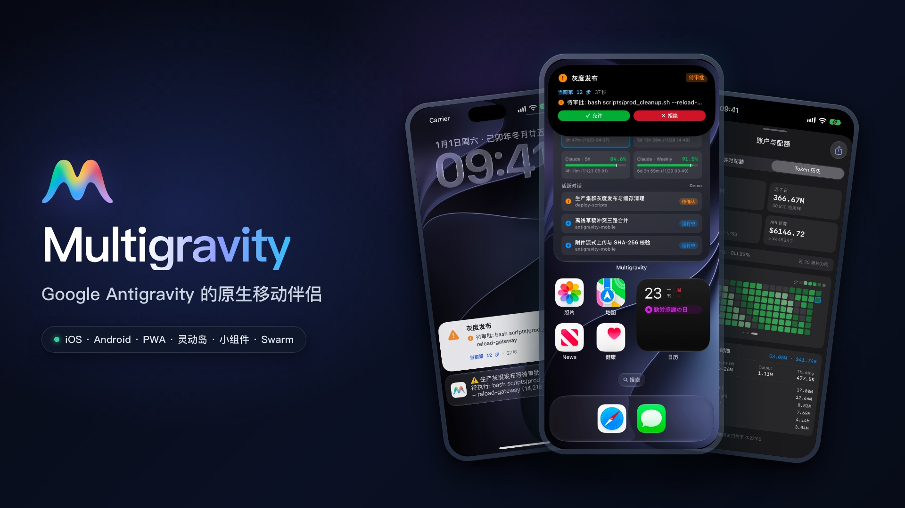
</p>

<p align="center">
  🌐 <b>官网</b>：<a href="https://mgy.jiuge.space">mgy.jiuge.space</a> &nbsp;·&nbsp; 🍎 <b>App Store</b>：<a href="https://apps.apple.com/app/id6835508934">iOS 正式版下载</a> &nbsp;·&nbsp; 🧪 <b>TestFlight</b>：<a href="https://testflight.apple.com/join/YM7f4aSK">公开测试通道</a> &nbsp;·&nbsp; 📦 <a href="https://github.com/GHSaiMo/antigravity-mobile/releases/latest">最新版 v1.2.7</a> &nbsp;·&nbsp; 𝕏 <a href="https://x.com/MultigravityApp">@MultigravityApp</a> &nbsp;·&nbsp; 💬 <a href="#wechat-group">微信用户群</a> &nbsp;·&nbsp; ☕ <a href="#sponsor">赞助支持</a>
</p>

> 🎉 **反重力智能体移动伴侣 iOS 版现已正式上架 Apple App Store！**  
> 无需本地编译或自签，直接前往 **[App Store 下载 Multigravity](https://apps.apple.com/app/id6835508934)**（支持美区等海外 174 地区，中文系统自动展示简体中文介绍与展示图，并内置零配置**离线演示模式**）；想抢先体验最新公测版也可加入 **[TestFlight 公开测试](https://testflight.apple.com/join/YM7f4aSK)**。

https://github.com/user-attachments/assets/37360cde-3875-45bf-947e-7774e800094c

---

## ⚡ 极速开始

### 1. 安装桌面 / 服务器网关 (`mgy`)

支持 **macOS (Apple Silicon / Intel)**、**Linux (x86_64 / NAS / 无头服务器)** 与 **Windows (x86_64)**，安装/卸载脚本支持中/英/日三语自适应，自动探测本地代理并按网络环境智能切换直连或镜像加速节点：

**macOS / Linux / Windows (Git Bash)：**
```bash
curl -fsSL https://ghfast.top/https://raw.githubusercontent.com/GHSaiMo/antigravity-mobile/main/scripts/install.sh | bash
```

**Windows (PowerShell)：**
```powershell
irm https://ghfast.top/https://raw.githubusercontent.com/GHSaiMo/antigravity-mobile/main/scripts/install.ps1 | iex
```

<details>
<summary>🌐 海外或已配置终端代理用户（GitHub 官方源）</summary>

```bash
# macOS / Linux / Git Bash
curl -fsSL https://raw.githubusercontent.com/GHSaiMo/antigravity-mobile/main/scripts/install.sh | bash
```

```powershell
# Windows PowerShell
irm https://raw.githubusercontent.com/GHSaiMo/antigravity-mobile/main/scripts/install.ps1 | iex
```
</details>

### 2. 安装或打开移动端
- **iOS**：🎉 现已正式上架 Apple App Store，直接前往 **[App Store 下载 Multigravity](https://apps.apple.com/app/id6835508934)** 一键安装（中文系统自动优先展示中文介绍与演示截图），也可通过 **[TestFlight 公开测试](https://testflight.apple.com/join/YM7f4aSK)** 抢先体验最新构建（如需自行源码编译调试，仍可参考 [iOS 本地构建与真机调试指南](docs/ios_build_guide.md)）。
- **Android**：前往 [GitHub Releases](https://github.com/GHSaiMo/antigravity-mobile/releases/latest) 直接下载安装 `Multigravity-v1.2.7.apk`（自 `v1.2.7` 起启用全新独立私有签名并内置 SHA-256 校验应用内检查更新，支持「设置 → 关于 → 版本」一键覆盖升级及 [Obtainium](https://github.com/ImranR98/Obtainium) 订阅；`v1.2.6` 及更早老版本首次升级请先卸载旧版再安装一次）。
- **PWA / Web**：无需安装 App，手机浏览器直接访问网关地址（或 `/?view=pwa`）即可添加到主屏幕。

### 3. 启动并扫码配对
```bash
mgy
```
网关前台启动后会在终端打印一次配对二维码（默认内置 Cloudflare Tunnel HTTPS 域名 + 局域网地址），手机打开 Multigravity 扫码即可秒连。

---

## 🖼️ 界面一览

<table>
  <tr>
    <td align="center" valign="top" width="25%">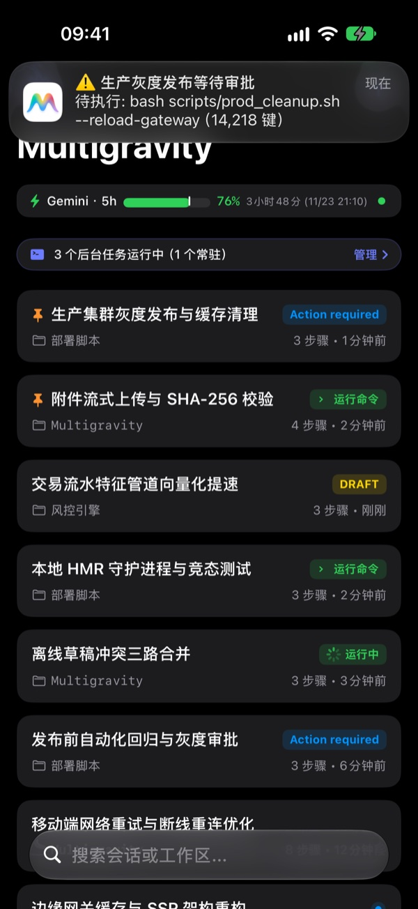<br/><b>全局视野与推送</b><br/><sub>原生 APNs 审批推送、状态徽标、后台任务与 5h 额度条</sub></td>
    <td align="center" valign="top" width="25%">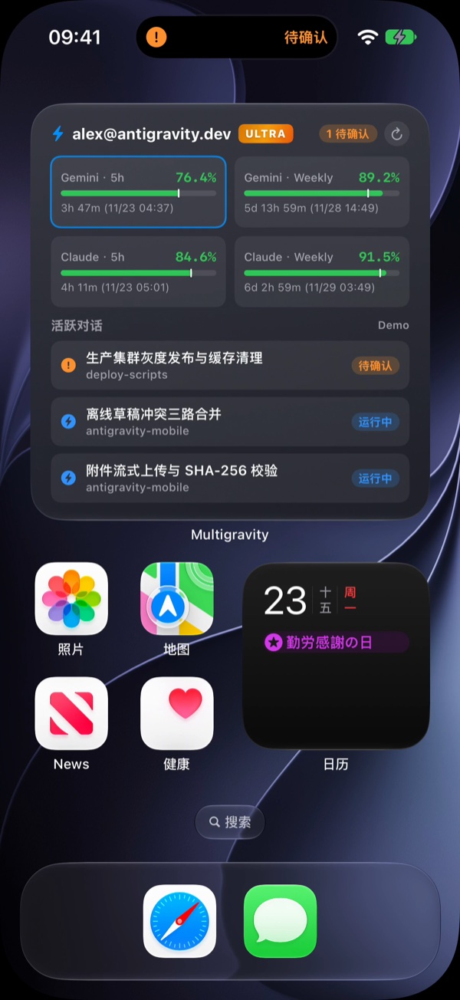<br/><b>灵动岛与主屏组件</b><br/><sub>紧凑灵动岛进度提醒 + 主屏 4×4 额度与活跃对话小组件</sub></td>
    <td align="center" valign="top" width="25%">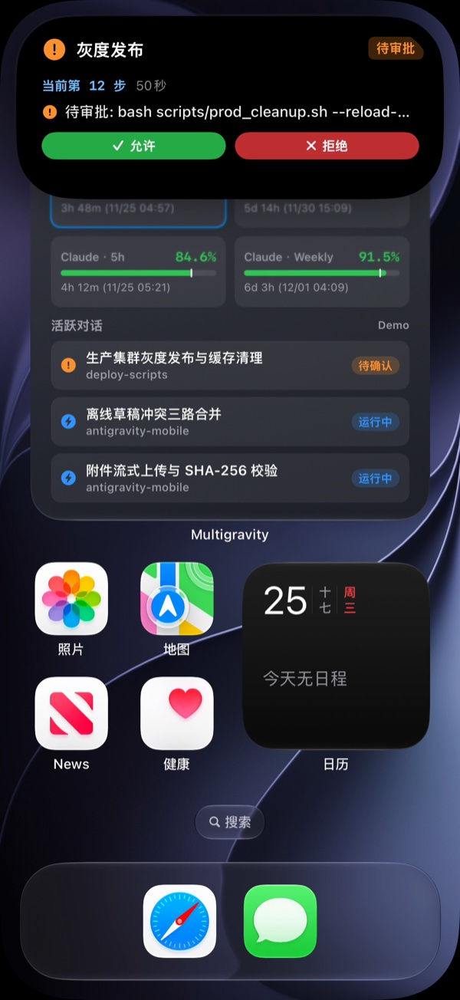<br/><b>灵动岛一键审批</b><br/><sub>长按展开灵动岛，离席无需开 App 直接允许或拒绝高危命令</sub></td>
    <td align="center" valign="top" width="25%">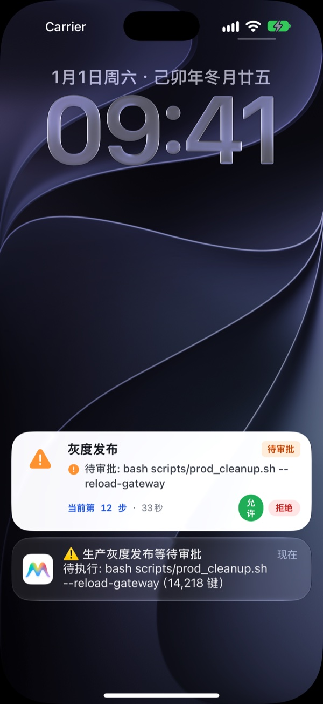<br/><b>锁屏实时活动</b><br/><sub>锁屏卡片实时追踪步骤与交互审批，与原生 APNs 推送联动</sub></td>
  </tr>
  <tr>
    <td align="center" valign="top" width="25%">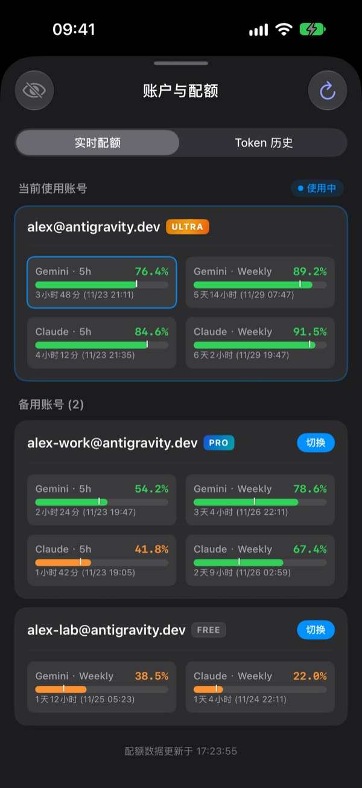<br/><b>账户与配额看板</b><br/><sub>5h / 每周额度均速刻度、Ultra / Pro / Free 多账号热切换</sub></td>
    <td align="center" valign="top" width="25%">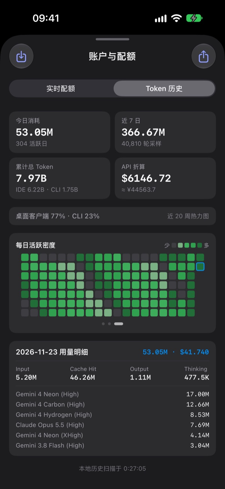<br/><b>Token 历史热力图</b><br/><sub>20 周活跃密度、缓存命中率与 Gemini 4 Neon 等各模型消耗明细</sub></td>
    <td align="center" valign="top" width="25%">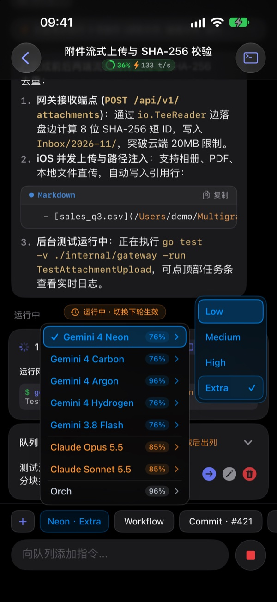<br/><b>双列模型选档</b><br/><sub>滑动直选 Gemini 4 Neon (Extra/High)、Orchestrator 与 Opus 5.5</sub></td>
    <td align="center" valign="top" width="25%">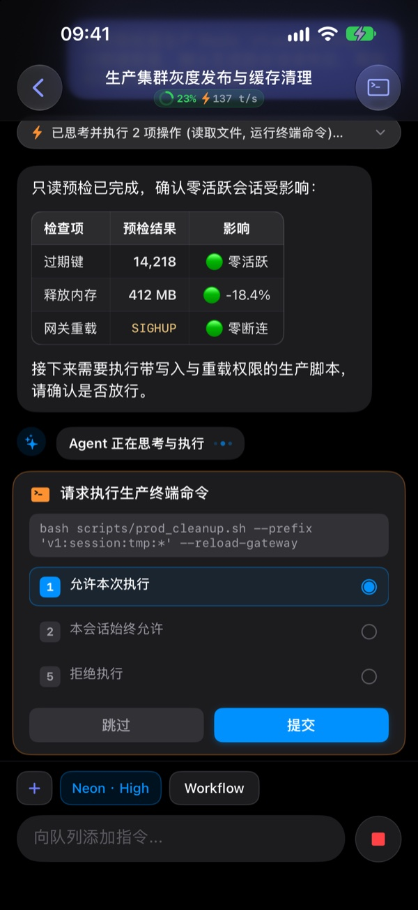<br/><b>高危命令安全门禁</b><br/><sub>只读预检摘要 + 完整命令预览，细粒度授权或拒绝执行</sub></td>
  </tr>
  <tr>
    <td align="center" valign="top" width="25%">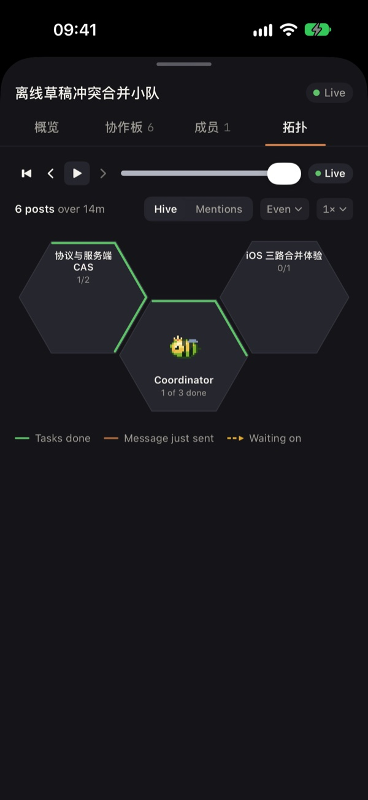<br/><b>Swarm 蜂群拓扑</b><br/><sub>桌面级 `/teamwork` 蜂巢视图、像素蜜蜂分工与协作板回放</sub></td>
    <td align="center" valign="top" width="25%">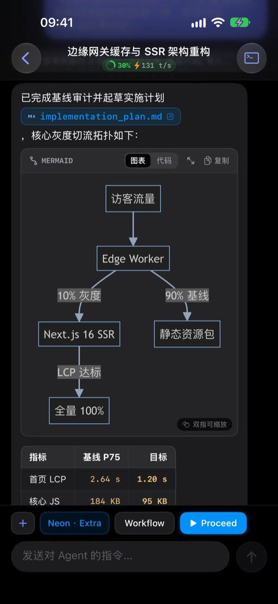<br/><b>方案与架构放行</b><br/><sub>离线 Mermaid 架构图与实施计划同屏预览，一键 Proceed</sub></td>
    <td align="center" valign="top" width="25%">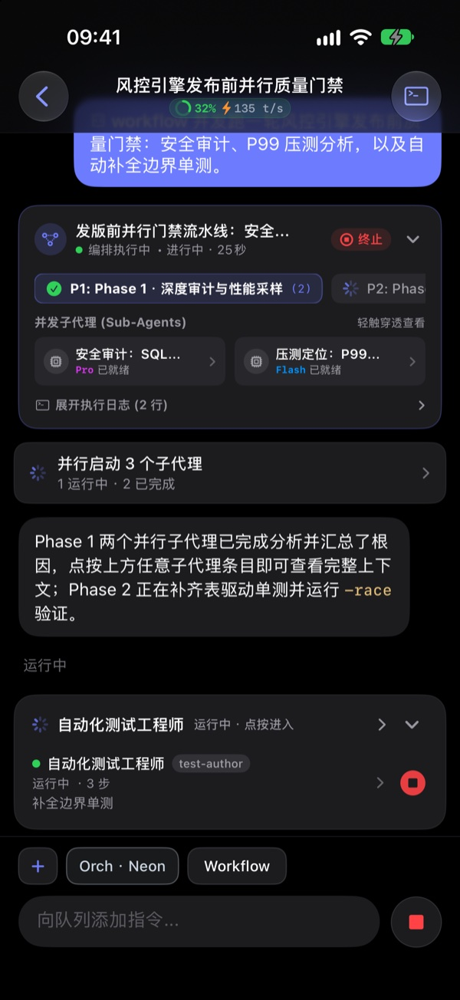<br/><b>并行子代理工作流</b><br/><sub>并发 Sub-Agents 状态网格、进度追踪与独立会话穿透查看</sub></td>
    <td align="center" valign="top" width="25%">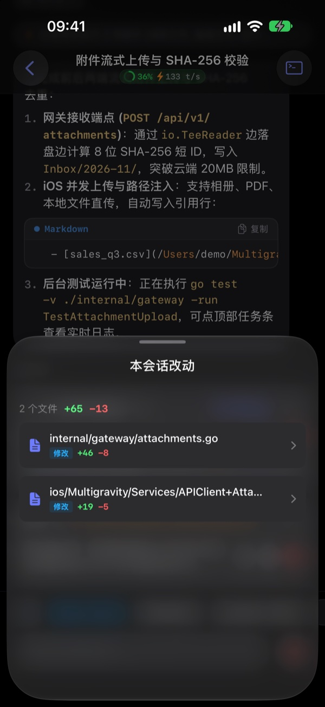<br/><b>代码改动审查</b><br/><sub>紧凑文件改动列表、增删行数统计与行级代码 Diff 直览</sub></td>
  </tr>
</table>

> 以上截图均来自客户端内置**离线演示模式**（v1.2.7 原生深色中文界面，完整对齐 Antigravity 2.35 真实协议与系统级灵动岛 / 锁屏实时活动 / 主屏小组件），下载后未配对即可零配置直接体验。

### 📱 iPhone Duo 折叠形态原生适配

针对 **iPhone Duo** 折叠形态与 iOS 27.1+ 特性做了全栈原生适配：合盖外屏自动启用侧边竖向工具栏与居中聊天标题；展开 180° 切换 342pt 比例双栏工作台并统一顶部导航；**Book 90° 半折姿态**基于 `ReservedRegion (.division)` 自动将分栏边界精准对齐物理折痕，同时通过 `ChatSessionStore` 在折叠 / 展开 / 旋转全过程中零中断保留活跃会话流与草稿状态。

<p align="center">
  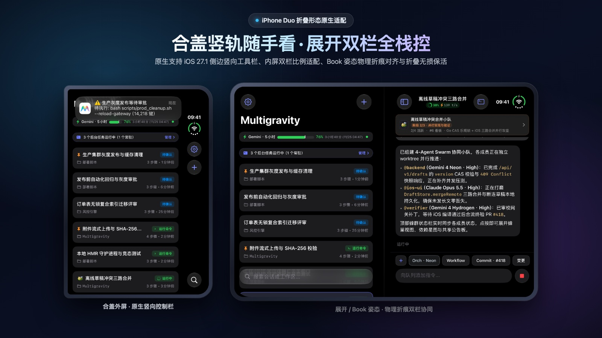
</p>

<table>
  <tr>
    <td align="center" valign="top" width="33%">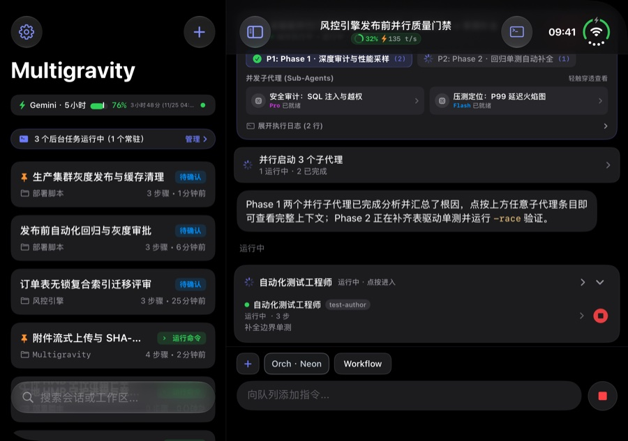<br/><b>展开双栏 · 并行子代理</b><br/><sub>342pt 比例侧栏 + 统一顶栏，左览全局会话与 5h 配额、右控并行 Sub-Agents</sub></td>
    <td align="center" valign="top" width="33%">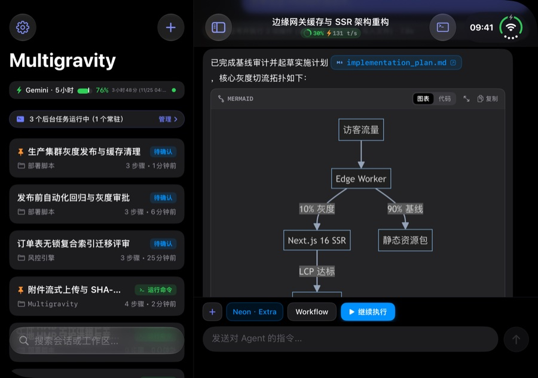<br/><b>展开双栏 · Mermaid 方案放行</b><br/><sub>宽幅内屏原生渲染离线暗黑 Mermaid 拓扑与指标表，审定后一键 Proceed</sub></td>
    <td align="center" valign="top" width="33%">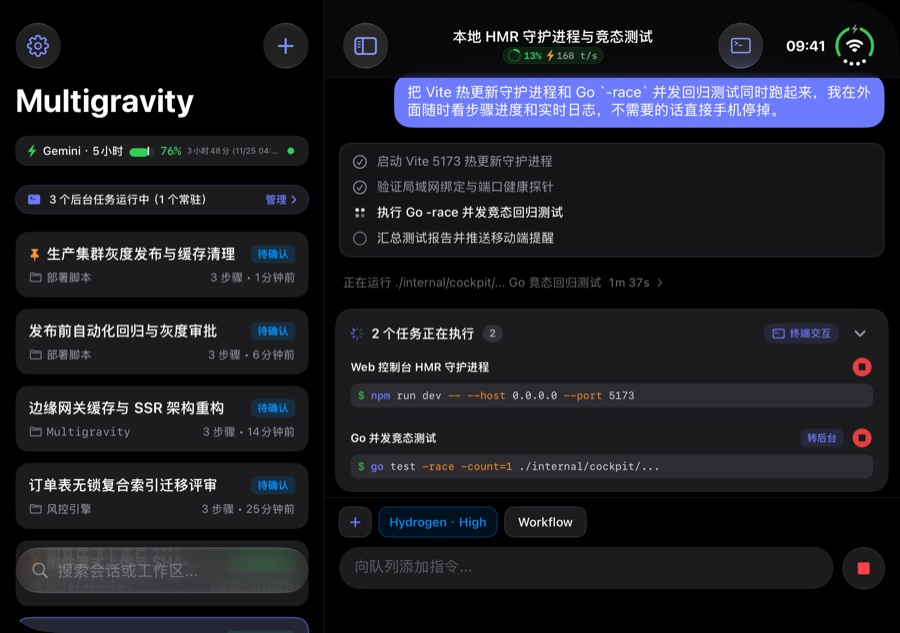<br/><b>展开双栏 · 步骤清单与计时</b><br/><sub>桌面 1:1 实时步骤清单、聚焦耗时计时与后台守护任务双栏同屏尽览</sub></td>
  </tr>
</table>

---

## ✨ 重点特性

### 1. 全端一致的实时流式体验
- **四端全覆盖与原生三语自适应**：原生 **iOS**（SwiftUI / Swift 6，含 **iPhone Duo** 折叠屏与主屏快捷操作）、原生 **Android**（Jetpack Compose Material 3）、零构建嵌入式 **PWA Web** 与**桌面工作台（`/`）**，全端支持**简体中文 / English / 日本語**自动协商与手动切换，提供「跟随系统 / 浅色 / 深色」原生外观与独立「精简模式」二级降噪开关。
- **桌面级步骤计划卡片、可展开 `Working` 行与实时计时器**：四端原生复刻 Antigravity 步骤计划卡片（Step Plan Card）、默认折叠思考过程的 `Working` 进度行与实时焦点计时器，同步透出至 iOS 灵动岛与锁屏实时活动；内置**全量会话轮次大纲（Turn Outline）、按需轮次跳转、尾部窗口磁盘缓存**与 iOS 原子化滚动防闪烁引擎，超长会话秒开且任意回溯丝滑流畅。
- **专业级富媒体排版与交互**：180+ 语言离线语法高亮（含 `R / R Markdown`）、单列行号槽 + 词级行内代码 Diff、LaTeX 公式、Mermaid 容错渲染、**双级高清图片预览**、全主题 Token 注入的 **MCP Apps (`ui://`) / Generative UI 交互式组件桥接**、**文档与 HTML 页内查找（Find in Page）**及高密度 PDF 懒加载预览。

### 2. 关键决策、分级权限与模型协同
- **原生交互卡片、高危 Diff 预检与收件箱置顶**：完整支持多选与多题决策（`ask_question`）、带摘要头与紧凑可折叠 Diff 预览的高危命令审批、**Agent Inbox 审批置顶**、限定范围写入审批、三档权限模式、插件权限撤销以及未信任工作区告警横幅一键授信。
- **全面对齐 Antigravity 2.35.0 模型代际**：原生支持 **Gemini 4 Neon**（含 Extra 思考档）、收入子菜单的 **Orchestrator (Neon / Carbon / Argon)**、Hydrogen / Carbon / Claude 5.5 全系模型，模型选择器内直览池配额；支持首选/次选模型与桌面同步、短按快切与长按全选。
- **方案放行、重构 `/btw` 旁问与会话归档**：支持预览方案一键 `Proceed` 推进、**会话归档/取消归档**、对话 Fork/Worktree 分叉、代码回滚与带阻塞状态提示的排队追问；支持全新独立 **`/btw` 旁问分支**并一键回插主对话；点击对话内 `/skill` 徽章可直达 `SKILL.md` 定义预览。

### 3. 多智能体工作流、蜂群看板、终端与自动化
- **动态工作流全生命周期 (`run_workflow`)**：内置常用模板快捷发起，精准拦截 Python 编排脚本并弹出安全审批卡，实时展示阶段流水线、按分组呈现且解析**真实运行模型**的并发子智能体网格、终端日志与 JSON 产物；单子代理运行时点击浮条即可一步直达详情。
- **蜂群看板与实时终端**：桌面级复刻蜂群协作板（`/swarm`），支持协作板分页与**运行中 Swarm 蜂群置顶 + 像素蜜蜂动态标识**；原生接入 PTY 终端 WebSocket 实时交互流、MCP Server 开关热刷新、Agent Memories 增删改查与浏览器子智能体跳过/加白控制。
- **定时任务与后台任务中心**：三端支持创建、详情查看、完整编辑与启停 Automations（含离线本地扫描双保险与「立即运行 Run Now」），跨会话监控全局后台任务并实时查看/刷新终端日志 Tail。

### 4. 全双工实时语音与多模态交互
- **实时语音通话、听写与朗读**：四端支持 Antigravity 全双工实时语音协议（iOS 启用硬件级回声消除 AEC），支持原生流式语音听写（Dictation）、回答语音朗读（Narration）、实时字幕、打断与倍速播放。
- **多模态输入与产出**：支持 `@` 上下文提及、微信式相册切换器与跨相册全量多选、音视频（`≤200MB`，含 `.amr` 语音）与常规文件（`≤50MB`）的 **E2EE `req-bin2` 流式进度上传与幂等重试**、**微信聊天记录 ZIP 智能识别、离线归档缓存与原生排版预览**、双端统一长按自由选词浮层、iOS 文稿扫描、AI 生图与 7 款精选皮肤（含 Solarized Light、Nord 等桌面配色）长图海报分享。

### 5. 上下文水位、速率监控与配额仪表盘
- **实时上下文水位、Token 汇总与速率**：聊天顶栏实时展示上下文占用圆环、**会话 Token 汇总与压缩阈值提示**及 `TTFT / TPS` 吐字速率，遇到上下文溢出自动升级为带「一键压缩 `/compact`」和「开启新会话」的救援卡片。
- **配额匀速刻度与可滑动 Token 三视图图表**：实时监控 Claude / Gemini（5h & Weekly）及 Argon 额度，叠加均速消耗刻度针与节奏分析；内置支持满 1 小时自动刷新的可滑动 **Token 历史三视图轮播**（近 14 天每日柱状图、模型累计占比与 20 周热力图，含智能冷启动默认与偏好记忆）、成本统计与所见即所得多皮肤报告海报一键保存/分享，配合 **Cockpit Tools v1.4+ SQLite 索引**与 **ULTRA 优先分级排序**支持多账号无感热切。
- **全尺寸额度与活跃对话小组件 & CarPlay 实时步骤（iOS）**：内置全套尺寸锁屏与桌面额度小组件（`Inline` / `Circular` / `Rectangular` / `Small`～`ExtraLarge`）及 **`AgentStatusWidget` 活跃对话监控小组件**（`Small`～`Large`），覆盖 iPhone、iPad、StandBy、iOS 26 CarPlay 与 Mac 桌面，支持 5h/7d 双窗走秒倒计时、一键轻刷与多会话审批总览；CarPlay 仪表盘与 Apple Watch 智能叠放同步支持两段式高对比实时步骤卡片。

### 6. 移动端工程闭环与外设生态
- **代码与工作区管理直达**：支持首页按项目 / Chat 原地筛选、新建本地工作区、**带本机目录选择器、原地新建文件夹与异步进度的 GitHub 仓库克隆**、会话全文秒搜（SQLite FTS5）、导出 Markdown、查看 `Changes` Diff、带短时缓存提速的原生 `Commit & Push` 与分支管理；会话列表与气泡自动关联 **GitHub PR 实时状态胶囊与详情弹窗**，同时支持 `/slash` 斜杠命令、交互提示与手势指南及 MCP/技能健康看板。
- **跨端游标与物理外设**：Follow-Me 游标引擎智能仲裁桌面与移动端活跃会话；支持 `integrations/yoooclaw/` 随身硬件按键语音直连注入活跃会话。

### 7. 零知识端到端加密、多地域中继池与安全推送
- **多通道并发测速与多地域中继池**：支持零知识多节点 VPS 中继池（并发 RTT 测速、滞回钉选、故障自动切换）、Cloudflare Tunnel 专属 HTTPS 域名自动回退、局域网 Wi-Fi 与 Tailscale 并发探活，自动择优切换最低延迟链路。
- **按设备语言三语推送、停滞告警、锁屏快批与全 5 池额度守护**：iOS 原生支持 **APNs 推送、锁屏快捷审批与远程 Live Activity 灵动岛状态更新**，Android 支持 `dataSync` 前台保活与 FCM 推送；全量通知按**各配对设备语言**原生输出 **简中 / English / 日本語**，支持可定制通知偏好子页、任务停滞告警、高危审批独立标题与桌面端已审批横幅静默撤回，覆盖全 5 池低水位、官方提前回满喜报及异常骤降告警；网关内置跨平台**任务期动态防休眠守卫**（仅活跃任务期持锁、允许熄屏、空闲 2 分钟自动释放）。
- **零知识 E2EE 与本地优先安全架构**：全端内置 **`mgy-e2ee-v1` 端到端加密协议**（ECDH P-256 + HKDF-SHA256 + AES-256-GCM），中继路径强制拒绝明文（HTTP 426）确保中转节点零知识不可见；支持老设备双轨静默升级，设备凭据存入系统 Keychain / EncryptedSharedPreferences，集成敏感路径黑名单与 WS 限流防刷。

---

## 🏛️ 架构概览

```text
手机端 (iOS / Android / PWA) ──[LAN / Tailscale / Zero-Knowledge E2EE Relay / Cloudflare HTTPS]──▶ mgy Go 网关 ──▶ Antigravity Core (language_server)
```

| 层级 | 核心组件 | 说明 |
| :--- | :--- | :--- |
| **移动客户端** | iOS (SwiftUI) · Android (Compose) · PWA (`web/`) | 完整交互体验、透明 E2EE 传输、语音通话、工作流看板、额度与 Token 审计 |
| **本地网关 (`mgy`)** | Go 单一二进制 (`cmd/gateway` / `internal/`) | 实例自愈发现、E2EE 中继/WS/ConnectRPC 代理、FTS5 检索、配额与通知引擎 |
| **远程与外设** | 零知识中继池 (`mgy-relay`) · Cloudflare Tunnel · YoooClaw | 端到端加密多地域中继、自动 Cloudflare 回退、多链路并发测速、硬件语音网桥 |

---

## 🛠️ 常用 CLI 与配置

```bash
mgy                # 前台启动网关并打印配对二维码
mgy pair           # 申请新的 5 分钟有效配对二维码
mgy cockpit        # 配置 Cockpit 报表服务与 Token
mgy cloudflare     # 配置 Cloudflare 穿透隧道 (别名: mgy cf)
mgy list           # 查看已配对设备
mgy clear all      # 吊销所有已配对设备 (或 mgy clear <dev_id>)
mgy help           # 查看完整命令与启动参数
```

- **默认配置目录**：`~/.multigravity/.env`（自动兼容迁移旧版 `~/.antigravity-mobile/`）。
- **核心环境变量**：`MULTIGRAVITY_PORT` (`58900`)、`CF_TUNNEL_ENABLED` (`1`)、`APNS_ENABLED` (`1`)、`MGY_PREVENT_SLEEP` (`1` 任务期按需防休眠)、`MGY_LANG` (`zh` / `en` / `ja` 自适应)、`MULTIGRAVITY_LOG_LEVEL` (`info`)。
- **进阶文档**：安装自测与排错详见 [安装与运维指南](docs/installation_and_testing_guide.md)，RPC 接入细节详见 [language_server RPC 说明](docs/ls_rpc_integration_notes.md)。

<details>
<summary>🗑️ 彻底卸载网关与清理配置</summary>

```bash
# macOS / Linux / Git Bash
curl -fsSL https://ghfast.top/https://raw.githubusercontent.com/GHSaiMo/antigravity-mobile/main/scripts/uninstall.sh | bash
```

```powershell
# Windows PowerShell
irm https://ghfast.top/https://raw.githubusercontent.com/GHSaiMo/antigravity-mobile/main/scripts/uninstall.ps1 | iex
```
*(支持 `--keep-config` 保留配置或 `--keep-cf` 保留 Cloudflare 引擎)*
</details>

---

## 💻 源码编译

```bash
make build          # 编译 bin/mgy
make run            # 本地测试运行
make install-local  # 安装到 ~/.local/bin/mgy
make test           # 运行 Go 单元与集成测试
```

---

## ⚖️ 移动端操控 Google Antigravity 主流方案对比

| 能力维度 | 官方 Remote Control（Web PWA） | 远程桌面（RDP / RustDesk / 向日葵） | 第三方跨模型套壳客户端 | **Multigravity（原生本地伴侣 · MIT）** |
| :--- | :--- | :--- | :--- | :--- |
| **原生 iOS / iPadOS / Android 客户端** | 仅手机浏览器 / 网页 PWA | 通用桌面画面串流 | 独立第三方前端（各异） | **原生 SwiftUI（App Store 正式上架）+ Jetpack Compose（Android）** |
| **完整保留官方原生 Antigravity 本体** | 是 | 是（直接操作桌面 GUI） | 替换或外挂壳层（Skills / 用量易受限） | **是——本机 `mgy` Go 网关直连官方原版 Antigravity IDE/CLI** |
| **锁屏审批与灵动岛实时追踪** | 网页通知（iOS 后台受限） | 无（需手动切入画面缩放） | 视平台实现，通常无灵动岛 | **原生 APNs 锁屏一键放行/拒绝、远程灵动岛与实时活动** |
| **5h / 每周额度、缓存命中与 Token 审计** | 基础状态查看 | 仅能看电脑屏幕 | 常缺失 Antigravity 真实配额同步 | **全 5 池 5h/7d 均速仪表盘、iOS 全尺寸小组件、20 周热力图与掉缓存告警** |
| **企业 / GCP / macOS 宿主机兼容** | 受官方云端灰度与企业策略限制 | 需维持高带宽图形桌面 | 依赖第三方服务或 ACP 协议支持 | **全支持——本地网关自托管，支持局域网、Tailscale、Cloudflare 与 E2EE 中继** |
| **端到端加密与隐私边界** | 云端会话中转 | 依赖远控服务商中转 | 依赖第三方后端 | **零知识端到端加密（`mgy-e2ee-v1`）、零埋点、全量 MIT 开源可审计** |
| **费用与免配对体验** | 免费（随 Google AI 订阅） | 免费 / 付费 | 免费 / 订阅制 | **100% 免费开源无内购，iOS 内置零配置离线 Demo 模式** |

## ❓ 常见问题（FAQ）

- **Google Antigravity 有原生 iOS / Android 手机 App 吗？**  
  Google 官方目前提供的是网页版 Remote Control（PWA），尚未推出独立原生 App。**Multigravity**（开源仓库 `GHSaiMo/antigravity-mobile`、官网 [mgy.jiuge.space](https://mgy.jiuge.space/)）是社区独立维护的 **MIT 开源原生 iOS / Android 移动伴侣**，专为希望获得原生流畅度、锁屏 APNs 快捷审批、灵动岛实时步骤、桌面/锁屏额度小组件与完整 `/swarm` 看板的开发者打造。
- **Multigravity 与桌面多开脚本（如 `multigravity-pro`）或第三方套壳工具有什么区别？**  
  Multigravity 是专注**手机与跨端远程操控**的原生移动伴侣（命令行工具为 `mgy`），与桌面多开脚本无关，也**不是**第三方 AI 套壳或 API 代理。所有模型调用、Skills、MCP 工具与 `/swarm` 编排仍 100% 在你电脑上的官方原版 Antigravity 内本地执行。
- **代码或 Google 账号凭据会上传到开发者服务器吗？**  
  不会。Multigravity 不提取 Google 登录凭据，也不直连 Google 后端；手机仅与你电脑本地运行的 `mgy` 网关通信。经公网中继路径传输时强制启用 **`mgy-e2ee-v1` 端到端加密**（ECDH P-256 + HKDF-SHA256 + AES-256-GCM，明文直拒 HTTP 426）；可选 APNs 推送中继（`push.jiuge.space`）完全无状态，无数据库、不记录消息正文。
- **还没安装电脑端网关前可以先体验吗？**  
  可以。[iOS App Store 正式版](https://apps.apple.com/app/id6835508934) 内置零配置 **离线 Demo 模式**，下载后 5 秒即可完整体验对话流、高危审批卡片、`/swarm` 蜂巢拓扑、Mermaid 计划审阅与 5h/周额度看板。

---

<a id="wechat-group"></a>
## 💬 微信用户群

欢迎扫码加入 **mgy 微信用户群**，交流使用心得、反馈建议或第一时间获取版本更新动态（二维码 7 天内有效，若过期请提交 [Issue](https://github.com/GHSaiMo/antigravity-mobile/issues) 提醒更新）：

<p align="center">
  
</p>

---

<a id="sponsor"></a>
## ☕ 赞助与支持

**Multigravity** 坚持免费开源、无广告且核心功能不设付费墙。如果它确实提升了你的日常开发效率，欢迎请作者喝杯咖啡——所有赞赏将优先用于分摊以下长期运维开支：

- 🌐 **多地域零知识中继节点 (`mgy-relay`)** 与服务器带宽费用
- 🔔 **APNs / 推送服务** 与官网域名运维
- 🍎 **Apple Developer 开发者年费**（用于 iOS App Store 正式分发与 TestFlight 公测）

<p align="center">
  
</p>

---

## 📄 开源许可证

本项目基于 [MIT License](LICENSE) 协议开源。欢迎提交 Issue 与 Pull Request！
