# Multigravity 📱✨

<p align="center">
  <a href="README.md">简体中文</a> &nbsp;|&nbsp; <b>English</b> &nbsp;|&nbsp; <a href="README_JA.md">日本語</a>
</p>

> **The Full-Stack Mobile & Remote Companion for Google Antigravity AI Agent.**  
> Real-time chats, decision approvals, multi-agent workflows, context watermarks, and quota monitoring on your iPhone, iPad, Android, or mobile browser — anytime, anywhere.  
> 
> *The repository is named `antigravity-mobile`, the official product brand is **Multigravity**, and the global CLI tool is **`mgy`**.*

[](https://github.com/GHSaiMo/antigravity-mobile/releases/latest)
[](https://apps.apple.com/app/id6835508934)
[](https://testflight.apple.com/join/YM7f4aSK)
[](https://github.com/GHSaiMo/antigravity-mobile/releases/latest)
[](https://github.com/GHSaiMo/antigravity-mobile/releases/latest)
[](https://github.com/GHSaiMo/antigravity-mobile/releases/latest)
[](https://github.com/GHSaiMo/antigravity-mobile/releases/latest)
[](https://kotlinlang.org)
[](https://swift.org)
[](https://go.dev)
[](https://x.com/MultigravityApp)
[](LICENSE)

<p align="center">
  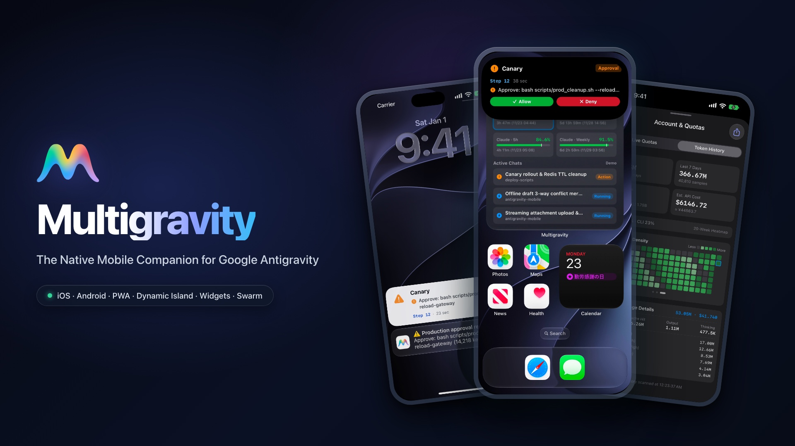
</p>

<p align="center">
  🌐 <b>Website</b>: <a href="https://mgy.jiuge.space/en.html">mgy.jiuge.space/en.html</a> &nbsp;·&nbsp; 🍎 <b>App Store</b>: <a href="https://apps.apple.com/app/id6835508934">Download for iOS</a> &nbsp;·&nbsp; 🧪 <b>TestFlight</b>: <a href="https://testflight.apple.com/join/YM7f4aSK">Public Beta</a> &nbsp;·&nbsp; 📦 <a href="https://github.com/GHSaiMo/antigravity-mobile/releases/latest">Latest Release v1.2.6</a> &nbsp;·&nbsp; 𝕏 <a href="https://x.com/MultigravityApp">@MultigravityApp</a> &nbsp;·&nbsp; 💬 <a href="#wechat-group">WeChat Group</a>
</p>

> 🎉 **Multigravity for iOS is officially available on the Apple App Store!**  
> No manual compilation or self-signing required. Download directly from the **[App Store](https://apps.apple.com/app/id6835508934)** (available in 174 countries and regions, including the US; features a zero-config built-in **offline Demo Mode**); or join the **[TestFlight Public Beta](https://testflight.apple.com/join/YM7f4aSK)** to preview bleeding-edge releases.

https://github.com/user-attachments/assets/37360cde-3875-45bf-947e-7774e800094c

---

## ⚡ Quick Start

### 1. Install Desktop / Server Gateway (`mgy`)

Supports **macOS (Apple Silicon / Intel)**, **Linux (x86_64 / NAS / Headless Servers)**, and **Windows (x86_64)** with native **English / 简体中文 / 日本語** installer & uninstaller output. Automatically probes local proxies and selects direct GitHub or accelerated mirrors based on locale and reachability:

**macOS / Linux / Windows (Git Bash):**
```bash
curl -fsSL https://raw.githubusercontent.com/GHSaiMo/antigravity-mobile/main/scripts/install.sh | bash
```

**Windows (PowerShell):**
```powershell
irm https://raw.githubusercontent.com/GHSaiMo/antigravity-mobile/main/scripts/install.ps1 | iex
```

<details>
<summary>🇨🇳 For users in Mainland China (Mirror acceleration)</summary>

```bash
# macOS / Linux / Git Bash
curl -fsSL https://ghfast.top/https://raw.githubusercontent.com/GHSaiMo/antigravity-mobile/main/scripts/install.sh | bash
```

```powershell
# Windows PowerShell
irm https://ghfast.top/https://raw.githubusercontent.com/GHSaiMo/antigravity-mobile/main/scripts/install.ps1 | iex
```
</details>

### 2. Install or Open the Mobile Client
- **iOS**: 🎉 Officially released on the Apple App Store! Install directly via **[App Store](https://apps.apple.com/app/id6835508934)** with one tap, or join the **[TestFlight Public Beta](https://testflight.apple.com/join/YM7f4aSK)** to test pre-release builds (for building from source or debugging on physical devices, refer to the [iOS Local Build & Device Debugging Guide](docs/ios_build_guide.md)).
- **Android**: Download `Multigravity-v1.2.6.apk` directly from [GitHub Releases](https://github.com/GHSaiMo/antigravity-mobile/releases/latest) (includes built-in in-app update checking & verified APK upgrades under **Settings → About → Version**; power users can also track `https://github.com/GHSaiMo/antigravity-mobile` automatically via [Obtainium](https://github.com/ImranR98/Obtainium)).
- **PWA / Web**: No app installation needed. Open the gateway URL (or `/?view=pwa`) directly in your mobile browser and add it to your Home Screen.

### 3. Launch & Scan QR Code to Pair
```bash
mgy
```
When launched in the foreground, the gateway prints a one-time pairing QR code in the terminal (equipped with an automated Cloudflare Tunnel HTTPS endpoint + LAN IP). Open Multigravity on your phone and scan the QR code to connect instantly.

---

## 🖼️ Interface Gallery

<table>
  <tr>
    <td align="center" valign="top" width="25%">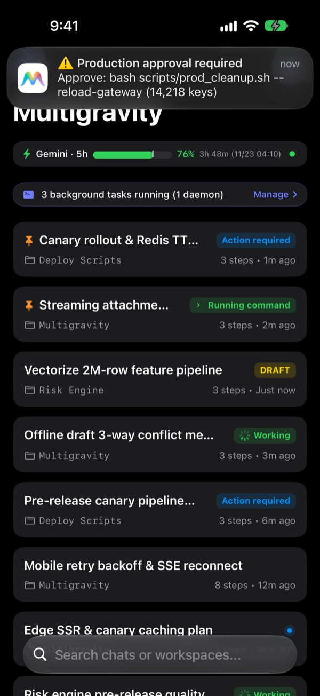<br/><b>Overview & APNs Push</b><br/><sub>Native APNs approval alerts, status badges, background tasks & 5h quota bar</sub></td>
    <td align="center" valign="top" width="25%">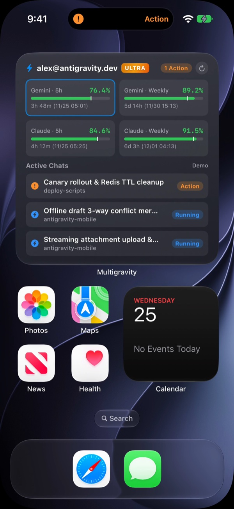<br/><b>Dynamic Island & Widgets</b><br/><sub>Compact Dynamic Island status + 4×4 Quota & Active Chats Home Widget</sub></td>
    <td align="center" valign="top" width="25%">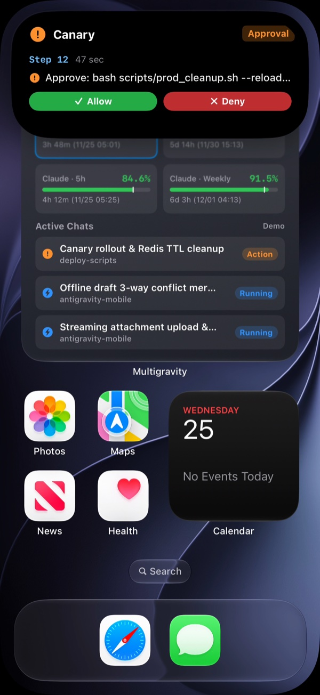<br/><b>Dynamic Island Approval</b><br/><sub>Long-press to expand and Allow or Deny high-risk commands off-desk</sub></td>
    <td align="center" valign="top" width="25%">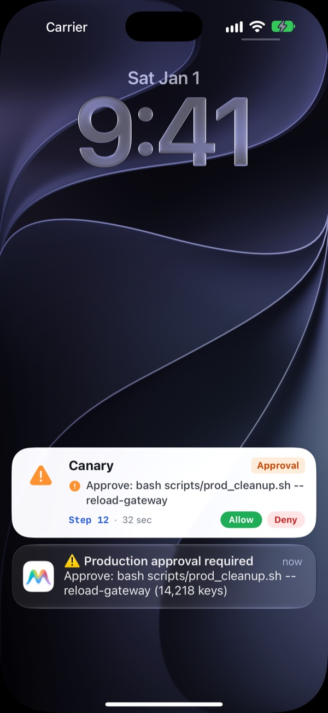<br/><b>Lock Screen Live Activity</b><br/><sub>Live step tracking & interactive Allow/Deny paired with native APNs</sub></td>
  </tr>
  <tr>
    <td align="center" valign="top" width="25%">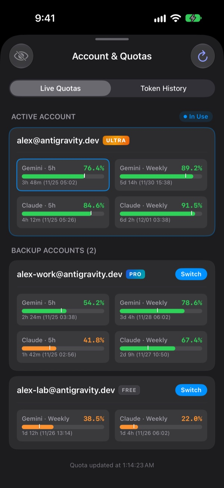<br/><b>Account & Quotas</b><br/><sub>5h / weekly burn-rate gauges & one-tap Ultra / Pro / Free account switching</sub></td>
    <td align="center" valign="top" width="25%">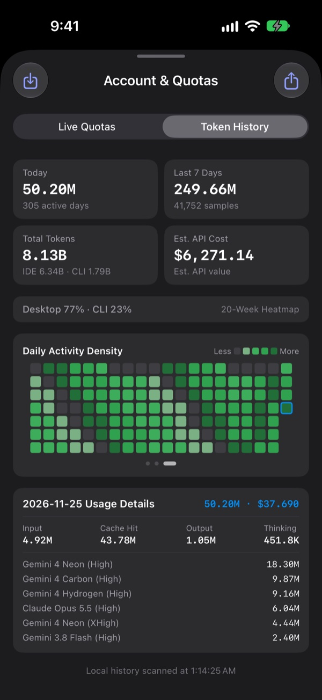<br/><b>Token History & Spend</b><br/><sub>20-week heatmap, cache hit rate & Gemini 4 Neon / Opus 5.5 breakdown</sub></td>
    <td align="center" valign="top" width="25%">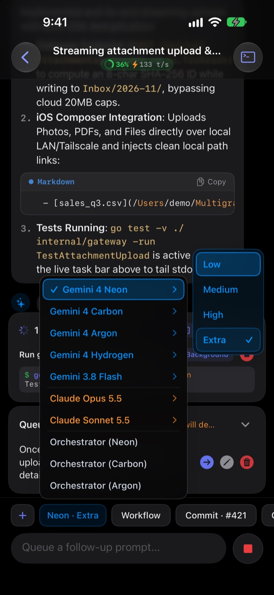<br/><b>Dual-Column Model Picker</b><br/><sub>Slide-pick Gemini 4 Neon (Extra/High), Orchestrator & Claude Opus 5.5</sub></td>
    <td align="center" valign="top" width="25%">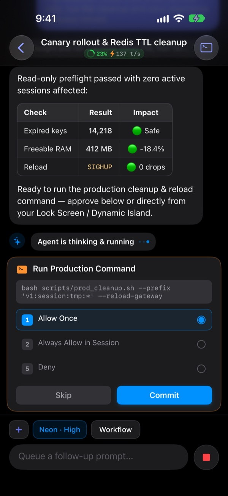<br/><b>Security Approval Gate</b><br/><sub>Read-only preflight summary + exact command preview with Allow/Deny</sub></td>
  </tr>
  <tr>
    <td align="center" valign="top" width="25%">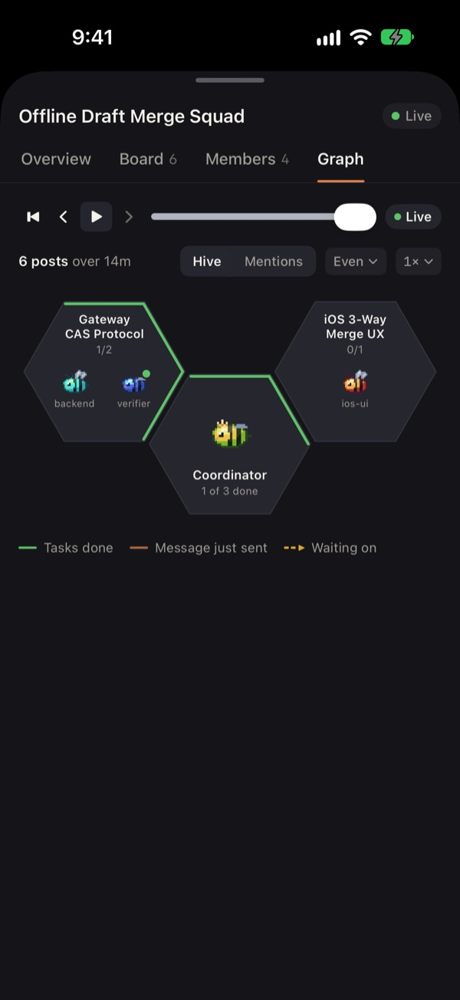<br/><b>Native Swarm Hive</b><br/><sub>Desktop-grade `/teamwork` Hive topology, pixel bees & live shared board</sub></td>
    <td align="center" valign="top" width="25%">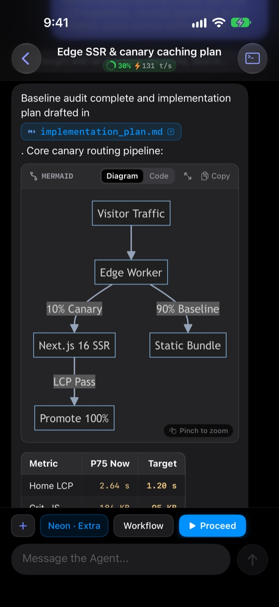<br/><b>Plan Review & Proceed</b><br/><sub>Offline Mermaid flowcharts + implementation plan with one-tap Proceed</sub></td>
    <td align="center" valign="top" width="25%">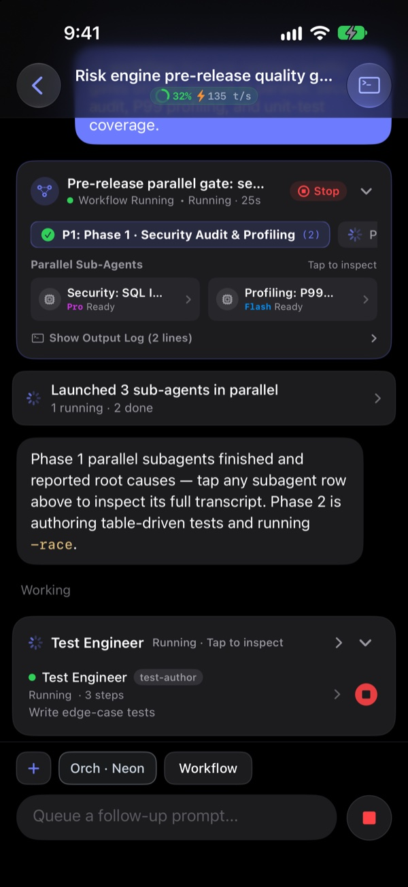<br/><b>Multi-Agent Workflows</b><br/><sub>Parallel sub-agent status cards, live step counts & instant drill-down</sub></td>
    <td align="center" valign="top" width="25%">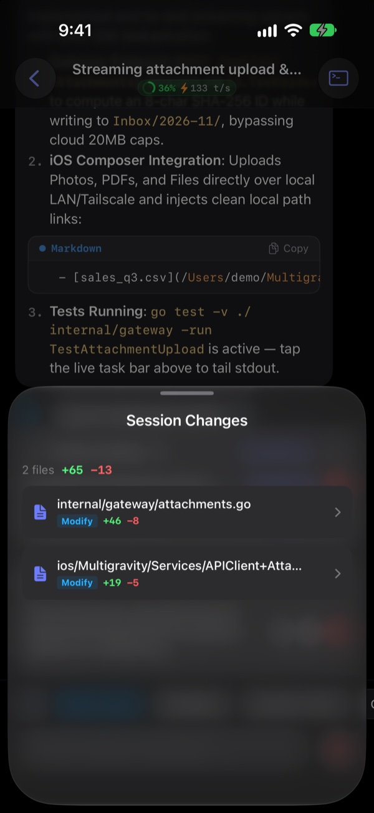<br/><b>Session Changes & Diff</b><br/><sub>Compact changed-files drawer with line-delta stats & inline code diffs</sub></td>
  </tr>
</table>

> *All screenshots above are captured from the built-in **offline Demo Mode** (v1.2.6 native dark English UI, aligned with Antigravity 2.34 protocols plus live iOS Dynamic Island, Lock Screen Live Activities & Home Screen Widgets) — try it out-of-the-box before pairing.*

---

## ✨ Key Features

### 1. Consistent Real-Time Streaming Across All Platforms
- **Cross-Platform & Trilingual Parity**: Native **iOS** (SwiftUI / Swift 6), native **Android** (Jetpack Compose Material 3), and zero-build embedded **PWA Web**, with native **English / 简体中文 / 日本語** localization and automatic locale detection. Supports System/Light/Dark themes and an independent "Compact Mode" toggle for reduced visual noise.
- **Desktop-Parity Step Plan Card, Live Focus Timer & Long-Session Jump**: Native **Step Plan Cards** and a **Live Focus Timer** across iOS, Android, PWA Web, and iOS Live Activities; paired with reactive Connect streaming, **full-session Turn Outline, on-demand turn jumping, and tail-window disk caching** so even massive sessions open instantly and jump smoothly to any turn.
- **Professional-Grade Rich Media & Interactive Rendering**: 180+ languages offline syntax highlighting (including `R / R Markdown`), single-gutter line-numbered & word-level inline code diffs, LaTeX math equations, fault-tolerant Mermaid rendering, **interactive MCP Apps (`ui://`) bridging**, **Find in Page**, and high-density PDF lazy loading.

### 2. Critical Decisions, Tiered Permissions & Model Synergy
- **Interactive Decision Cards, Tiered Permissions & Workspace Trust**: Full support for multi-question decision cards (`askQuestion`), high-risk command approvals, 3-tier permission modes (locally cached to prevent flicker), and one-click authorization banners for untrusted workspaces.
- **Full Antigravity 2.34.0 Model Parity**: Native support for **Gemini 4 Neon** (including Extra thinking effort), **Orchestrator (Neon)**, Hydrogen, Carbon, and Claude 5.5 models. Configure primary/secondary favorites with desktop active-model sync; tap the model pill to quick-toggle or long-press to pick any model.
- **Plan Approvals, `/btw` Side Questions & Clickable Skill Pills**: One-click `Proceed` execution for plans, conversation Fork/Worktree branching, code rollback, and queued follow-ups. Initiate independent **`/btw` side questions** with one-tap insertion back into the main chat, and tap `/skill` pills in chat bubbles to inspect `SKILL.md` directly.

### 3. Multi-Agent Workflows, Swarm Board, Terminal & Automations
- **Dynamic Workflow Lifecycle (`run_workflow`)**: Quick start from built-in workflow templates; intercept Python orchestration scripts with security approval cards; live visualization of stage pipelines, concurrent sub-agent grids, terminal logs, and structured JSON artifacts. Jump straight to details by tapping running sub-agent status bars.
- **Swarm Board & Live Terminal**: Desktop-grade Swarm collaboration board (`/swarm`), native PTY terminal WebSocket interactive stream, dynamic MCP Server toggles, Agent Memories CRUD, and browser sub-agent whitelist/skip controls.
- **Automations & Global Task Center**: Create, inspect, edit, and toggle scheduled automations across all platforms (with offline local scan backup and "Run Now" triggers); monitor global background tasks across all conversations with live terminal log tailing.

### 4. Full-Duplex Real-Time Voice & Multimodal Interaction
- **Real-Time Voice Calls, Dictation & Narration**: Antigravity full-duplex real-time voice protocol supported on all platforms (iOS includes hardware-level Acoustic Echo Cancellation / AEC); streaming voice dictation, audio narration of answers, live subtitles, conversational interruption, and multi-speed playback.
- **Multimodal Inputs & Artifacts**: Supports `@` context mentions, album switcher with cross-album multi-photo selection, audio/video (`≤200MB`, including `.amr` voice clips) and general file uploads (`≤50MB`) with circular progress rings; **smart WeChat chat history ZIP extraction, offline archive caching, and native typography rendering**; unified cross-platform free text selection popup; iOS document scanning; AI image generation; and one-click long-image poster sharing with 7 curated themes (including Solarized Light, Nord, etc.).

### 5. Context Watermarks, Rate Monitoring & Quota Dashboard
- **Real-Time Context Watermarks & Throughput**: Chat top bar displays live context token utilization rings alongside `TTFT / TPS` output rates. When context approaches limits, an automatic rescue card surfaces with one-tap `/compact` and "New Session".
- **Quota Burn-Rate Gauges & Swipeable Token History Charts**: Real-time quota monitoring for Claude / Gemini (5h & Weekly) and Argon, overlaid with consumption velocity needles and pacing analytics. Built-in swipeable **3-view Token History carousel** (14-day daily trend bars, cumulative model breakdown, and 20-week heatmap with smart cold-start defaults), cost breakdown, and WYSIWYG multi-skin exportable report posters. Compatible with **Cockpit Tools v1.4+ SQLite index** and **ULTRA-first tier sorting** for seamless zero-downtime multi-account switching.
- **Full-Size Quota & Active Chats Widgets + CarPlay Live Activities (iOS)**: Complete WidgetKit suite covering `QuotaStatusWidget` (`Inline` / `Circular` / `Rectangular` / `Small`–`ExtraLarge`) and **`AgentStatusWidget` (Active Chats `Small`–`Large`)** across iPhone, iPad, StandBy, iOS 26 CarPlay Widgets, and macOS Desktop — displaying live 5h/7d balances, ticking reset countdowns, one-tap refresh, and multi-session status; CarPlay Dashboard and Apple Watch Smart Stack also display high-contrast two-row live execution steps and approval alerts.

### 6. Mobile Engineering Loop & Hardware Ecosystem
- **Code & Workspace Management**: Inline project/Chat filtering on the home list, local workspace creation, GitHub repo cloning, instant full-text search across conversations (SQLite FTS5), Markdown export, `Changes` diffs, cached fast `git status` + native `Commit & Push` and branch management. Conversation list and chat bubbles automatically display **real-time GitHub PR status pills and detail popups**, alongside `/slash` commands, Tips & Gestures Guide, and MCP/skill health boards.
- **Cross-Device Cursor & Physical Peripherals**: Follow-Me cursor engine intelligently arbitrates active sessions between desktop and mobile. Hardware integration via `integrations/yoooclaw/` enables wearable push-to-talk buttons to inject voice directly into the active session.

### 7. Zero-Knowledge E2EE, Multi-Region Relay Pool & Secure Push
- **Multi-Region Relay Pool & Smart Routing**: Combines a zero-knowledge multi-VPS relay pool (concurrent RTT probing, hysteresis pinning, automatic failover) with automatic Cloudflare Tunnel HTTPS fallback, LAN Wi-Fi, and Tailscale — probing all paths concurrently and switching to the lowest-latency route automatically.
- **Trilingual Push, Silent Stale-Banner Dismissal, 5-Bucket Quota Guardian & Task-Time Sleep Guard**: Native **iOS APNs & Live Activities** and **Android FCM** with native **English / 简体中文 / 日本語** alerts; automatically clears stale approval banners when resolved on desktop, guards all 5 quota pools (low-quota, early bonus-reset refills, rapid/idle anomaly drops — works with or without Cockpit Tools), and prevents host idle sleep only while sessions are running (allowing display sleep, auto-releasing 2 minutes after idle).
- **Zero-Knowledge E2EE & Local-First Security**: Implements **`mgy-e2ee-v1`** (ECDH P-256 + HKDF-SHA256 + AES-256-GCM) end-to-end across iOS, Android, PWA, and Go gateway, strictly rejecting plaintext over relay routes (`HTTP 426`) with dual-track silent migration for legacy paired devices. Credentials stay in Keychain / EncryptedSharedPreferences, hardened with sensitive path blacklists and WebSocket rate limiting.

---

## 🏛️ Architecture Overview

```text
Mobile Clients (iOS / Android / PWA) ──[LAN / Tailscale / Zero-Knowledge E2EE Relay / Cloudflare HTTPS]──▶ mgy Go Gateway ──▶ Antigravity Core (language_server)
```

| Layer | Core Components | Description |
| :--- | :--- | :--- |
| **Mobile Clients** | iOS (SwiftUI) · Android (Compose) · PWA (`web/`) | Complete conversational UI, transparent E2EE transport, voice calls, workflow boards, quota & token audits |
| **Local Gateway (`mgy`)** | Single Go Binary (`cmd/gateway` / `internal/`) | Self-healing instance discovery, E2EE relay/WS/ConnectRPC proxy, FTS5 search, quota & push engine |
| **Remote & Hardware** | Zero-Knowledge Relay (`mgy-relay`) · Cloudflare Tunnel · YoooClaw | Multi-region E2EE relay pool, automatic Cloudflare fallback, concurrent latency probing, wearable hardware voice bridge |

---

## 🛠️ CLI Commands & Configuration

```bash
mgy                # Start gateway in foreground and print pairing QR code
mgy pair           # Generate a new pairing QR code (valid for 5 minutes)
mgy cockpit        # Configure Cockpit reporting service and access token
mgy cloudflare     # Configure Cloudflare tunnel (alias: mgy cf)
mgy list           # List paired devices
mgy clear all      # Revoke all paired devices (or: mgy clear <dev_id>)
mgy help           # Show full command list and startup options
```

- **Default Config Path**: `~/.multigravity/.env` (automatically migrates legacy `~/.antigravity-mobile/`).
- **Core Environment Variables**: `MULTIGRAVITY_PORT` (`58900`), `CF_TUNNEL_ENABLED` (`1`), `APNS_ENABLED` (`1`), `MGY_PREVENT_SLEEP` (`1` task-time idle-sleep guard), `MGY_LANG` (`zh` / `en` / `ja` auto-detect), `MULTIGRAVITY_LOG_LEVEL` (`info`).
- **Advanced Documentation**: See [Installation & Testing Guide](docs/installation_and_testing_guide.md) for troubleshooting, and [language_server RPC Notes](docs/ls_rpc_integration_notes.md) for RPC protocol specifications.

<details>
<summary>🗑️ Completely Uninstall Gateway & Clean Configurations</summary>

```bash
# macOS / Linux / Git Bash
curl -fsSL https://raw.githubusercontent.com/GHSaiMo/antigravity-mobile/main/scripts/uninstall.sh | bash
```

```powershell
# Windows PowerShell
irm https://raw.githubusercontent.com/GHSaiMo/antigravity-mobile/main/scripts/uninstall.ps1 | iex
```
*(Supports `--keep-config` to preserve configuration or `--keep-cf` to preserve Cloudflare engine)*
</details>

---

## 💻 Building from Source

```bash
make build          # Compile bin/mgy
make run            # Run local test instance
make install-local  # Install binary to ~/.local/bin/mgy
make test           # Run Go unit and integration tests
```

---

<a id="wechat-group"></a>
## 💬 WeChat User Group

Scan the QR code below to join the **mgy WeChat User Group** for discussions, feedback, and release updates (valid for 7 days; if expired, please open an [Issue](https://github.com/GHSaiMo/antigravity-mobile/issues) to request a refreshed QR code):

<p align="center">
  
</p>

---

## 📄 License

This project is licensed under the [MIT License](LICENSE). Issues and Pull Requests are welcome!
