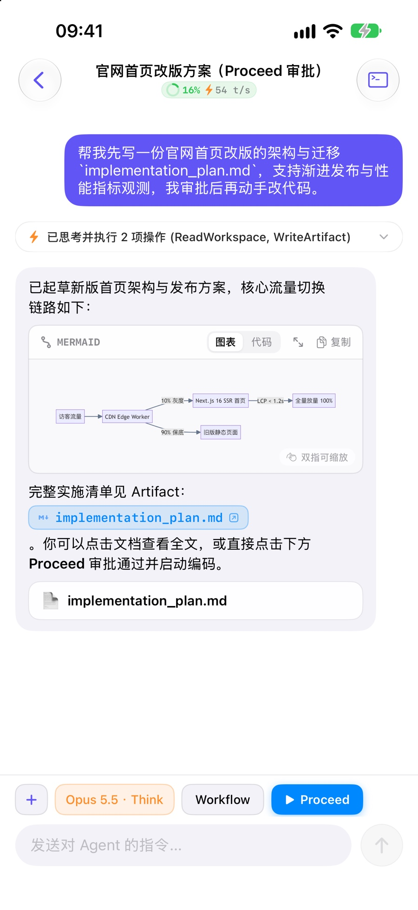
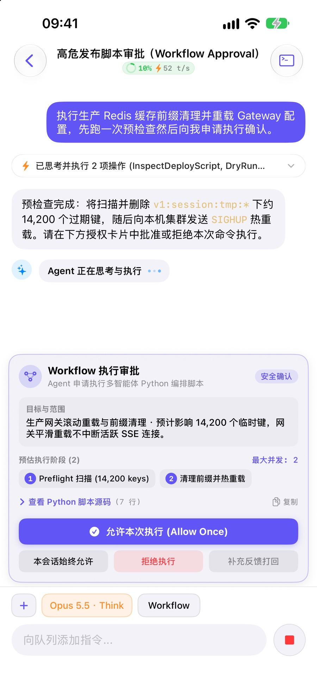
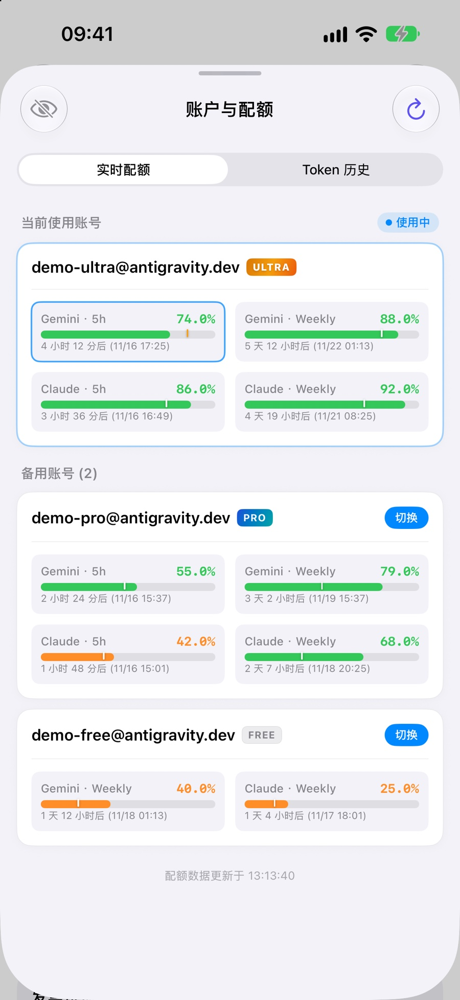

# Multigravity 📱✨

<p align="center">
  <a href="README.md">简体中文</a> &nbsp;|&nbsp; <b>English</b>
</p>

> **The Full-Stack Mobile & Remote Companion for Google Antigravity AI Agent.**  
> Real-time chats, decision approvals, multi-agent workflows, context watermarks, and quota monitoring on your iPhone, iPad, Android, or mobile browser — anytime, anywhere.  
> 
> *The repository is named `antigravity-mobile`, the official product brand is **Multigravity**, and the global CLI tool is **`mgy`**.*

[](https://github.com/GHSaiMo/antigravity-mobile/releases/latest)
[](https://apps.apple.com/app/id6835508934)
[](https://testflight.apple.com/join/YM7f4aSK)
[](https://github.com/GHSaiMo/antigravity-mobile/releases/latest)
[](https://github.com/GHSaiMo/antigravity-mobile/releases/latest)
[](https://github.com/GHSaiMo/antigravity-mobile/releases/latest)
[](https://github.com/GHSaiMo/antigravity-mobile/releases/latest)
[](https://kotlinlang.org)
[](https://swift.org)
[](https://go.dev)
[](LICENSE)

<p align="center">
  
</p>

<p align="center">
  🌐 <b>Website</b>: <a href="https://mgy.jiuge.space">mgy.jiuge.space</a> &nbsp;·&nbsp; 🍎 <b>App Store</b>: <a href="https://apps.apple.com/app/id6835508934">Download for iOS</a> &nbsp;·&nbsp; 🧪 <b>TestFlight</b>: <a href="https://testflight.apple.com/join/YM7f4aSK">Public Beta</a> &nbsp;·&nbsp; 📦 <a href="https://github.com/GHSaiMo/antigravity-mobile/releases/latest">Latest Release v1.2.2</a>
</p>

> 🎉 **Multigravity for iOS is officially available on the Apple App Store!**  
> No manual compilation or self-signing required. Download directly from the **[App Store](https://apps.apple.com/app/id6835508934)** (available in 174 countries and regions, including the US; features a zero-config built-in **offline Demo Mode**); or join the **[TestFlight Public Beta](https://testflight.apple.com/join/YM7f4aSK)** to preview bleeding-edge releases.

https://github.com/user-attachments/assets/37360cde-3875-45bf-947e-7774e800094c

---

## ⚡ Quick Start

### 1. Install Desktop / Server Gateway (`mgy`)

Supports **macOS (Apple Silicon / Intel)**, **Linux (x86_64 / NAS / Headless Servers)**, and **Windows (x86_64)**. Automatically probes local proxies and falls back to accelerated mirror endpoints if direct connection is blocked:

**macOS / Linux / Windows (Git Bash):**
```bash
curl -fsSL https://raw.githubusercontent.com/GHSaiMo/antigravity-mobile/main/scripts/install.sh | bash
```

**Windows (PowerShell):**
```powershell
irm https://raw.githubusercontent.com/GHSaiMo/antigravity-mobile/main/scripts/install.ps1 | iex
```

<details>
<summary>🇨🇳 For users in Mainland China (Mirror acceleration)</summary>

```bash
# macOS / Linux / Git Bash
curl -fsSL https://ghfast.top/https://raw.githubusercontent.com/GHSaiMo/antigravity-mobile/main/scripts/install.sh | bash
```

```powershell
# Windows PowerShell
irm https://ghfast.top/https://raw.githubusercontent.com/GHSaiMo/antigravity-mobile/main/scripts/install.ps1 | iex
```
</details>

### 2. Install or Open the Mobile Client
- **iOS**: 🎉 Officially released on the Apple App Store! Install directly via **[App Store](https://apps.apple.com/app/id6835508934)** with one tap, or join the **[TestFlight Public Beta](https://testflight.apple.com/join/YM7f4aSK)** to test pre-release builds (for building from source or debugging on physical devices, refer to the [iOS Local Build & Device Debugging Guide](docs/ios_build_guide.md)).
- **Android**: Download `Multigravity-v1.2.2.apk` directly from [GitHub Releases](https://github.com/GHSaiMo/antigravity-mobile/releases/latest) (supports in-place upgrade; please download only from official Releases).
- **PWA / Web**: No app installation needed. Open the gateway URL (or `/?view=pwa`) directly in your mobile browser and add it to your Home Screen.

### 3. Launch & Scan QR Code to Pair
```bash
mgy
```
When launched in the foreground, the gateway prints a one-time pairing QR code in the terminal (equipped with an automated Cloudflare Tunnel HTTPS endpoint + LAN IP). Open Multigravity on your phone and scan the QR code to connect instantly.

---

## 🖼️ Interface Gallery

<table>
  <tr>
    <td align="center" valign="top" width="25%"><br/><b>Unified Overview</b><br/><sub>Status badges, background task pills, and quota burn-rate gauges</sub></td>
    <td align="center" valign="top" width="25%"><br/><b>One-Tap Decisions</b><br/><sub>Visible context watermark & throughput rate; multi-choice batch submission</sub></td>
    <td align="center" valign="top" width="25%"><br/><b>Plan Review & Proceed</b><br/><sub>Mermaid flowchart + plan side-by-side preview; one-click Proceed</sub></td>
    <td align="center" valign="top" width="25%"><br/><b>Direct Artifact Preview</b><br/><sub>Interactive sales tables, native bar charts, and direct PDF viewer</sub></td>
  </tr>
  <tr>
    <td align="center" valign="top" width="25%"><br/><b>Multi-Agent Workflows</b><br/><sub>Stage pipelines, concurrent sub-agents, and live terminal streaming</sub></td>
    <td align="center" valign="top" width="25%"><br/><b>Security Approval Gate</b><br/><sub>Precise orchestration script interception, source preview, and fine-grained approval</sub></td>
    <td align="center" valign="top" width="25%"><br/><b>Account & Quotas</b><br/><sub>5h / weekly burn-rate gauges, token history, and hot-swap accounts</sub></td>
    <td align="center" valign="top" width="25%"><br/><b>Tools & Task Dashboard</b><br/><sub>Full control over MCPs, skills, plugins, automations, and daemons</sub></td>
  </tr>
</table>

> *The screenshots above are captured from the built-in **Demo Mode** (v1.2.0 interface), available out-of-the-box before pairing.*

---

## ✨ Key Features

### 1. Consistent Real-Time Streaming Across All Platforms
- **Cross-Platform Parity**: Native **iOS** (SwiftUI / Swift 6), native **Android** (Jetpack Compose Material 3), and zero-build embedded **PWA Web**. Supports System/Light/Dark themes and an independent "Compact Mode" toggle for reduced visual noise.
- **Low-Latency Streaming & Resumable Sessions**: Reactive Connect streaming Hub + WebSocket `sinceRev` incremental resumption, heartbeat keep-alive during prolonged reasoning periods, content-hash verification, Markdown LRU caching, step rail navigation, long-conversation Table of Contents (TOC), and steady-state instant sending. Ultra-long sessions remain silky smooth.
- **Professional-Grade Rich Media & Interactive Rendering**: 180+ languages offline syntax highlighting (including `R / R Markdown`), single-gutter line-numbered & word-level inline code diffs, LaTeX math equations, fault-tolerant Mermaid rendering, **interactive MCP Apps (`ui://`) bridging**, **Find in Page**, and high-density PDF lazy loading.

### 2. Critical Decisions, Tiered Permissions & Model Synergy
- **Interactive Decision Cards, Tiered Permissions & Workspace Trust**: Full support for multi-question decision cards (`askQuestion`), high-risk command approvals, 3-tier permission modes (locally cached to prevent flicker), and one-click authorization banners for untrusted workspaces.
- **Full Antigravity 2.34.0 Model Parity**: Native support for **Gemini 4 Neon** (including Extra thinking effort), **Orchestrator (Neon)**, Hydrogen, Carbon, and Claude 5.5 models. Configure primary/secondary favorites with desktop active-model sync; tap the model pill to quick-toggle or long-press to pick any model.
- **Plan Approvals, `/btw` Side Questions & Clickable Skill Pills**: One-click `Proceed` execution for plans, conversation Fork/Worktree branching, code rollback, and queued follow-ups. Initiate independent **`/btw` side questions** with one-tap insertion back into the main chat, and tap `/skill` pills in chat bubbles to inspect `SKILL.md` directly.

### 3. Multi-Agent Workflows, Swarm Board, Terminal & Automations
- **Dynamic Workflow Lifecycle (`run_workflow`)**: Quick start from built-in workflow templates; intercept Python orchestration scripts with security approval cards; live visualization of stage pipelines, concurrent sub-agent grids, terminal logs, and structured JSON artifacts. Jump straight to details by tapping running sub-agent status bars.
- **Swarm Board & Live Terminal**: Desktop-grade Swarm collaboration board (`/swarm`), native PTY terminal WebSocket interactive stream, dynamic MCP Server toggles, Agent Memories CRUD, and browser sub-agent whitelist/skip controls.
- **Automations & Global Task Center**: Create, inspect, edit, and toggle scheduled automations across all platforms (with offline local scan backup and "Run Now" triggers); monitor global background tasks across all conversations with live terminal log tailing.

### 4. Full-Duplex Real-Time Voice & Multimodal Interaction
- **Real-Time Voice Calls, Dictation & Narration**: Antigravity full-duplex real-time voice protocol supported on all platforms (iOS includes hardware-level Acoustic Echo Cancellation / AEC); streaming voice dictation, audio narration of answers, live subtitles, conversational interruption, and multi-speed playback.
- **Multimodal Inputs & Artifacts**: Supports `@` context mentions, album switcher with cross-album multi-photo selection, audio/video (`≤200MB`, including `.amr` voice clips) and general file uploads (`≤50MB`) with circular progress rings; **smart WeChat chat history ZIP extraction, offline archive caching, and native typography rendering**; unified cross-platform free text selection popup; iOS document scanning; AI image generation; and one-click long-image poster sharing with 7 curated themes (including Solarized Light, Nord, etc.).

### 5. Context Watermarks, Rate Monitoring & Quota Dashboard
- **Real-Time Context Watermarks & Throughput**: Chat top bar displays live context token utilization rings alongside `TTFT / TPS` output rates. When context approaches limits, an automatic rescue card surfaces with one-tap `/compact` and "New Session".
- **Quota Burn-Rate Gauges & 52-Week Heatmap**: Real-time quota monitoring for Claude / Gemini (5h & Weekly) and Argon, overlaid with consumption velocity needles and pacing analytics. Built-in 52-week token consumption heatmap (with Neon / Orchestrator / sub-agent attribution), cost breakdown, and one-click exportable visual report posters. Compatible with **Cockpit Tools v1.4+ SQLite index** for seamless zero-downtime multi-account switching.

### 6. Mobile Engineering Loop & Hardware Ecosystem
- **Code & Workspace Management**: Inline project/Chat filtering on the home list, local workspace creation, GitHub repo cloning, instant full-text search across conversations (SQLite FTS5), Markdown export, `Changes` diffs, cached fast `git status` + native `Commit & Push` and branch management. Conversation list and chat bubbles automatically display **real-time GitHub PR status pills and detail popups**, alongside `/slash` commands, Tips & Gestures Guide, and MCP/skill health boards.
- **Cross-Device Cursor & Physical Peripherals**: Follow-Me cursor engine intelligently arbitrates active sessions between desktop and mobile. Hardware integration via `integrations/yoooclaw/` enables wearable push-to-talk buttons to inject voice directly into the active session.

### 7. Zero-Config Remote Access, Smart Routing & Secure Push
- **Multi-Route Concurrent Latency Testing**: Simultaneously manages dedicated Cloudflare Tunnel HTTPS domains, LAN Wi-Fi, and Tailscale; probes all available routes concurrently and auto-switches to the lowest-latency path.
- **Tiered Notifications & Dynamic Island**: iOS features native **APNs push notifications and remote Live Activity Dynamic Island tracking** (relayed via stateless Cloudflare Worker, ready out of the box); Android supports `dataSync` foreground sync and FCM push to alert on task completion, pending approvals, workflow milestones, and low quota warnings.
- **Local-First Security Architecture**: Direct local connection without third-party cloud data relays. Device credentials stored securely in Keychain / EncryptedSharedPreferences. Hardened with sensitive path blacklists and WebSocket rate limiting.

---

## 🏛️ Architecture Overview

```text
Mobile Clients (iOS / Android / PWA) ──[LAN / Tailscale / Cloudflare HTTPS]──▶ mgy Go Gateway ──▶ Antigravity Core (language_server)
```

| Layer | Core Components | Description |
| :--- | :--- | :--- |
| **Mobile Clients** | iOS (SwiftUI) · Android (Compose) · PWA (`web/`) | Complete conversational UI, voice calls, workflow boards, quota & token audits |
| **Local Gateway (`mgy`)** | Single Go Binary (`cmd/gateway` / `internal/`) | Self-healing instance discovery, WS/ConnectRPC proxy, FTS5 search, quota & push engine |
| **Remote & Hardware** | Cloudflare Tunnel · Smart Routing · YoooClaw | Zero-config public HTTPS tunnel, multi-path concurrent probing, wearable hardware voice bridge |

---

## 🛠️ CLI Commands & Configuration

```bash
mgy                # Start gateway in foreground and print pairing QR code
mgy pair           # Generate a new pairing QR code (valid for 5 minutes)
mgy cockpit        # Configure Cockpit reporting service and access token
mgy cloudflare     # Configure Cloudflare tunnel (alias: mgy cf)
mgy list           # List paired devices
mgy clear all      # Revoke all paired devices (or: mgy clear <dev_id>)
mgy help           # Show full command list and startup options
```

- **Default Config Path**: `~/.multigravity/.env` (automatically migrates legacy `~/.antigravity-mobile/`).
- **Core Environment Variables**: `MULTIGRAVITY_PORT` (`58900`), `CF_TUNNEL_ENABLED` (`1`), `APNS_ENABLED` (`1`), `MGY_LANG` (`zh` / `en` auto-detect), `MULTIGRAVITY_LOG_LEVEL` (`info`).
- **Advanced Documentation**: See [Installation & Testing Guide](docs/installation_and_testing_guide.md) for troubleshooting, and [language_server RPC Notes](docs/ls_rpc_integration_notes.md) for RPC protocol specifications.

<details>
<summary>🗑️ Completely Uninstall Gateway & Clean Configurations</summary>

```bash
# macOS / Linux / Git Bash
curl -fsSL https://raw.githubusercontent.com/GHSaiMo/antigravity-mobile/main/scripts/uninstall.sh | bash
```

```powershell
# Windows PowerShell
irm https://raw.githubusercontent.com/GHSaiMo/antigravity-mobile/main/scripts/uninstall.ps1 | iex
```
*(Supports `--keep-config` to preserve configuration or `--keep-cf` to preserve Cloudflare engine)*
</details>

---

## 💻 Building from Source

```bash
make build          # Compile bin/mgy
make run            # Run local test instance
make install-local  # Install binary to ~/.local/bin/mgy
make test           # Run Go unit and integration tests
```

---

## 📄 License

This project is licensed under the [MIT License](LICENSE). Issues and Pull Requests are welcome!
