# Multigravity 📱✨

<p align="center">
  <a href="README.md">简体中文</a> &nbsp;|&nbsp; <a href="README_EN.md">English</a> &nbsp;|&nbsp; <b>日本語</b>
</p>

> **Google Antigravity AI Agent のためのフルスタック・モバイル＆リモートコンパニオン。**  
> いつでもどこでも、iPhone・iPhone Duo・iPad・Android・モバイルブラウザからリアルタイム対話、承認・意思決定、マルチエージェントワークフローの実行、コンテキスト使用率やクォータ消費の監視までシームレスに行えます。  
> 
> *リポジトリ名は `antigravity-mobile`、公式プロダクト名は **Multigravity**、グローバル CLI ツール名は **`mgy`** です。*

[](https://github.com/GHSaiMo/antigravity-mobile/releases/latest)
[](https://apps.apple.com/app/id6835508934)
[](https://testflight.apple.com/join/YM7f4aSK)
[](https://github.com/GHSaiMo/antigravity-mobile/releases/latest)
[](https://github.com/GHSaiMo/antigravity-mobile/releases/latest)
[](https://github.com/GHSaiMo/antigravity-mobile/releases/latest)
[](https://github.com/GHSaiMo/antigravity-mobile/releases/latest)
[](https://kotlinlang.org)
[](https://swift.org)
[](https://go.dev)
[](https://x.com/MultigravityApp)
[](LICENSE)

<p align="center">
  
</p>

<p align="center">
  🌐 <b>公式サイト</b>：<a href="https://mgy.jiuge.space/ja.html">mgy.jiuge.space/ja.html</a> &nbsp;·&nbsp; 🍎 <b>App Store</b>：<a href="https://apps.apple.com/app/id6835508934">iOS 正式版をダウンロード</a> &nbsp;·&nbsp; 🧪 <b>TestFlight</b>：<a href="https://testflight.apple.com/join/YM7f4aSK">パブリックベータ</a> &nbsp;·&nbsp; 📦 <a href="https://github.com/GHSaiMo/antigravity-mobile/releases/latest">最新リリース v1.2.7</a> &nbsp;·&nbsp; 𝕏 <a href="https://x.com/MultigravityApp">@MultigravityApp</a> &nbsp;·&nbsp; 💬 <a href="#wechat-group">WeChat ユーザーグループ</a> &nbsp;·&nbsp; ☕ <a href="#sponsor">スポンサー</a>
</p>

> 🎉 **Multigravity for iOS が Apple App Store にて正式公開されました！**  
> 手動ビルドや自己署名は不要です。**[App Store から Multigravity をダウンロード](https://apps.apple.com/app/id6835508934)** してすぐに使い始められます（日本・米国を含む世界 174 の国と地域で配信中。設定不要ですぐ試せる**オフラインデモモード**を内蔵）。最新の先行ビルドを試したい方は **[TestFlight パブリックベータ](https://testflight.apple.com/join/YM7f4aSK)** にも参加できます。

https://github.com/user-attachments/assets/37360cde-3875-45bf-947e-7774e800094c

---

## ⚡ クイックスタート

### 1. デスクトップ / サーバーゲートウェイ (`mgy`) のインストール

**macOS (Apple Silicon / Intel)**、**Linux (x86_64 / NAS / ヘッドレスサーバー)**、**Windows (x86_64)** に対応。インストール／アンインストールスクリプトは **日本語 / English / 简体中文** にネイティブ対応し、ローカルプロキシとロケールに応じて GitHub 直結または高速ミラーへ自動ルーティングします。

**macOS / Linux / Windows (Git Bash):**
```bash
curl -fsSL https://raw.githubusercontent.com/GHSaiMo/antigravity-mobile/main/scripts/install.sh | bash
```

**Windows (PowerShell):**
```powershell
irm https://raw.githubusercontent.com/GHSaiMo/antigravity-mobile/main/scripts/install.ps1 | iex
```

<details>
<summary>🇨🇳 中国本土向けミラー経由でのインストール</summary>

```bash
# macOS / Linux / Git Bash
curl -fsSL https://ghfast.top/https://raw.githubusercontent.com/GHSaiMo/antigravity-mobile/main/scripts/install.sh | bash
```

```powershell
# Windows PowerShell
irm https://ghfast.top/https://raw.githubusercontent.com/GHSaiMo/antigravity-mobile/main/scripts/install.ps1 | iex
```
</details>

### 2. モバイルクライアントのインストール・起動
- **iOS**：🎉 Apple App Store にて正式配信中。**[App Store](https://apps.apple.com/app/id6835508934)** からワンタップでインストールできるほか、**[TestFlight パブリックベータ](https://testflight.apple.com/join/YM7f4aSK)** で最新ビルドを先行体験できます（ソースコードからのビルドや実機デバッグを行う場合は [iOS ローカルビルド＆実機デバッグガイド](docs/ios_build_guide.md) を参照してください）。
- **Android**：[GitHub Releases](https://github.com/GHSaiMo/antigravity-mobile/releases/latest) から `Multigravity-v1.2.7.apk` を直接ダウンロードしてインストールしてください（`v1.2.7` より新しい独立プライベート署名＆SHA-256 検証付きアプリ内更新に対応し、「設定 → バージョン情報」や [Obtainium](https://github.com/ImranR98/Obtainium) で自動追従可能。`v1.2.6` 以前の旧版からは初回のみアンインストール後に導入してください）。
- **PWA / Web**：アプリをインストールせず、モバイルブラウザからゲートウェイ URL（または `/?view=pwa`）を開いてホーム画面に追加するだけで利用できます。

### 3. 起動して QR コードでペアリング
```bash
mgy
```
ゲートウェイをフォアグラウンドで起動すると、ワンタイムのペアリング用 QR コードがターミナルに表示されます（自動発行される Cloudflare Tunnel の HTTPS エンドポイントと LAN アドレスを同梱）。スマートフォンで Multigravity を開き、QR コードを読み取るだけで即座に接続できます。

---

## 🖼️ 画面イメージ

<table>
  <tr>
    <td align="center" valign="top" width="25%">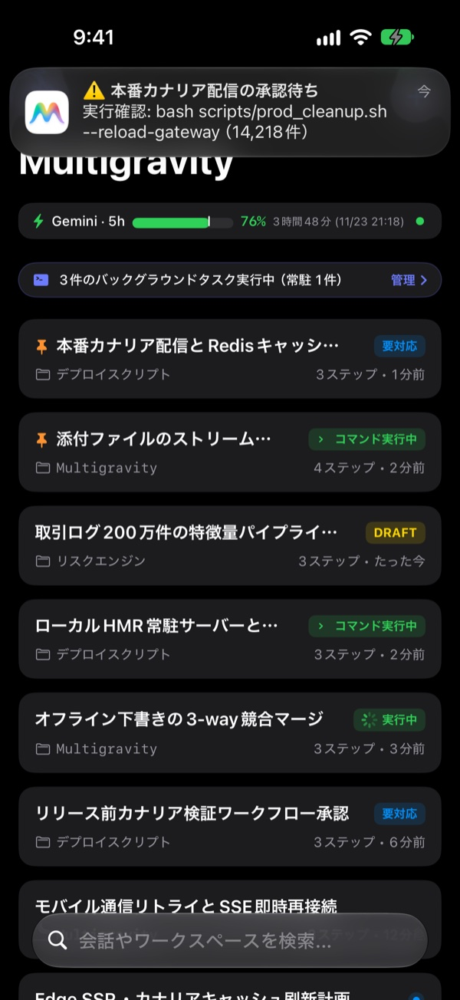<br/><b>全体俯瞰＆APNs 通知</b><br/><sub>純正 APNs 承認バナー、ステータスバッジ、バックグラウンドタスク、5h 枠</sub></td>
    <td align="center" valign="top" width="25%"><br/><b>Dynamic Island＆ウィジェット</b><br/><sub>コンパクト島の進捗表示＋ホーム画面 4×4 クォータ＆アクティブ会話</sub></td>
    <td align="center" valign="top" width="25%">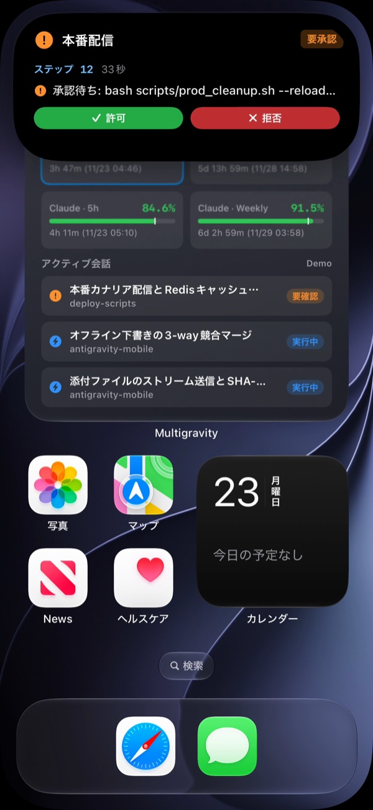<br/><b>Dynamic Island ワンタップ承認</b><br/><sub>長押し展開でアプリを開かず本番コマンドを即座に許可・拒否</sub></td>
    <td align="center" valign="top" width="25%">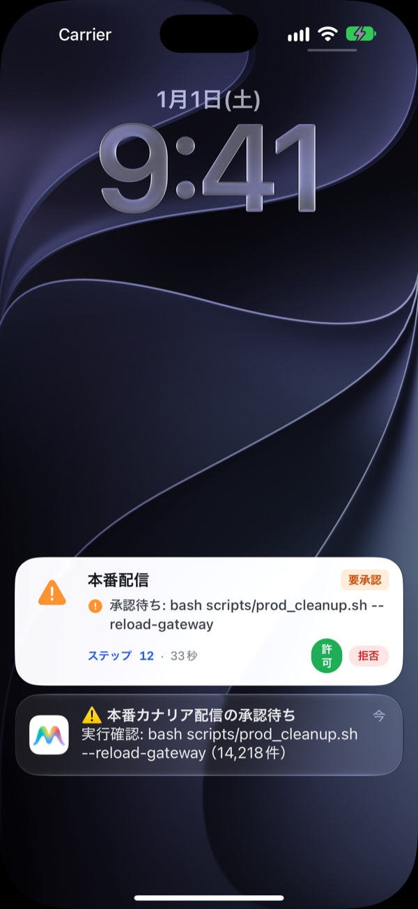<br/><b>ロック画面ライブアクティビティ</b><br/><sub>ステップ進捗と許可・拒否ボタン、APNs 通知をロック画面で完結</sub></td>
  </tr>
  <tr>
    <td align="center" valign="top" width="25%">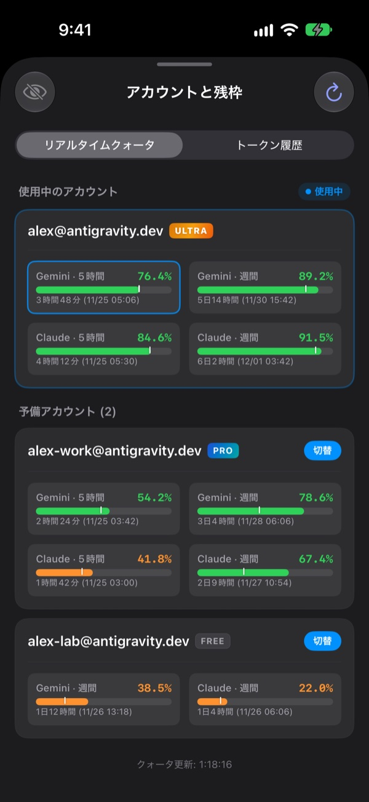<br/><b>アカウント＆クォータ</b><br/><sub>5時間 / 週間クォータの消費ペース計、Ultra / Pro / Free 即時切替</sub></td>
    <td align="center" valign="top" width="25%">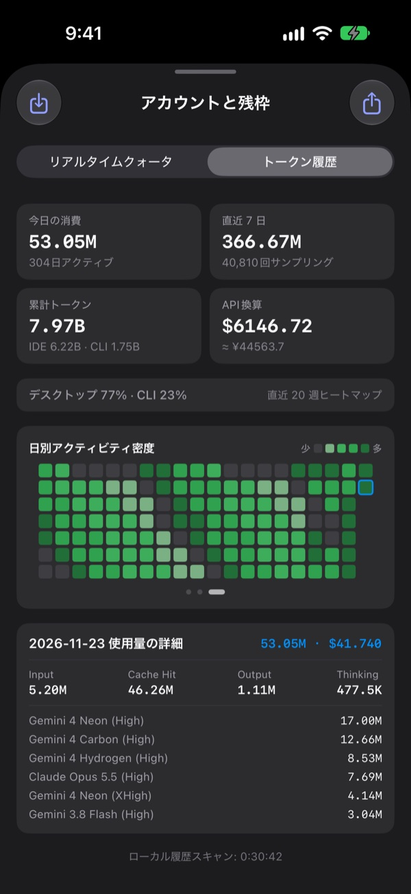<br/><b>トークン履歴＆内訳</b><br/><sub>直近 20 週ヒートマップ、キャッシュ率、Gemini 4 Neon 等モデル別集計</sub></td>
    <td align="center" valign="top" width="25%">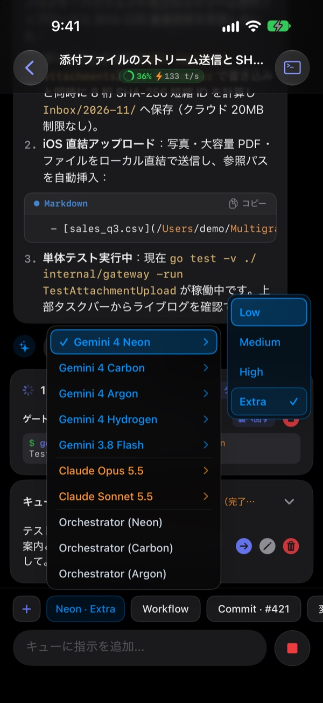<br/><b>2列モデルスイッチャー</b><br/><sub>Gemini 4 Neon (Extra/High)・Orchestrator・Opus 5.5 をスライド即切替</sub></td>
    <td align="center" valign="top" width="25%"><br/><b>高リスクコマンド承認</b><br/><sub>事前ドライラン結果と実行コマンドを明示し、細粒度で許可・拒否</sub></td>
  </tr>
  <tr>
    <td align="center" valign="top" width="25%"><br/><b>Swarm 蜂群グラフ</b><br/><sub>デスクトップ同等の `/teamwork` Hive トポロジと共有ボードを可視化</sub></td>
    <td align="center" valign="top" width="25%">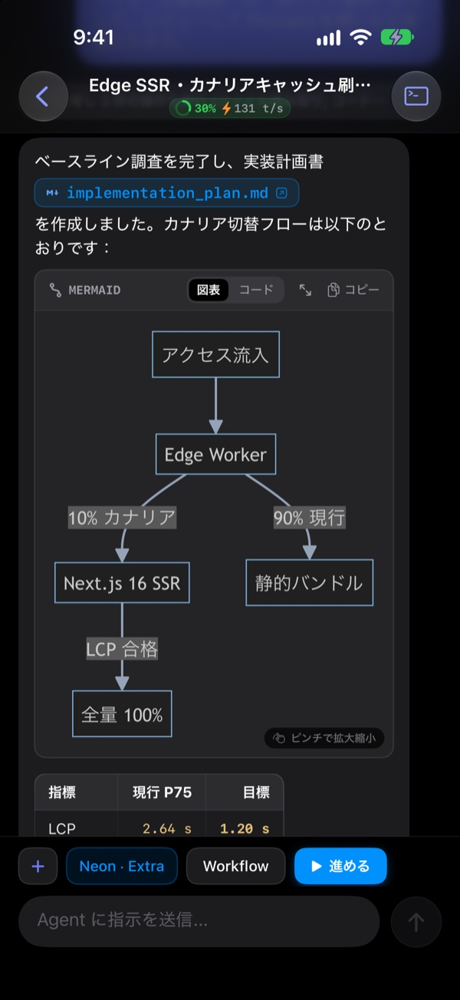<br/><b>プラン確認＆承認</b><br/><sub>オフライン Mermaid 構成図と実装計画を同時確認し、ワンタップで実行</sub></td>
    <td align="center" valign="top" width="25%">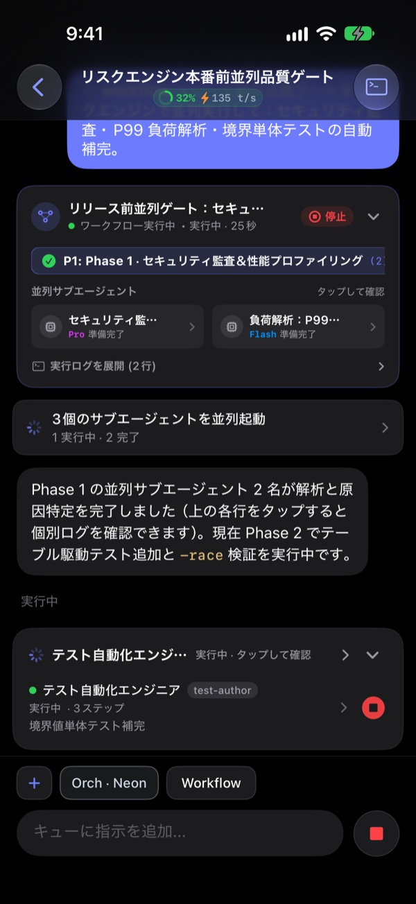<br/><b>並列サブエージェント</b><br/><sub>複数サブエージェントの進捗とステップをリアルタイムに一覧・詳細閲覧</sub></td>
    <td align="center" valign="top" width="25%">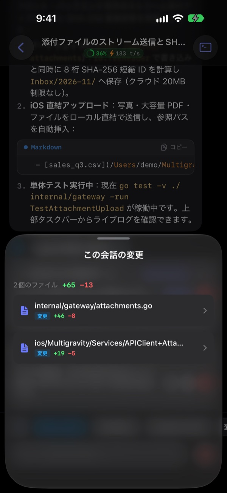<br/><b>コード変更＆Diff 確認</b><br/><sub>変更ファイル一覧、追加・削除行数、インライン Diff を手元でレビュー</sub></td>
  </tr>
</table>

> *上記スクリーンショットはクライアント内蔵の**オフラインデモモード**（v1.2.7 ネイティブ日本語ダーク UI・Antigravity 2.35 準拠および実機 Dynamic Island / ロック画面ライブアクティビティ / ホームウィジェット）で撮影したもので、ペアリング前でもすぐ操作感を体験できます。*

### 📱 iPhone Duo 折りたたみネイティブ対応

**iPhone Duo** および iOS 27.1+ の折りたたみ体験にネイティブ最適化しています。閉じたカバー画面では純正の右側縦ツールバーと中央揃えのチャットタイトルを維持し、180° 展開時は 342pt 比率の 2 ペイン作業台＋統一トップバーへ自動切替。**Book 90° 姿勢**では `ReservedRegion (.division)` により分割境界を物理的な折り目にぴったり揃え、開閉や回転時も `ChatSessionStore` でストリーミング会話・下書き・スクロール位置を途切れず保持します。

<p align="center">
  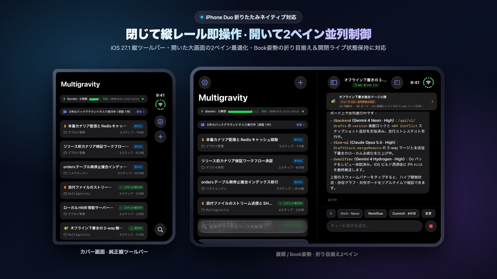
</p>

<table>
  <tr>
    <td align="center" valign="top" width="33%"><br/><b>展開 2 ペイン · 並列サブエージェント</b><br/><sub>342pt サイドバー＋統一ヘッダーで全会話・5h 枠と並列サブエージェントを同時操作</sub></td>
    <td align="center" valign="top" width="33%">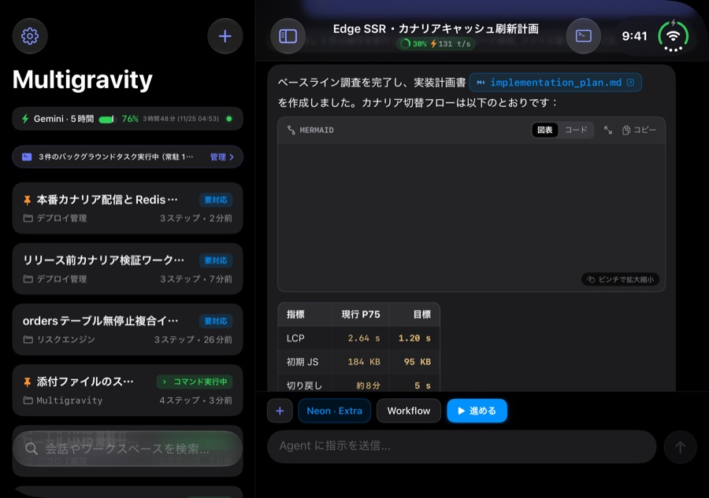<br/><b>展開 2 ペイン · Mermaid プラン承認</b><br/><sub>大画面でオフライン Mermaid 構成図と基準指標を確認し、ワンタップで Proceed</sub></td>
    <td align="center" valign="top" width="33%"><br/><b>展開 2 ペイン · ステップ計画＆計測</b><br/><sub>デスクトップ同等のステップチェックリスト・経過時間・並列タスクを 1 画面で監視</sub></td>
  </tr>
</table>

---

## ✨ 主な機能

### 1. 全プラットフォームで一貫したリアルタイムストリーミング体験
- **4 プラットフォーム＆3 言語完全対応**：ネイティブ **iOS**（SwiftUI / Swift 6、**iPhone Duo** 折りたたみ対応＆ホーム画面クイックアクション搭載）、ネイティブ **Android**（Jetpack Compose Material 3）、ビルド不要の組み込み **PWA Web**、および**デスクトップワークベンチ（`/`）**のすべてで**日本語 / English / 简体中文**の自動判別・手動切替に対応。システム連動 / ライト / ダーク外観に加え、独立した「コンパクトモード」切替も備えています。
- **デスクトップ同等のステップ計画カード・展開式 `Working` 行＆超長文ジャンプ**：全クライアントと iOS Live Activity で**ステップ計画カード（Step Plan Card）**、思考を初期折りたたみする `Working` 行、実行経過タイマーをネイティブ描画。リアクティブ Connect ストリーミング、**全ターン目次（Turn Outline）・オンデマンドジャンプ・末尾ウィンドウキャッシュ**・iOS アトミック固定スクロールにより、巨大セッションでもちらつきなく滑らかに閲覧できます。
- **プロ品質のリッチメディア描画と操作性**：180 言語以上のオフライン構文ハイライト（`R / R Markdown` 対応）、単一ガター行番号＋単語単位インラインコード Diff、LaTeX 数式、フォールトトレラントな Mermaid 描画、**2 段階高解像度画像プレビュー**、完全テーマトークン注入の **MCP Apps (`ui://`) / Generative UI 連携**、**ドキュメント＆HTML ページ内検索（Find in Page）**、高密度 PDF 遅延読み込みプレビューを備えています。

### 2. 重要な意思決定・段階的権限管理・モデル連携
- **インタラクティブ承認カード・高リスク Diff プレビュー・受信トレイ固定**：単一＆**複数選択 `ask_question`**、要約ヘッダーと折りたたみ Diff プレビュー付き高リスクコマンド承認、**Agent Inbox 承認ピン留め**、スコープ限定書き込み承認、3 段階の権限モード、プラグイン権限取り消し、未信頼ワークスペース警告からのワンタップ信頼付与に対応しています。
- **Antigravity 2.35.0 モデル世代に完全準拠**：**Gemini 4 Neon**（Extra 思考レベル含む）、サブメニュー整理された **Orchestrator (Neon / Carbon / Argon)**、Hydrogen / Carbon / Claude 5.5 シリーズをネイティブサポートし、モデル選択画面内で各プール残量を直接確認可能。メイン / サブのお気に入りモデルとデスクトップ側アクティブモデルの同期に対応し、タップで素早く切替、長押しで全モデルから選択できます。
- **プラン承認・刷新された `/btw` ブランチ・会話アーカイブ**：実行計画のワンタップ `Proceed`、**会話のアーカイブ／解除**、Fork / Worktree 分岐、コードロールバック、待機理由表示付きキューイング追質問に対応。独立した新しい **`/btw` サイド質問ブランチ**の結果をワンタップで本会話へ差し込めるほか、チャット内の `/skill` バッジをタップして `SKILL.md` を直接確認できます。

### 3. マルチエージェントワークフロー・Swarm ボード・ターミナル・自動化
- **動的ワークフロー全ライフサイクル (`run_workflow`)**：組み込みテンプレートからのクイック起動に対応。Python オーケストレーションスクリプトを安全承認カードで確実にインターセプトし、ステージパイプライン、**実稼働モデルを表示**するグループ化並列サブエージェントグリッド、ターミナルログ、JSON 成果物をリアルタイムに表示します。単一サブエージェント実行中はフローティングバーからワンタップで詳細画面へ移動できます。
- **Swarm ボードとリアルタイムターミナル**：デスクトップ同等の Swarm コラボレーションボード（`/swarm`）にページングと**稼働中 Swarm セッションの最上位表示＋ドット絵ミツバチバッジ**を搭載。ネイティブ PTY ターミナルの WebSocket 対話ストリーム、MCP Server の動的オン/オフ切替、Agent Memories の CRUD、ブラウザサブエージェントのスキップ/ホワイトリスト制御に対応します。
- **定期実行とグローバルタスクセンター**：全クライアントから Automations の作成・詳細確認・編集・有効/無効切替が可能（オフライン時のローカルスキャン補完および「今すぐ実行 Run Now」対応）。全セッションを横断してバックグラウンドタスクを監視し、ターミナルログの Tail をリアルタイム確認・更新できます。

### 4. フルデュプレックス音声対話とマルチモーダル入力・出力
- **リアルタイム音声通話・音声入力・読み上げ**：全プラットフォームで Antigravity フルデュプレックス音声プロトコルに対応（iOS ではハードウェアレベルの音響エコーキャンセル AEC を有効化）。ストリーミング音声ディクテーション、回答の音声読み上げ（Narration）、リアルタイム字幕、割り込み発話、倍速再生をサポートします。
- **マルチモーダル入出力と共有**：`@` コンテキストメンション、アルバム切替＆クロスアルバム複数枚選択、音声・動画（`≤200MB`、`.amr` 音声含む）および一般ファイル（`≤50MB`）の **実進捗＆冪等リトライ付き E2EE `req-bin2` ストリーミングアップロード**、**WeChat チャット履歴 ZIP の自動解析・オフラインアーカイブキャッシュ・ネイティブ閲覧**、クロスプラットフォーム共通の長押し自由テキスト選択、iOS ドキュメントスキャン、AI 画像生成、7 種の厳選テーマ（Solarized Light・Nord など）によるロング画像ポスター共有に対応します。

### 5. コンテキスト使用率・生成速度モニタリング・クォータダッシュボード
- **リアルタイムのコンテキスト水位・トークン集計・スループット**：チャット上部バーにコンテキスト使用率リング、**セッショントークン集計＆圧縮上限ガイド**、`TTFT / TPS` 生成速度をリアルタイム表示。上限に近づくと、ワンタップ `/compact` と「新規セッション開始」を備えたレスキューカードへ自動昇格します。
- **クォータ消費ペース計とスワイプ対応トークン履歴 3 ビューチャート**：Claude / Gemini（5時間枠＆週間枠）および Argon クォータをリアルタイム監視し、均等消費ペース針と消費傾向分析を重ねて表示。1 時間ごとの自動更新付き**トークン履歴 3 ビューカルーセル**（直近14日間の日別棒グラフ・モデル別累計内訳・20週間ヒートマップ、利用日数に応じたスマート初期表示付き）、コスト集計、選択チャート連動の WYSIWYG レポート画像出力を内蔵し、**Cockpit Tools v1.4+ SQLite インデックス**および **ULTRA 優先ソート**によるシームレスなマルチアカウント切替にも対応します。
- **フルサイズクォータ＆アクティブチャットウィジェット・車載詳細ステップ（iOS）**：全サイズ対応のクォータウィジェット（`Inline` / `Circular` / `Rectangular` / `Small`〜`ExtraLarge`）に加え、複数セッションの進行状況を一覧できる **`AgentStatusWidget`（アクティブチャット `Small`〜`Large`）** を搭載（iPhone / iPad / StandBy / iOS 26 CarPlay / Mac デスクトップ対応）。CarPlay ダッシュボードと Apple Watch スマートスタックでも、高コントラストな 2 段表示で現在ステップと承認待ちをひと目で確認できます。

### 6. モバイル完結の開発ループとハードウェア連携
- **コード＆ワークスペース管理**：ホーム画面でのプロジェクト / Chat インライン絞り込み、ローカルワークスペース新規作成、**ローカルフォルダ選択・ディレクトリ作成・非同期進捗＆自動登録を備えた GitHub リポジトリクローン**、SQLite FTS5 による会話全文の高速検索、Markdown エクスポート、`Changes` Diff 閲覧、キャッシュ最適化された `git status` とネイティブ `Commit & Push`・ブランチ管理に対応。セッション一覧とチャット内には **GitHub PR のリアルタイムステータスバッジと詳細ポップアップ**が自動連携され、`/slash` コマンド、操作ヒント＆ジェスチャーガイド、MCP / スキルヘルスダッシュボードも備えています。
- **クロスデバイスカーソルと物理ハードウェア連携**：Follow-Me カーソルエンジンがデスクトップとモバイル間のアクティブセッションを自動調停。`integrations/yoooclaw/` 経由でウェアラブルデバイスの物理ボタンから音声をアクティブセッションへ直接送信できます。

### 7. ゼロ知識 E2EE・マルチリージョンリレープール・セキュア通知
- **マルチリージョンリレープールとスマート経路選択**：ゼロ知識マルチ VPS リレープール（並列 RTT 計測・ヒステリシス固定・自動フェイルオーバー）、Cloudflare Tunnel 自動フォールバック、LAN Wi-Fi、Tailscale を一括管理し、並列疎通テストで最小遅延ルートへ自動切替します。
- **端末別 3 言語通知・停滞アラート・ロック画面クイック承認＆全 5 プール守護**：iOS の **APNs / ロック画面クイック承認 / Dynamic Island** と Android の **FCM** が**ペアリング端末ごとのアプリ言語**に合わせて**日本語 / English / 简体中文**で個別通知。カテゴリ別通知設定サブページ、タスク停滞アラート、高リスク承認タイトル、デスクトップ承認済みバナーの自動サイレント消去、全 5 プール守護（残量低下・公式早期リセット喜報・急減/アイドル減少）を網羅し、稼働中のみのホストスリープ防止も標準搭載します。
- **ゼロ知識 E2EE とローカルファースト設計**：全クライアント＆ゲートウェイに **`mgy-e2ee-v1` エンドツーエンド暗号化**（ECDH P-256 + HKDF-SHA256 + AES-256-GCM）を実装し、リレー経路での平文アクセスを厳格に拒否（HTTP 426）。既存デバイスのデュアルトラック自動移行、Keychain / EncryptedSharedPreferences による認証情報保護、機密パスブラックリスト、WebSocket レート制限も標準搭載しています。

---

## 🏛️ アーキテクチャ概要

```text
モバイルクライアント (iOS / Android / PWA) ──[LAN / Tailscale / Zero-Knowledge E2EE Relay / Cloudflare HTTPS]──▶ mgy Go ゲートウェイ ──▶ Antigravity Core (language_server)
```

| レイヤー | 主なコンポーネント | 役割 |
| :--- | :--- | :--- |
| **モバイルクライアント** | iOS (SwiftUI) · Android (Compose) · PWA (`web/`) | チャット UI、透過 E2EE 通信、リアルタイム音声、ワークフローボード、クォータ＆トークン監査 |
| **ローカルゲートウェイ (`mgy`)** | 単一 Go バイナリ (`cmd/gateway` / `internal/`) | インスタンス自動検出＆自己修復、E2EE リレー/WS/ConnectRPC ブリッジ、FTS5 検索、クォータ＆通知エンジン |
| **リモート＆周辺機器** | ゼロ知識リレー (`mgy-relay`) · Cloudflare Tunnel · YoooClaw | マルチリージョン E2EE リレー、Cloudflare 自動フォールバック、複数経路並列計測、ウェアラブル音声ブリッジ |

---

## 🛠️ 主な CLI コマンドと設定

```bash
mgy                # ゲートウェイをフォアグラウンド起動し、ペアリング用 QR コードを表示
mgy pair           # 新しいペアリング用 QR コードを発行（有効期限 5 分）
mgy cockpit        # Cockpit レポートサービスおよびトークンを設定
mgy cloudflare     # Cloudflare トンネルを設定（エイリアス: mgy cf）
mgy list           # ペアリング済みデバイス一覧を表示
mgy clear all      # ペアリング済みデバイスをすべて失効（個別指定: mgy clear <dev_id>）
mgy help           # 全コマンド一覧と起動オプションを表示
```

- **デフォルト設定パス**：`~/.multigravity/.env`（旧 `~/.antigravity-mobile/` からの自動マイグレーションに対応）。
- **主な環境変数**：`MULTIGRAVITY_PORT` (`58900`)、`CF_TUNNEL_ENABLED` (`1`)、`APNS_ENABLED` (`1`)、`MGY_PREVENT_SLEEP` (`1` 稼働時スリープ防止)、`MGY_LANG` (`zh` / `en` / `ja` 自動判別)、`MULTIGRAVITY_LOG_LEVEL` (`info`)。
- **詳細ドキュメント**：インストール検証やトラブルシューティングは [インストール＆運用テストガイド](docs/installation_and_testing_guide.md)、RPC プロトコル仕様は [language_server RPC 技術ノート](docs/ls_rpc_integration_notes.md) を参照してください。

<details>
<summary>🗑️ ゲートウェイの完全アンインストールと設定削除</summary>

```bash
# macOS / Linux / Git Bash
curl -fsSL https://raw.githubusercontent.com/GHSaiMo/antigravity-mobile/main/scripts/uninstall.sh | bash
```

```powershell
# Windows PowerShell
irm https://raw.githubusercontent.com/GHSaiMo/antigravity-mobile/main/scripts/uninstall.ps1 | iex
```
*（`--keep-config` で設定ファイルを保持、`--keep-cf` で Cloudflare エンジンを保持できます）*
</details>

---

## 💻 ソースからのビルド

```bash
make build          # bin/mgy をビルド
make run            # ローカルテスト起動
make install-local  # ~/.local/bin/mgy へインストール
make test           # Go のユニットテストおよび結合テストを実行
```

---

<a id="wechat-group"></a>
## 💬 WeChat ユーザーグループ

以下の QR コードをスキャンして **mgy WeChat ユーザーグループ** に参加できます。使い方の共有、フィードバック、最新リリースの確認などにご活用ください（QR コードの有効期限は 7 日間です。期限切れの場合は [Issue](https://github.com/GHSaiMo/antigravity-mobile/issues) よりお知らせください）：

<p align="center">
  
</p>

---

<a id="sponsor"></a>
## ☕ スポンサー・支援

**Multigravity** は完全無料・オープンソース・広告なしで、主要機能にペイウォールを設けていません。日々の開発効率向上に役立っていれば、WeChat Pay の投げ銭コードからコーヒー一杯ご馳走いただけると嬉しいです。いただいたご支援は以下の継続的な運用コストに優先的に充当します：

- 🌐 **マルチリージョン・ゼロ知識リレーノード (`mgy-relay`)** およびサーバー帯域費
- 🔔 **APNs / プッシュ通知リレー** および公式サイト・ドメイン運用費
- 🍎 **Apple Developer Program 年間メンバーシップ費**（iOS App Store 正式配信・TestFlight パブリックベータ維持のため）

<p align="center">
  
</p>

---

## 📄 ライセンス

本プロジェクトは [MIT License](LICENSE) のもとで公開されています。Issue や Pull Request を歓迎します！
