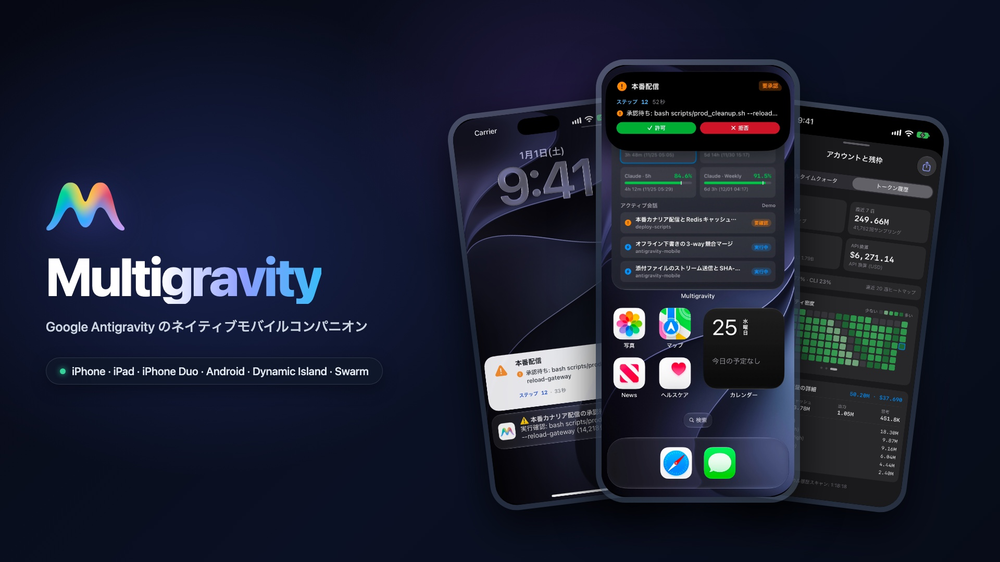
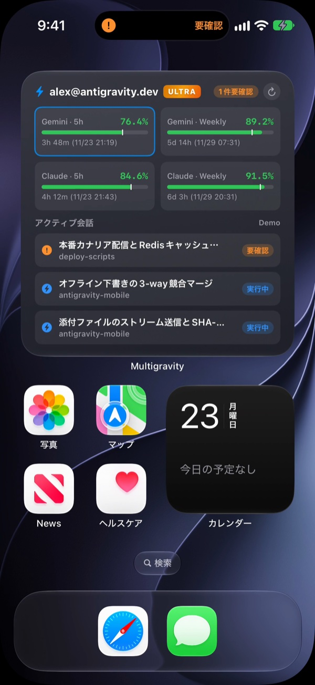
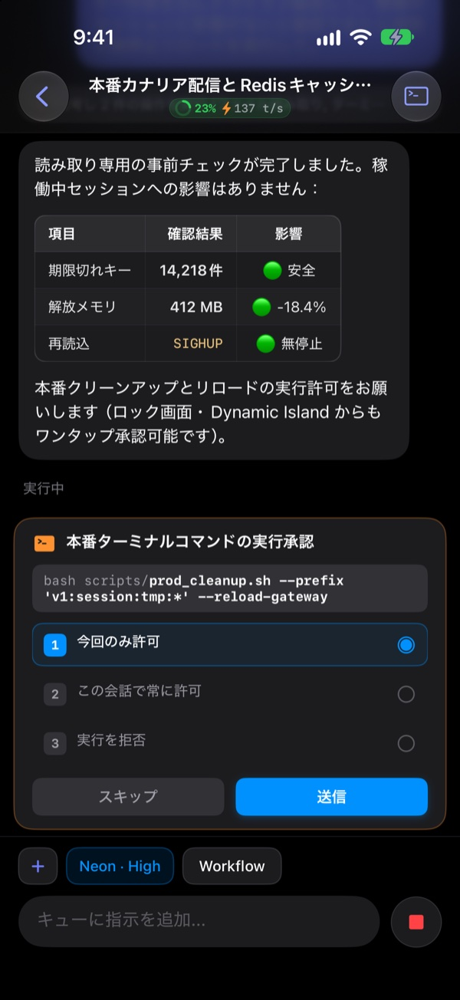
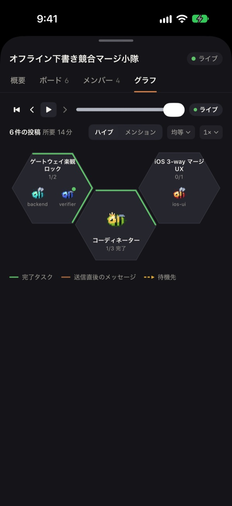
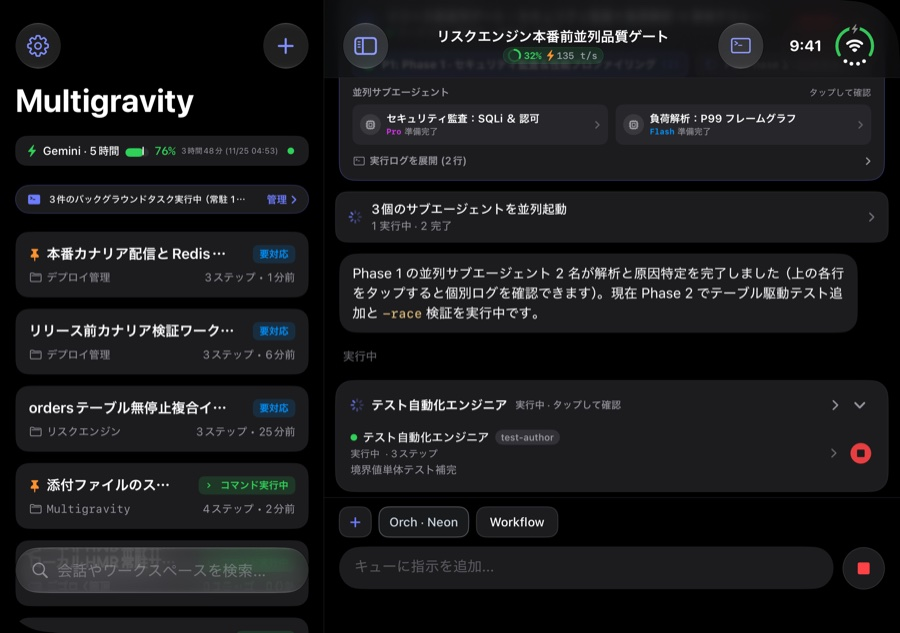
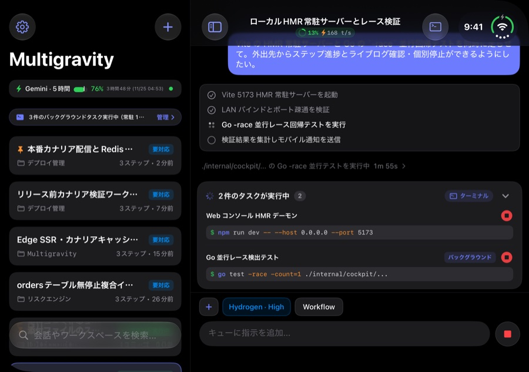

# Multigravity 📱✨

<p align="center">
  <a href="README.md">简体中文</a> &nbsp;|&nbsp; <a href="README_EN.md">English</a> &nbsp;|&nbsp; <b>日本語</b>
</p>

> **Google Antigravity AI Agent のためのフルスタック・モバイル＆リモートコンパニオン。**  
> いつでもどこでも、iPhone・iPhone Duo・iPad・Android・モバイルブラウザからリアルタイム対話、承認・意思決定、マルチエージェントワークフローの実行、コンテキスト使用率やクォータ消費の監視までシームレスに行えます。  
> 
> *リポジトリ名は `antigravity-mobile`、公式プロダクト名は **Multigravity**、グローバル CLI ツール名は **`mgy`** です。*

[](https://github.com/GHSaiMo/antigravity-mobile/releases/latest)
[](https://apps.apple.com/app/id6835508934)
[](https://testflight.apple.com/join/YM7f4aSK)
[](https://github.com/GHSaiMo/antigravity-mobile/releases/latest)
[](https://github.com/GHSaiMo/antigravity-mobile/releases/latest)
[](https://github.com/GHSaiMo/antigravity-mobile/releases/latest)
[](https://github.com/GHSaiMo/antigravity-mobile/releases/latest)
[](https://kotlinlang.org)
[](https://swift.org)
[](https://go.dev)
[](https://x.com/MultigravityApp)
[](https://t.me/mgyapp)
[](LICENSE)

<p align="center">
  
</p>

<p align="center">
  🌐 <b>公式サイト</b>：<a href="https://multigravity.app/ja.html">multigravity.app/ja.html</a> &nbsp;·&nbsp; 🍎 <b>App Store</b>：<a href="https://apps.apple.com/app/id6835508934">iOS 正式版をダウンロード</a> &nbsp;·&nbsp; 🧪 <b>TestFlight</b>：<a href="https://testflight.apple.com/join/YM7f4aSK">パブリックベータ</a> &nbsp;·&nbsp; 📦 <a href="https://github.com/GHSaiMo/antigravity-mobile/releases/latest">最新リリース v1.2.8</a> &nbsp;·&nbsp; 𝕏 <a href="https://x.com/MultigravityApp">@MultigravityApp</a> &nbsp;·&nbsp; ✈️ <a href="https://t.me/mgyapp">Telegram</a> &nbsp;·&nbsp; 💬 <a href="#wechat-group">WeChat ユーザーグループ</a> &nbsp;·&nbsp; ☕ <a href="#sponsor">スポンサー</a>
</p>

> 🎉 **Multigravity for iOS が Apple App Store にて正式公開されました！**  
> 手動ビルドや自己署名は不要です。**[App Store から Multigravity をダウンロード](https://apps.apple.com/app/id6835508934)** してすぐに使い始められます（日本・米国を含む世界 174 の国と地域で配信中。設定不要ですぐ試せる**オフラインデモモード**を内蔵）。最新の先行ビルドを試したい方は **[TestFlight パブリックベータ](https://testflight.apple.com/join/YM7f4aSK)** にも参加できます。

https://github.com/user-attachments/assets/37360cde-3875-45bf-947e-7774e800094c

---

## ⚡ クイックスタート

### 1. デスクトップ / サーバーゲートウェイ (`mgy`) のインストール

**macOS (Apple Silicon / Intel)**、**Linux (x86_64 / NAS / ヘッドレスサーバー)**、**Windows (x86_64)** に対応。インストール／アンインストールスクリプトは **日本語 / English / 简体中文** にネイティブ対応し、ローカルプロキシとロケールに応じて GitHub 直結または高速ミラーへ自動ルーティングします。

**macOS / Linux / Windows (Git Bash):**
```bash
curl -fsSL https://raw.githubusercontent.com/GHSaiMo/antigravity-mobile/main/scripts/install.sh | bash
```

**Windows (PowerShell):**
```powershell
irm https://raw.githubusercontent.com/GHSaiMo/antigravity-mobile/main/scripts/install.ps1 | iex
```

<details>
<summary>🇨🇳 中国本土向けミラー経由でのインストール</summary>

```bash
# macOS / Linux / Git Bash
curl -fsSL https://ghfast.top/https://raw.githubusercontent.com/GHSaiMo/antigravity-mobile/main/scripts/install.sh | bash
```

```powershell
# Windows PowerShell
irm https://ghfast.top/https://raw.githubusercontent.com/GHSaiMo/antigravity-mobile/main/scripts/install.ps1 | iex
```
</details>

### 2. モバイルクライアントのインストール・起動
- **iOS**：🎉 Apple App Store にて正式配信中。**[App Store](https://apps.apple.com/app/id6835508934)** からワンタップでインストールできるほか、**[TestFlight パブリックベータ](https://testflight.apple.com/join/YM7f4aSK)** で最新ビルドを先行体験できます（ソースコードからのビルドや実機デバッグを行う場合は [iOS ローカルビルド＆実機デバッグガイド](docs/ios_build_guide.md) を参照してください）。
- **Android**：[GitHub Releases](https://github.com/GHSaiMo/antigravity-mobile/releases/latest) から `Multigravity-v1.2.8.apk` を直接ダウンロードしてインストールしてください（独立プライベート署名＆SHA-256 検証付きアプリ内更新に対応し、「設定 → バージョン情報」や [Obtainium](https://github.com/ImranR98/Obtainium) で自動追従可能。`v1.2.7` / `v1.2.8-beta.*` からはそのまま上書き更新でき、`v1.2.6` 以前の旧版のみ初回アンインストールが必要です）。
- **PWA / Web**：アプリをインストールせず、モバイルブラウザからゲートウェイ URL（または `/?view=pwa`）を開いてホーム画面に追加するだけで利用できます。

### 3. 起動して QR コードでペアリング
```bash
mgy
```
ゲートウェイをフォアグラウンドで起動すると、ワンタイムのペアリング用 QR コードがターミナルに表示されます（自動発行される Cloudflare Tunnel の HTTPS エンドポイントと LAN アドレスを同梱）。スマートフォンで Multigravity を開き、QR コードを読み取るだけで即座に接続できます。

---

## 🖼️ 画面イメージ

<table>
  <tr>
    <td align="center" valign="top" width="25%"><br/><b>全体俯瞰＆APNs 通知</b><br/><sub>純正 APNs 承認バナー、ステータスバッジ、バックグラウンドタスク、5h 枠</sub></td>
    <td align="center" valign="top" width="25%"><br/><b>Dynamic Island＆ウィジェット</b><br/><sub>コンパクト島の進捗表示＋ホーム画面 4×4 クォータ＆アクティブ会話</sub></td>
    <td align="center" valign="top" width="25%"><br/><b>Dynamic Island ワンタップ承認</b><br/><sub>長押し展開でアプリを開かず本番コマンドを即座に許可・拒否</sub></td>
    <td align="center" valign="top" width="25%"><br/><b>ロック画面ライブアクティビティ</b><br/><sub>ステップ進捗と許可・拒否ボタン、APNs 通知をロック画面で完結</sub></td>
  </tr>
  <tr>
    <td align="center" valign="top" width="25%"><br/><b>アカウント＆クォータ</b><br/><sub>5時間 / 週間クォータの消費ペース計、Ultra / Pro / Free 即時切替</sub></td>
    <td align="center" valign="top" width="25%"><br/><b>トークン履歴＆内訳</b><br/><sub>直近 20 週ヒートマップ、キャッシュ率、Gemini 4 Neon 等モデル別集計</sub></td>
    <td align="center" valign="top" width="25%"><br/><b>2列モデルスイッチャー</b><br/><sub>Gemini 4 Neon (Extra/High)・Orchestrator・Opus 5.5 をスライド即切替</sub></td>
    <td align="center" valign="top" width="25%"><br/><b>高リスクコマンド承認</b><br/><sub>事前ドライラン結果と実行コマンドを明示し、細粒度で許可・拒否</sub></td>
  </tr>
  <tr>
    <td align="center" valign="top" width="25%"><br/><b>Swarm 蜂群グラフ</b><br/><sub>デスクトップ同等の `/teamwork` Hive トポロジと共有ボードを可視化</sub></td>
    <td align="center" valign="top" width="25%"><br/><b>プラン確認＆承認</b><br/><sub>オフライン Mermaid 構成図と実装計画を同時確認し、ワンタップで実行</sub></td>
    <td align="center" valign="top" width="25%"><br/><b>並列サブエージェント</b><br/><sub>複数サブエージェントの進捗とステップをリアルタイムに一覧・詳細閲覧</sub></td>
    <td align="center" valign="top" width="25%"><br/><b>コード変更＆Diff 確認</b><br/><sub>変更ファイル一覧、追加・削除行数、インライン Diff を手元でレビュー</sub></td>
  </tr>
</table>

> *上記スクリーンショットはクライアント内蔵の**オフラインデモモード**（v1.2.7 ネイティブ日本語ダーク UI・Antigravity 2.35 準拠および実機 Dynamic Island / ロック画面ライブアクティビティ / ホームウィジェット）で撮影したもので、ペアリング前でもすぐ操作感を体験できます。*

### 📱 iPhone Duo 折りたたみネイティブ対応

**iPhone Duo** および iOS 27.1+ の折りたたみ体験にネイティブ最適化しています。閉じたカバー画面では純正の右側縦ツールバーと中央揃えのチャットタイトルを維持し、180° 展開時は 342pt 比率の 2 ペイン作業台＋統一トップバーへ自動切替。**Book 90° 姿勢**では `ReservedRegion (.division)` により分割境界を物理的な折り目にぴったり揃え、開閉や回転時も `ChatSessionStore` でストリーミング会話・下書き・スクロール位置を途切れず保持します。

<p align="center">
  
</p>

<table>
  <tr>
    <td align="center" valign="top" width="33%"><br/><b>展開 2 ペイン · 並列サブエージェント</b><br/><sub>342pt サイドバー＋統一ヘッダーで全会話・5h 枠と並列サブエージェントを同時操作</sub></td>
    <td align="center" valign="top" width="33%"><br/><b>展開 2 ペイン · Mermaid プラン承認</b><br/><sub>大画面でオフライン Mermaid 構成図と基準指標を確認し、ワンタップで Proceed</sub></td>
    <td align="center" valign="top" width="33%"><br/><b>展開 2 ペイン · ステップ計画＆計測</b><br/><sub>デスクトップ同等のステップチェックリスト・経過時間・並列タスクを 1 画面で監視</sub></td>
  </tr>
</table>

---

## ✨ 主な機能

### 1. 全プラットフォームで一貫したリアルタイム体験と AI アシストスイート
- **4 プラットフォーム・多言語対応＆マルチゲートウェイ切替**：ネイティブ **iOS**（SwiftUI / Swift 6、**iPhone Duo** 折りたたみ対応＆ホーム画面クイックアクション搭載）、ネイティブ **Android**（Jetpack Compose Material 3）、組み込み **PWA Web**、**デスクトップワークベンチ（`/`）**のすべてで**日本語 / English / 简体中文**（その他言語は英語 UI へクリーンにフォールバック）に対応。**複数ホストの独立管理・横スワイプ切替**や、「設定 → バージョン情報 → ホスト更新」からの `mgy` 遠隔ワンタップ更新を備えています。
- **AI アシストスイート**：ローカル Antigravity ネイティブ RPC でステートレス実行（余計な会話生成なし・端末間設定同期）。**スマート翻訳**（タイトル・ステップ計画・リアルタイム状態・iOS Live Activity 翻訳。英語環境では既定オフ＆端末別抑止を維持し、日本語や仏語・韓国語など非中日英の母語翻訳にも動的対応）、**次プロンプト提案チップ**（タップで入力・1.5 秒長押しプログレス直送信）、**ロングセッション記憶保護**（`/compact` 後の自動再注入 Hook）を搭載します。
- **ステップ計画カード・展開式 `Working` 行＆リッチメディア**：全クライアントと iOS Live Activity で**ステップ計画カード**・`Working` 行・**全ターン目次＆末尾ウィンドウキャッシュ**をネイティブ描画。180 言語以上の構文ハイライト、単語単位 Diff、LaTeX、Mermaid、**2 段階高解像度画像プレビュー**、**インタラクティブ HTML 成果物カード**、テーマ注入 **MCP Apps (`ui://`) / Generative UI**、高密度 PDF プレビューを備えています。

### 2. 重要な意思決定・Antigravity 2.35.2 ネイティブ機能・モデル連携
- **インタラクティブ承認・4 段階権限・高リスク Diff プレビュー**：単一＆**複数選択 `ask_question`**、要約ヘッダー＋折りたたみ Diff 付き高リスクコマンド承認、**Agent Inbox 承認ピン留め**、スコープ限定書き込み承認、**4 段階の権限モード**、プラグイン権限取り消し、未信頼ワークスペースのワンタップ信頼付与に対応します。
- **Antigravity 2.35.2 に完全準拠**：**Gemini 4 Neon**（`XHigh` 思考レベル）、サブメニュー整理された **Orchestrator (Neon / Carbon / Argon)**、Hydrogen / Carbon / Claude 5.5 とプール残量表示に対応。さらに**ブラウザライブプレビュー＆操作引き継ぎ**、**リモート SSH ホスト管理**、**プラグインマーケット検索＆Plugin/MCP OAuth 完結**、ワークスペース検索、成果物スナップショット、Worktree PR、お気に入り星印をネイティブ搭載します。
- **プラン承認・`/btw` 引き出しドロワー・複数スラッシュ・アーカイブ**：ワンタップ `Proceed`、**会話アーカイブ**、Fork / Worktree 分岐、コードロールバック、1 通のメッセージでの**複数順序付き `/slash` コマンド**実行に対応。カード下部に収まる **`/btw` 引き出しドロワー＆ツリー接続線**と `/skill` タッププレビューも備えています。

### 3. マルチエージェントワークフロー・Swarm ボード・ターミナル・自動化
- **動的ワークフロー全ライフサイクル (`run_workflow`)**：組み込みテンプレートからのクイック起動に対応。Python オーケストレーションスクリプトを安全承認カードで確実にインターセプトし、ステージパイプライン、**実稼働モデルを表示**するグループ化並列サブエージェントグリッド、ターミナルログ、JSON 成果物をリアルタイムに表示します。
- **Swarm ボードとリアルタイムターミナル**：デスクトップ同等の Swarm コラボレーションボード（`/swarm`）にページング、**完全 Markdown ネストリスト＆最下部ジャンプボタン**、**稼働中 Swarm セッションの最上位表示＋ドット絵ミツバチバッジ**を搭載。ネイティブ PTY ターミナル WebSocket、MCP Server 動的切替、Agent Memories CRUD に対応します。
- **デスクトップ準拠の定期実行＆グローバルタスクセンター**：全クライアントで **Prompt からの自動化作成**・詳細確認・編集・今すぐ実行に対応（スケジュール起動プロンプト吹き出しは初期折りたたみ＆タップ展開）。全セッションのバックグラウンドタスクとターミナルログ Tail を監視できます。

### 4. フルデュプレックス音声対話とマルチモーダル入力・出力
- **リアルタイム音声通話・音声入力・読み上げ**：全プラットフォームで Antigravity フルデュプレックス音声プロトコルに対応（iOS ではハードウェアレベルの音響エコーキャンセル AEC を有効化）。ストリーミング音声ディクテーション、回答の音声読み上げ（Narration）、リアルタイム字幕、割り込み発話、倍速再生をサポートします。
- **マルチモーダル入出力と共有**：`@` コンテキストメンション、アルバム切替＆クロスアルバム複数枚選択、音声・動画（`≤200MB`、`.amr` 音声含む）および一般ファイル（`≤50MB`）の **実進捗＆冪等リトライ付き E2EE `req-bin2` ストリーミングアップロード**、**WeChat チャット履歴 ZIP の自動解析・オフラインアーカイブキャッシュ・ネイティブ閲覧**、クロスプラットフォーム共通の長押し自由テキスト選択、iOS ドキュメントスキャン、AI 画像生成、7 種の厳選テーマ（Solarized Light・Nord など）によるロング画像ポスター共有に対応します。

### 5. コンテキスト内訳・しきい値自動切替・クォータダッシュボード
- **リアルタイムのコンテキスト内訳・トークン集計・スループット**：チャット上部バーにコンテキスト使用率リング、**コンテキスト内訳（Context Breakdown）と Top 3 消費ステップへのワンタップジャンプ**、トークン集計・圧縮上限ガイド、`TTFT / TPS` 生成速度を表示。上限付近ではワンタップ `/compact` レスキューカードへ自動昇格します。
- **アイドル安全自動切替・消費ペース計＆トークン履歴 3 ビューチャート**：Claude / Gemini（5時間枠＆週間枠）および Argon をリアルタイム監視し、**しきい値によるアイドル待機後の安全な自動アカウント切替**と動的料金・消費推定に対応。1 時間ごとの自動更新付き**トークン履歴 3 ビューカルーセル**、WYSIWYG レポート画像出力、**Cockpit Tools v1.4+ SQLite インデックス**＆ **ULTRA 優先ソート**を備えています。
- **フルサイズクォータ＆アクティブチャットウィジェット・車載詳細ステップ（iOS）**：全サイズ対応のクォータウィジェット（`Inline` / `Circular` / `Rectangular` / `Small`〜`ExtraLarge`）に加え、複数セッションの進行状況を一覧できる **`AgentStatusWidget`（アクティブチャット `Small`〜`Large`）** を搭載（iPhone / iPad / StandBy / iOS 26 CarPlay / Mac デスクトップ対応）。CarPlay ダッシュボードと Apple Watch スマートスタックでも、高コントラストな 2 段表示で現在ステップと承認待ちをひと目で確認できます。

### 6. モバイル完結の開発ループとハードウェア連携
- **コード＆ワークスペース管理**：ホーム画面でのプロジェクト / Chat インライン絞り込み、ローカルワークスペース新規作成、**ローカルフォルダ選択・ディレクトリ作成・非同期進捗＆自動登録を備えた GitHub リポジトリクローン**、SQLite FTS5 による会話全文の高速検索、Markdown エクスポート、`Changes` Diff 閲覧、キャッシュ最適化された `git status` とネイティブ `Commit & Push`・ブランチ管理に対応。セッション一覧とチャット内には **GitHub PR のリアルタイムステータスバッジと詳細ポップアップ**が自動連携され、`/slash` コマンド、操作ヒント＆ジェスチャーガイド、MCP / スキルヘルスダッシュボードも備えています。
- **クロスデバイスカーソルと物理ハードウェア連携**：Follow-Me カーソルエンジンがデスクトップとモバイル間のアクティブセッションを自動調停。`integrations/yoooclaw/` 経由でウェアラブルデバイスの物理ボタンから音声をアクティブセッションへ直接送信できます。

### 7. ゼロ知識 E2EE・マルチリージョンリレープール・セキュア通知
- **パケットロス感知マルチリージョンリレープール＆BYO-Relay**：ゼロ知識マルチ VPS リレープール（ロス感知マルチサンプル計測・ヒステリシス固定・ランタイム Ping エスケープ・自動フェイルオーバー）と **BYO-Relay** に加え、Cloudflare Tunnel・LAN Wi-Fi・Tailscale から最小遅延ルートへ自動切替します。
- **端末別多言語通知・通知秘匿・ロック画面承認＆全 5 プール守護**：iOS の **APNs / ロック画面クイック承認 / Dynamic Island** と Android の **FCM** が端末ごとの言語に合わせて通知（非中日英は英語へフォールバック）。**通知本文秘匿（`MGY_PUSH_REDACT`）**、カテゴリ別通知設定、停滞アラート、高リスク承認タイトル、承認済みバナー自動消去、全 5 プール守護、稼働中ホストスリープ防止を標準搭載します。
- **ゼロ知識 E2EE v2 とローカルファースト設計**：全クライアント＆ゲートウェイに **E2EE v2 エンドツーエンド暗号化**（ECDH P-256 + HKDF-SHA256 + AES-256-GCM＋リプレイ・WS 連番保護）と強制 E2EE を実装し、リレー経路での平文アクセスを厳格に拒否（HTTP 426）。Keychain / EncryptedSharedPreferences 保護、機密パスブラックリスト、WebSocket レート制限も標準搭載しています。

---

## 🏛️ アーキテクチャ概要

```text
モバイルクライアント (iOS / Android / PWA) ──[LAN / Tailscale / Zero-Knowledge E2EE Relay / Cloudflare HTTPS]──▶ mgy Go ゲートウェイ ──▶ Antigravity Core (language_server)
```

| レイヤー | 主なコンポーネント | 役割 |
| :--- | :--- | :--- |
| **モバイルクライアント** | iOS (SwiftUI) · Android (Compose) · PWA (`web/`) | チャット UI、透過 E2EE 通信、リアルタイム音声、ワークフローボード、クォータ＆トークン監査 |
| **ローカルゲートウェイ (`mgy`)** | 単一 Go バイナリ (`cmd/gateway` / `internal/`) | インスタンス自動検出＆自己修復、E2EE リレー/WS/ConnectRPC ブリッジ、FTS5 検索、クォータ＆通知エンジン |
| **リモート＆周辺機器** | ゼロ知識リレー (`mgy-relay`) · Cloudflare Tunnel · YoooClaw | マルチリージョン E2EE リレー、Cloudflare 自動フォールバック、複数経路並列計測、ウェアラブル音声ブリッジ |

---

## 🛠️ 主な CLI コマンドと設定

```bash
mgy                  # ゲートウェイをフォアグラウンド起動し、ペアリング用 QR コードを表示
mgy service install  # OS ネイティブ自動起動サービスを登録（Windows タスク スケジューラ / macOS launchd / Linux systemd）
mgy service status   # 自動起動サービス状態・ログを確認（start / stop / restart / logs -f / uninstall 対応）
mgy update           # mgy ゲートウェイを確認・ワンタップ自己更新（バージョン指定可: mgy update v1.2.8）
mgy pair             # 新しいペアリング用 QR コードを発行（-copy / -uri / -hub 6 桁 Hub コード対応）
mgy hub              # マルチホスト集約 Hub を起動（LAN 内の mgy を自動スキャン、-headless 対応）
mgy hub pair <name>  # 検出された LAN 内 mgy を 6 桁確認コードでペアリング接続
mgy cockpit          # Cockpit レポートサービスおよびトークンを設定
mgy cloudflare       # Cloudflare トンネルを設定（エイリアス: mgy cf）
mgy list             # ペアリング済みデバイス一覧を表示
mgy clear all        # ペアリング済みデバイスをすべて失効（個別指定: mgy clear <dev_id>）
mgy help             # 全コマンド一覧と起動オプションを表示
```

- **デフォルト設定パス**：`~/.multigravity/.env`（旧 `~/.antigravity-mobile/` からの自動マイグレーションに対応）。
- **主な環境変数**：`MULTIGRAVITY_PORT` (`58900`)、`CF_TUNNEL_ENABLED` (`1`)、`APNS_ENABLED` (`1`)、`MGY_PREVENT_SLEEP` (`1` 稼働時スリープ防止)、`MGY_LANG` (`zh` / `en` / `ja` 自動判別)、`MULTIGRAVITY_LOG_LEVEL` (`info`)。
- **詳細ドキュメント**：複数 PC の LAN 集約は [マルチホスト Hub 接続ガイド](docs/hub_guide.md#english-guide)、インストール検証やトラブルシューティングは [インストール＆運用テストガイド](docs/installation_and_testing_guide.md)、RPC プロトコル仕様は [language_server RPC 技術ノート](docs/ls_rpc_integration_notes.md) を参照してください。

<details>
<summary>🗑️ ゲートウェイの完全アンインストールと設定削除</summary>

```bash
# macOS / Linux / Git Bash
curl -fsSL https://raw.githubusercontent.com/GHSaiMo/antigravity-mobile/main/scripts/uninstall.sh | bash
```

```powershell
# Windows PowerShell
irm https://raw.githubusercontent.com/GHSaiMo/antigravity-mobile/main/scripts/uninstall.ps1 | iex
```
*（`--keep-config` で設定ファイルを保持、`--keep-cf` で Cloudflare エンジンを保持できます）*
</details>

---

## 💻 ソースからのビルド

```bash
make build          # bin/mgy をビルド
make run            # ローカルテスト起動
make install-local  # ~/.local/bin/mgy へインストール
make test           # Go のユニットテストおよび結合テストを実行
```

---

## ⚖️ Google Antigravity をスマホから操作する主な方法の比較

| 機能・特徴 | 公式 Remote Control（Web / PWA） | リモートデスクトップ（RDP / RustDesk） | サードパーティ製ラッパー | **Multigravity（ネイティブ・ローカルコンパニオン）** |
| :--- | :--- | :--- | :--- | :--- |
| **ネイティブ iOS / iPadOS / Android アプリ** | モバイルブラウザ / Web PWA のみ | 汎用画面ストリーミング | 独自フロントエンド（ツール依存） | **ネイティブ SwiftUI（App Store 正式版）+ Jetpack Compose（Android）** |
| **純正ローカル Antigravity 本体を維持** | はい | はい（デスクトップ画面経由） | ハーネスや MCP / Skills を置換・ラップ | **はい — ローカル Go ゲートウェイ `mgy` が純正 Antigravity と直接連携** |
| **ロック画面承認 & Dynamic Island** | Web 通知（iOS バックグラウンド制約あり） | なし（画面を開いて操作が必要） | 限定的 / プラットフォーム依存 | **ネイティブ APNs ロック画面承認・Dynamic Island・ライブアクティビティ対応** |
| **5時間 / 週間クォータ & キャッシュ監査** | 基本ステータスのみ | PC 画面のみ | Antigravity クォータ同期が非対応な場合あり | **全 5 プール 5h/7d ゲージ・iOS ウィジェット・20 週ヒートマップ・キャッシュ低下警告** |
| **macOS / Linux / 企業 / GCP 環境対応** | 段階ロールアウト・組織ポリシー依存 | 画面共有ホスト常時稼働が必要 | 外部 API / ACP 対応に依存 | **全面対応 — LAN / Tailscale / Cloudflare / E2EE リレーでセルフホスト直結** |
| **ゼロ知識暗号化 & テレメトリ** | クラウド中継 | リモートデスクトップ中継に依存 | ベンダーのバックエンドに依存 | **エンドツーエンド暗号化（`mgy-e2ee-v1`）・追跡ゼロ・MIT オープンソース** |
| **料金 & 事前お試し** | 無料（Google AI プラン付帯） | 無料 / 有料 | 無料 / サブスクリプション | **完全無料・MIT・アプリ内課金なし・オフライン Demo モード内蔵** |

## ❓ よくある質問（FAQ）

- **Google Antigravity にネイティブの iOS / Android アプリはありますか？**  
  Google 公式が提供しているのは Web ベースの Remote Control（PWA）です。**Multigravity**（リポジトリ `GHSaiMo/antigravity-mobile`、公式サイト [multigravity.app/ja.html](https://multigravity.app/ja.html)）は、ネイティブ UI、ロック画面からの APNs ワンタップ承認、Dynamic Island 進捗表示、ホーム／ロック画面クォータウィジェット、`/swarm` 監視を求める開発者向けに作られた **MIT オープンソースのネイティブ iOS / Android コンパニオンアプリ**です。
- **デスクトップ向けマルチプロファイルツール（`multigravity-pro`）やサードパーティ製ラッパーとは何が違いますか？**  
  Multigravity は純正ローカル Antigravity IDE / CLI 専用の**モバイル＆リモートコンパニオン**（CLI バイナリ `mgy`）であり、デスクトップ複数起動スクリプトや外部 API ラッパーではありません。すべてのモデル推論・Skills・MCP・`/swarm` はお使いの PC 上の純正 Antigravity 内でそのまま実行されます。
- **ソースコードや Google 認証情報が開発者サーバーに送信されることはありますか？**  
  ありません。Multigravity は Google 認証トークンを抽出せず、会話・差分・添付ファイルはすべてスマホとご自身の PC 上で動くローカル `mgy` ゲートウェイ間でのみ通信されます。リレー経路ではエンドツーエンド暗号化（`mgy-e2ee-v1`：ECDH P-256 + HKDF-SHA256 + AES-256-GCM、平文は HTTP 426 で拒否）を強制し、オプションの APNs 通知リレー（`push.jiuge.space`）もステートレスでログやデータベースを一切保持しません。
- **PC 側ゲートウェイを入れる前にアプリを試せますか？**  
  はい。[iOS App Store 正式版](https://apps.apple.com/app/id6835508934) には設定不要の**オフライン Demo モード**が内蔵されており、ペアリング前にチャット・高リスク承認・`/swarm` トポロジー・Mermaid 計画レビュー・クォータ画面をすぐ体験できます。

---

<a id="telegram-group"></a>
## 💬 コミュニティ・フィードバック

### ✈️ Telegram グループ（グローバル · 日本語 / English）

不具合報告・機能リクエスト・使い方の相談や最新リリースの確認は、公式 Telegram グループ **[t.me/mgyapp](https://t.me/mgyapp)** へお気軽にご参加ください（日本語での投稿も大歓迎です！）。

<a id="wechat-group"></a>
### 💬 WeChat ユーザーグループ

以下の QR コードをスキャンして **mgy WeChat ユーザーグループ** に参加できます（QR コードの有効期限は 7 日間です。期限切れの場合は [Issue](https://github.com/GHSaiMo/antigravity-mobile/issues) よりお知らせください）：

<p align="center">
  
</p>

---

<a id="sponsor"></a>
## ☕ スポンサー・支援

**Multigravity** は完全無料・オープンソース・広告なしで、主要機能にペイウォールを設けていません。日々の開発効率向上に役立っていれば、WeChat Pay の投げ銭コードからコーヒー一杯ご馳走いただけると嬉しいです。いただいたご支援は以下の継続的な運用コストに優先的に充当します：

- 🌐 **マルチリージョン・ゼロ知識リレーノード (`mgy-relay`)** およびサーバー帯域費
- 🔔 **APNs / プッシュ通知リレー** および公式サイト・ドメイン運用費
- 🍎 **Apple Developer Program 年間メンバーシップ費**（iOS App Store 正式配信・TestFlight パブリックベータ維持のため）

<p align="center">
  
</p>

---

<a id="acknowledgments"></a>
## 🙏 謝辞

Multigravity に貴重なアイデアやフィードバックを寄せてくださったコミュニティメンバーに感謝します：

- **[@tuzkil](https://github.com/tuzkil)**：プッシュ通知の E2EE およびマルチノード集約ハブ（`mgy hub`）の設計アイデアを提供いただきました。

---

## 📄 ライセンス

本プロジェクトは [MIT License](LICENSE) のもとで公開されています。Issue や Pull Request を歓迎します！
