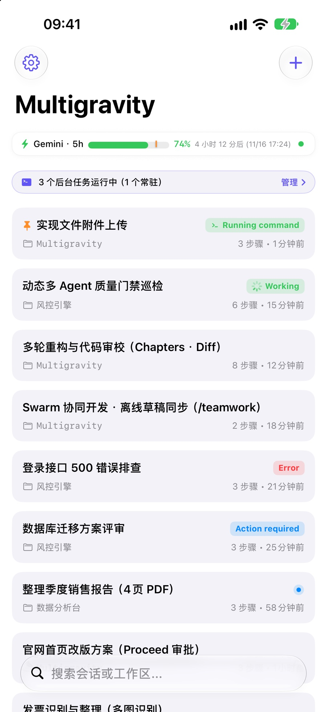
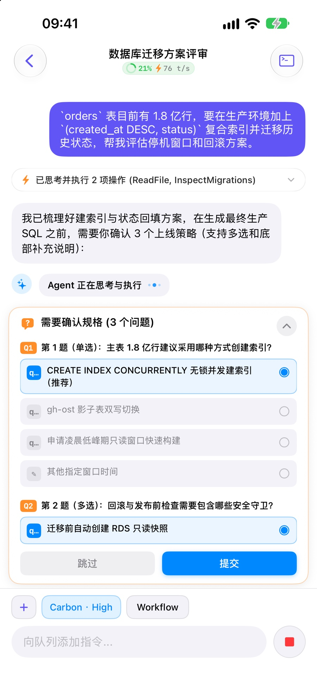
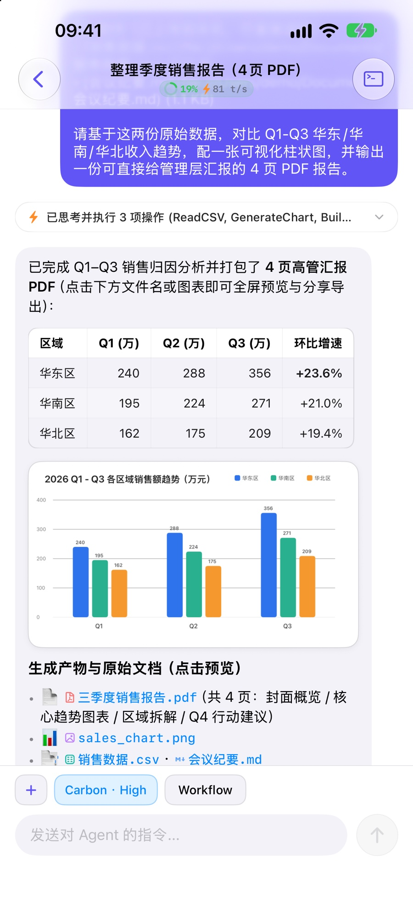
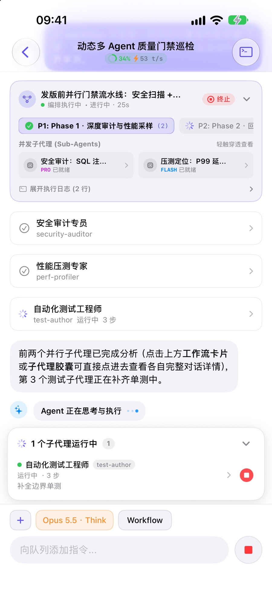
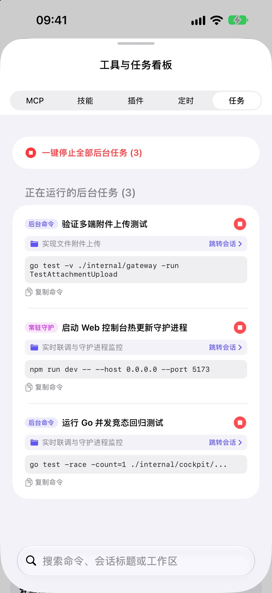

# Multigravity 📱✨

<p align="center">
  <a href="README.md">简体中文</a> &nbsp;|&nbsp; <a href="README_EN.md">English</a> &nbsp;|&nbsp; <b>日本語</b>
</p>

> **Google Antigravity AI Agent のためのフルスタック・モバイル＆リモートコンパニオン。**  
> いつでもどこでも、iPhone・iPad・Android・モバイルブラウザからリアルタイム対話、承認・意思決定、マルチエージェントワークフローの実行、コンテキスト使用率やクォータ消費の監視までシームレスに行えます。  
> 
> *リポジトリ名は `antigravity-mobile`、公式プロダクト名は **Multigravity**、グローバル CLI ツール名は **`mgy`** です。*

[](https://github.com/GHSaiMo/antigravity-mobile/releases/latest)
[](https://apps.apple.com/app/id6835508934)
[](https://testflight.apple.com/join/YM7f4aSK)
[](https://github.com/GHSaiMo/antigravity-mobile/releases/latest)
[](https://github.com/GHSaiMo/antigravity-mobile/releases/latest)
[](https://github.com/GHSaiMo/antigravity-mobile/releases/latest)
[](https://github.com/GHSaiMo/antigravity-mobile/releases/latest)
[](https://kotlinlang.org)
[](https://swift.org)
[](https://go.dev)
[](LICENSE)

<p align="center">
  
</p>

<p align="center">
  🌐 <b>公式サイト</b>：<a href="https://mgy.jiuge.space/ja.html">mgy.jiuge.space/ja.html</a> &nbsp;·&nbsp; 🍎 <b>App Store</b>：<a href="https://apps.apple.com/app/id6835508934">iOS 正式版をダウンロード</a> &nbsp;·&nbsp; 🧪 <b>TestFlight</b>：<a href="https://testflight.apple.com/join/YM7f4aSK">パブリックベータ</a> &nbsp;·&nbsp; 📦 <a href="https://github.com/GHSaiMo/antigravity-mobile/releases/latest">最新リリース v1.2.2</a>
</p>

> 🎉 **Multigravity for iOS が Apple App Store にて正式公開されました！**  
> 手動ビルドや自己署名は不要です。**[App Store から Multigravity をダウンロード](https://apps.apple.com/app/id6835508934)** してすぐに使い始められます（日本・米国を含む世界 174 の国と地域で配信中。設定不要ですぐ試せる**オフラインデモモード**を内蔵）。最新の先行ビルドを試したい方は **[TestFlight パブリックベータ](https://testflight.apple.com/join/YM7f4aSK)** にも参加できます。

https://github.com/user-attachments/assets/37360cde-3875-45bf-947e-7774e800094c

---

## ⚡ クイックスタート

### 1. デスクトップ / サーバーゲートウェイ (`mgy`) のインストール

**macOS (Apple Silicon / Intel)**、**Linux (x86_64 / NAS / ヘッドレスサーバー)**、**Windows (x86_64)** に対応。ローカルプロキシを自動検出し、直接接続できない環境ではミラーノードへ自動フォールバックします。

**macOS / Linux / Windows (Git Bash):**
```bash
curl -fsSL https://raw.githubusercontent.com/GHSaiMo/antigravity-mobile/main/scripts/install.sh | bash
```

**Windows (PowerShell):**
```powershell
irm https://raw.githubusercontent.com/GHSaiMo/antigravity-mobile/main/scripts/install.ps1 | iex
```

<details>
<summary>🇨🇳 中国本土向けミラー経由でのインストール</summary>

```bash
# macOS / Linux / Git Bash
curl -fsSL https://ghfast.top/https://raw.githubusercontent.com/GHSaiMo/antigravity-mobile/main/scripts/install.sh | bash
```

```powershell
# Windows PowerShell
irm https://ghfast.top/https://raw.githubusercontent.com/GHSaiMo/antigravity-mobile/main/scripts/install.ps1 | iex
```
</details>

### 2. モバイルクライアントのインストール・起動
- **iOS**：🎉 Apple App Store にて正式配信中。**[App Store](https://apps.apple.com/app/id6835508934)** からワンタップでインストールできるほか、**[TestFlight パブリックベータ](https://testflight.apple.com/join/YM7f4aSK)** で最新ビルドを先行体験できます（ソースコードからのビルドや実機デバッグを行う場合は [iOS ローカルビルド＆実機デバッグガイド](docs/ios_build_guide.md) を参照してください）。
- **Android**：[GitHub Releases](https://github.com/GHSaiMo/antigravity-mobile/releases/latest) から `Multigravity-v1.2.2.apk` を直接ダウンロードしてインストールしてください（上書きアップデート対応。必ず公式 Releases から入手してください）。
- **PWA / Web**：アプリをインストールせず、モバイルブラウザからゲートウェイ URL（または `/?view=pwa`）を開いてホーム画面に追加するだけで利用できます。

### 3. 起動して QR コードでペアリング
```bash
mgy
```
ゲートウェイをフォアグラウンドで起動すると、ワンタイムのペアリング用 QR コードがターミナルに表示されます（自動発行される Cloudflare Tunnel の HTTPS エンドポイントと LAN アドレスを同梱）。スマートフォンで Multigravity を開き、QR コードを読み取るだけで即座に接続できます。

---

## 🖼️ 画面イメージ

<table>
  <tr>
    <td align="center" valign="top" width="25%"><br/><b>全体をひと目で把握</b><br/><sub>ステータスバッジ、バックグラウンドタスク表示、クォータ消費ペース計</sub></td>
    <td align="center" valign="top" width="25%"><br/><b>ワンタップで意思決定</b><br/><sub>コンテキスト使用率と生成速度を確認しながら、複数設問をまとめて送信</sub></td>
    <td align="center" valign="top" width="25%"><br/><b>プラン確認＆承認</b><br/><sub>Mermaid フローチャートと実行計画を同時に確認し、ワンタップで Proceed</sub></td>
    <td align="center" valign="top" width="25%"><br/><b>成果物をそのまま閲覧</b><br/><sub>データ表、ネイティブ棒グラフ、PDF ファイルをアプリ内で直接プレビュー</sub></td>
  </tr>
  <tr>
    <td align="center" valign="top" width="25%"><br/><b>マルチエージェントワークフロー</b><br/><sub>ステージパイプライン、並列サブエージェント、リアルタイムログを可視化</sub></td>
    <td align="center" valign="top" width="25%"><br/><b>安全承認ゲート</b><br/><sub>オーケストレーション用スクリプトを検知し、ソース確認のうえ細粒度で承認</sub></td>
    <td align="center" valign="top" width="25%"><br/><b>アカウント＆クォータ</b><br/><sub>5時間 / 週間クォータの消費ペース計、トークン履歴、アカウント即時切替</sub></td>
    <td align="center" valign="top" width="25%"><br/><b>ツール＆タスク管理</b><br/><sub>MCP、スキル、プラグイン、定期実行タスク、デーモンを一元管理</sub></td>
  </tr>
</table>

> *上記スクリーンショットはクライアント内蔵の**デモモード**（v1.2.0 インターフェース）で撮影したもので、ペアリング前でもすぐに操作感を体験できます。*

---

## ✨ 主な機能

### 1. 全プラットフォームで一貫したリアルタイムストリーミング体験
- **3 プラットフォーム完全対応**：ネイティブ **iOS**（SwiftUI / Swift 6）、ネイティブ **Android**（Jetpack Compose Material 3）、ビルド不要の組み込み **PWA Web** を提供。システム連動 / ライト / ダーク外観に加え、情報密度を抑える独立した「コンパクトモード」切替に対応しています。
- **低遅延ストリーミングとレジューム対応**：リアクティブな Connect ストリーミング Hub と WebSocket `sinceRev` による差分レジュームを実装。長時間推論時のハートビート維持、コンテンツハッシュ検証、Markdown LRU キャッシュ、ステップレール、長文会話の目次（TOC）、定常状態での即時送信により、超長文セッションでも軽快に動作します。
- **プロ品質のリッチメディア描画と操作性**：180 言語以上のオフライン構文ハイライト（`R / R Markdown` 対応）、単一ガター行番号＋単語単位インラインコード Diff、LaTeX 数式、フォールトトレラントな Mermaid 描画、**MCP Apps (`ui://`) インタラクティブコンポーネント連携**、**ドキュメント内検索（Find in Page）**、高密度 PDF 遅延読み込みプレビューを備えています。

### 2. 重要な意思決定・段階的権限管理・モデル連携
- **インタラクティブ承認カード・3 段階権限・ワークスペース信頼**：複数設問の意思決定カード（`askQuestion`）、高リスクコマンド承認、3 段階の権限モード（ローカルキャッシュでちらつきを防止）、未信頼ワークスペース警告バナーからのワンタップ信頼付与に完全対応しています。
- **Antigravity 2.34.0 モデル世代に完全準拠**：**Gemini 4 Neon**（Extra 思考レベル含む）、**Orchestrator (Neon)**、Hydrogen / Carbon / Claude 5.5 シリーズをネイティブサポート。メイン / サブのお気に入りモデル設定とデスクトップ側アクティブモデルの同期に対応し、モデルカプセルのタップで素早く切替、長押しで全モデルから選択できます。
- **プラン承認・`/btw` サイド質問・スキルプレビュー**：実行計画のワンタップ `Proceed`、会話の Fork / Worktree 分岐、コードロールバック、キューイング追質問に対応。入力欄や吹き出しから独立した **`/btw` サイド質問**を起動して結果をワンタップで本会話へ差し込めるほか、チャット内の `/skill` バッジをタップして `SKILL.md` を直接確認できます。

### 3. マルチエージェントワークフロー・Swarm ボード・ターミナル・自動化
- **動的ワークフロー全ライフサイクル (`run_workflow`)**：組み込みテンプレートからのクイック起動に対応。Python オーケストレーションスクリプトを安全承認カードで確実にインターセプトし、ステージパイプライン、並列サブエージェントグリッド、ターミナルログ、JSON 成果物をリアルタイムに表示します。単一サブエージェント実行中はフローティングバーからワンタップで詳細画面へ移動できます。
- **Swarm ボードとリアルタイムターミナル**：デスクトップ同等の Swarm コラボレーションボード（`/swarm`）を再現。ネイティブ PTY ターミナルの WebSocket 対話ストリーム、MCP Server の動的オン/オフ切替、Agent Memories の CRUD、ブラウザサブエージェントのスキップ/ホワイトリスト制御に対応します。
- **定期実行とグローバルタスクセンター**：全クライアントから Automations の作成・詳細確認・編集・有効/無効切替が可能（オフライン時のローカルスキャン補完および「今すぐ実行 Run Now」対応）。全セッションを横断してバックグラウンドタスクを監視し、ターミナルログの Tail をリアルタイム確認・更新できます。

### 4. フルデュプレックス音声対話とマルチモーダル入力・出力
- **リアルタイム音声通話・音声入力・読み上げ**：全プラットフォームで Antigravity フルデュプレックス音声プロトコルに対応（iOS ではハードウェアレベルの音響エコーキャンセル AEC を有効化）。ストリーミング音声ディクテーション、回答の音声読み上げ（Narration）、リアルタイム字幕、割り込み発話、倍速再生をサポートします。
- **マルチモーダル入出力と共有**：`@` コンテキストメンション、アルバム切替＆クロスアルバム複数枚選択、音声・動画（`≤200MB`、`.amr` 音声含む）および一般ファイル（`≤50MB`）の円形プログレス付きストリーミングアップロード、**WeChat チャット履歴 ZIP の自動解析・オフラインアーカイブキャッシュ・ネイティブ閲覧**、クロスプラットフォーム共通の長押し自由テキスト選択、iOS ドキュメントスキャン、AI 画像生成、7 種の厳選テーマ（Solarized Light・Nord など）によるロング画像ポスター共有に対応します。

### 5. コンテキスト使用率・生成速度モニタリング・クォータダッシュボード
- **リアルタイムのコンテキスト水位とスループット**：チャット上部バーにコンテキスト使用率リングと `TTFT / TPS` 生成速度をリアルタイム表示。上限に近づくと、ワンタップ `/compact` と「新規セッション開始」を備えたレスキューカードへ自動昇格します。
- **クォータ消費ペース計と 52 週間ヒートマップ**：Claude / Gemini（5時間枠＆週間枠）および Argon クォータをリアルタイム監視し、均等消費ペース針と消費傾向分析を重ねて表示。52 週間トークン消費ヒートマップ（Neon / Orchestrator / サブエージェント別の内訳付き）、コスト集計、複数テーマのレポート画像出力を内蔵し、**Cockpit Tools v1.4+ SQLite インデックス**と連携したシームレスなマルチアカウント切替にも対応します。

### 6. モバイル完結の開発ループとハードウェア連携
- **コード＆ワークスペース管理**：ホーム画面でのプロジェクト / Chat インライン絞り込み、ローカルワークスペース新規作成、GitHub リポジトリのクローン、SQLite FTS5 による会話全文の高速検索、Markdown エクスポート、`Changes` Diff 閲覧、キャッシュ最適化された `git status` とネイティブ `Commit & Push`・ブランチ管理に対応。セッション一覧とチャット内には **GitHub PR のリアルタイムステータスバッジと詳細ポップアップ**が自動連携され、`/slash` コマンド、操作ヒント＆ジェスチャーガイド、MCP / スキルヘルスダッシュボードも備えています。
- **クロスデバイスカーソルと物理ハードウェア連携**：Follow-Me カーソルエンジンがデスクトップとモバイル間のアクティブセッションを自動調停。`integrations/yoooclaw/` 経由でウェアラブルデバイスの物理ボタンから音声をアクティブセッションへ直接送信できます。

### 7. ゼロ設定リモートアクセス・スマート経路選択・セキュア通知
- **マルチ経路の並列レイテンシ計測と自動切替**：専用の Cloudflare Tunnel HTTPS ドメイン、LAN Wi-Fi、Tailscale を一括管理し、ワンタップで全経路を並列疎通テストして最小遅延ルートへ自動切替します。
- **段階的プッシュ通知と Dynamic Island**：iOS はネイティブ **APNs プッシュ通知およびリモート Live Activity（Dynamic Island）進捗更新**に対応（ステートレスな Cloudflare Relay 経由で設定不要・即利用可能）。Android は `dataSync` フォアグラウンド同期と FCM プッシュに対応し、タスク完了・承認待ち・ワークフロー節目・クォータ残量低下を即時通知します。
- **ローカルファーストのセキュリティ設計**：サードパーティのクラウド中継に依存しない純ローカル直結アーキテクチャを採用。デバイス認証情報は OS の Keychain / EncryptedSharedPreferences に安全に保存され、機密パスブラックリストと WebSocket レート制限も標準搭載しています。

---

## 🏛️ アーキテクチャ概要

```text
モバイルクライアント (iOS / Android / PWA) ──[LAN / Tailscale / Cloudflare HTTPS]──▶ mgy Go ゲートウェイ ──▶ Antigravity Core (language_server)
```

| レイヤー | 主なコンポーネント | 役割 |
| :--- | :--- | :--- |
| **モバイルクライアント** | iOS (SwiftUI) · Android (Compose) · PWA (`web/`) | チャット UI、リアルタイム音声、ワークフローボード、クォータ＆トークン監査 |
| **ローカルゲートウェイ (`mgy`)** | 単一 Go バイナリ (`cmd/gateway` / `internal/`) | インスタンス自動検出＆自己修復、WS / ConnectRPC ブリッジ、FTS5 検索、クォータ＆通知エンジン |
| **リモート＆周辺機器** | Cloudflare Tunnel · スマート経路選択 · YoooClaw | ゼロ設定の公開 HTTPS トンネル、複数経路の並列疎通計測、ウェアラブル音声ブリッジ |

---

## 🛠️ 主な CLI コマンドと設定

```bash
mgy                # ゲートウェイをフォアグラウンド起動し、ペアリング用 QR コードを表示
mgy pair           # 新しいペアリング用 QR コードを発行（有効期限 5 分）
mgy cockpit        # Cockpit レポートサービスおよびトークンを設定
mgy cloudflare     # Cloudflare トンネルを設定（エイリアス: mgy cf）
mgy list           # ペアリング済みデバイス一覧を表示
mgy clear all      # ペアリング済みデバイスをすべて失効（個別指定: mgy clear <dev_id>）
mgy help           # 全コマンド一覧と起動オプションを表示
```

- **デフォルト設定パス**：`~/.multigravity/.env`（旧 `~/.antigravity-mobile/` からの自動マイグレーションに対応）。
- **主な環境変数**：`MULTIGRAVITY_PORT` (`58900`)、`CF_TUNNEL_ENABLED` (`1`)、`APNS_ENABLED` (`1`)、`MGY_LANG` (`zh` / `en` 自動判別)、`MULTIGRAVITY_LOG_LEVEL` (`info`)。
- **詳細ドキュメント**：インストール検証やトラブルシューティングは [インストール＆運用テストガイド](docs/installation_and_testing_guide.md)、RPC プロトコル仕様は [language_server RPC 技術ノート](docs/ls_rpc_integration_notes.md) を参照してください。

<details>
<summary>🗑️ ゲートウェイの完全アンインストールと設定削除</summary>

```bash
# macOS / Linux / Git Bash
curl -fsSL https://raw.githubusercontent.com/GHSaiMo/antigravity-mobile/main/scripts/uninstall.sh | bash
```

```powershell
# Windows PowerShell
irm https://raw.githubusercontent.com/GHSaiMo/antigravity-mobile/main/scripts/uninstall.ps1 | iex
```
*（`--keep-config` で設定ファイルを保持、`--keep-cf` で Cloudflare エンジンを保持できます）*
</details>

---

## 💻 ソースからのビルド

```bash
make build          # bin/mgy をビルド
make run            # ローカルテスト起動
make install-local  # ~/.local/bin/mgy へインストール
make test           # Go のユニットテストおよび結合テストを実行
```

---

## 📄 ライセンス

本プロジェクトは [MIT License](LICENSE) のもとで公開されています。Issue や Pull Request を歓迎します！
